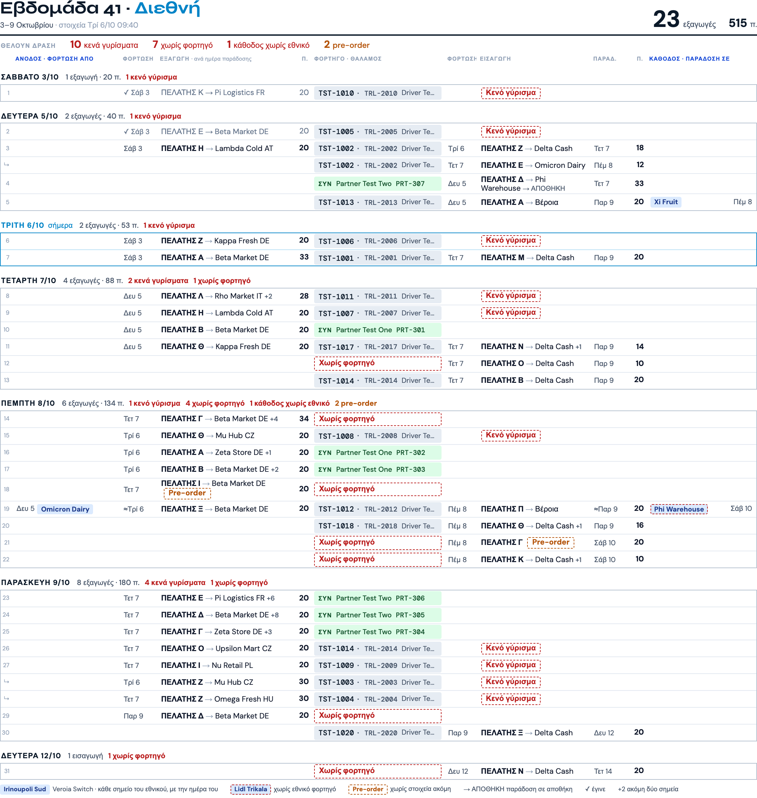
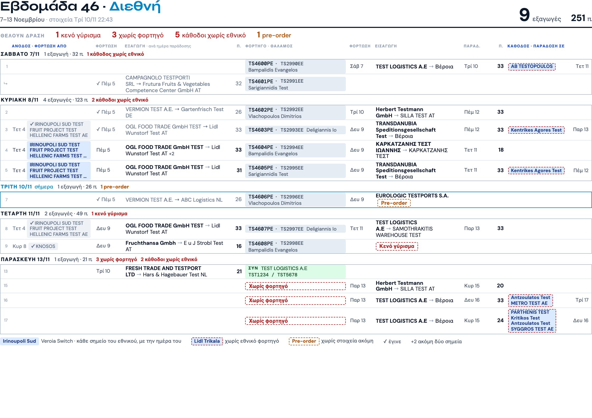
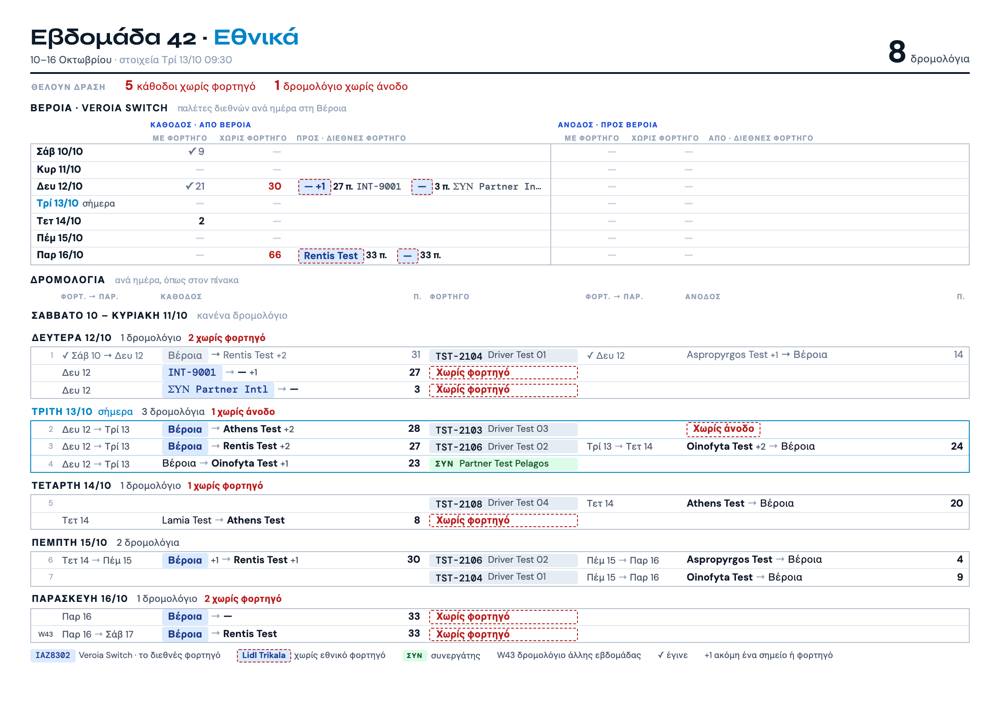

# Εκτύπωση εβδομάδας Διεθνών: σχέδιο και υλοποίηση

Το σχέδιο εγκρίθηκε από τον owner στις 10/11/2026 («οκ το προχωράμε») ως PDF με τα πραγματικά στοιχεία της εβδομάδας 46. Το PDF δεν μπαίνει στο repo (δημόσιο, έχει ονόματα πελατών). Εδώ είναι η υλοποίηση πάνω στη συνθετική εβδομάδα του rig (`tests/fixtures/wi4-week.json`, επινοημένα στοιχεία):

Πώς βγαίνει: `node tests/critics/wi4-board-rig.js paper --shots <φάκελος>` (από το κύριο repo, που έχει `node_modules`) γράφει το `paper.html`.

## Διαφορές από το εγκεκριμένο σχέδιο

| Σημείο | Σχέδιο | Υλοποίηση | Γιατί |
|---|---|---|---|
| Άνοδος με μέρος χωρίς εθνικό | «Fruit Project 4 π.» σε κόκκινο πλαίσιο | όλο το κουτί μπλε ή όλο σε κόκκινο πλαίσιο | η οθόνη κρατά μία ανάγνωση ανά παραγγελία (έχει / δεν έχει εθνικό)· το μερικό θέλει αλλαγή στον Worker |
| Μετρητής «χωρίς φορτηγό» | «εισαγωγές χωρίς φορτηγό» | «χωρίς φορτηγό» | μετρά και εξαγωγή χωρίς φορτηγό, όπως τη ζωγραφίζει το χαρτί |
| Εκτιμώμενη ημέρα Βέροιας | δεν υπήρχε | «≈Παρ 9» | όπως το κουτάκι της οθόνης όταν η ημέρα είναι εκτίμηση |
| Εθνικό που δεν διαβάστηκε | δεν υπήρχε | κουτί με γκρι διακεκομμένο πλαίσιο | το άγνωστο δεν τυπώνεται ως «χωρίς φορτηγό» |
| Γραμμές «↳» | δεν υπήρχαν στην εβδομάδα 46 | δεύτερο φορτίο του ίδιου φορτηγού και μέρη σπασμένης παραγγελίας, χωρίς αριθμό | υπάρχουν στον πίνακα, άρα και στο χαρτί |
| Απόθεμα | δεν υπήρχε | «ΑΠ» πριν από τον πελάτη, «→ ΑΠΟΘΗΚΗ» μετά τον προορισμό | τα είχε το παλιό χαρτί, δεν χάνονται |
| Παλέτες ομάδας με μέλος χωρίς καταγραφή | δεν υπήρχε | «22+;» και «+;» στο σύνολο | το άγνωστο δεν είναι μηδέν |
| Υπόμνημα | σταθερό | μόνο όσα σημάδια έχει το φύλλο | λιγότερες λέξεις |
| Ύψος γραμμής | γεμίζει τη σελίδα | γεμίζει ως 6,6 mm ανά γραμμή | με λίγες γραμμές σε δεύτερη σελίδα, η σελίδα δεν τεντώνεται |
| «Εισαγωγή εκτός προβολής» | δεν υπήρχε | κεχριμπαρί σημείωση | ταιριασμένη εισαγωγή που δεν φορτώθηκε σε αυτή την εβδομάδα |

Ίδια με το σχέδιο: ομάδες ανά ημέρα με τη σημερινή σε μπλε, φορτηγό στη μέση, μπλε κουτί Veroia Switch με όνομα σημείου, «Κενό γύρισμα» / «Χωρίς φορτηγό» / «Pre-order», γραμμή «Θέλουν δράση», γκρι με ✓ για τα παραδομένα, εισαγωγές χωρίς εξαγωγή στην ημέρα φόρτωσής τους, «→ Βέροια» με την ημέρα Βέροιας.

## Αλλαγές 10/11 μετά την πρώτη εκτύπωση (σημειώσεις Παντελή + owner)

Ζητήθηκαν πάνω στο τυπωμένο φύλλο της εβδομάδας 46. Η εικόνα πάνω είναι ήδη με αυτές.

| Σημείο | Πριν | Τώρα | Ποιος το ζήτησε |
|---|---|---|---|
| Ημέρες εισαγωγής | «Τρί 6 → Τετ 7» μαζί, πριν από την εισαγωγή | φόρτωση πριν από τον πελάτη, παράδοση μετά τον προορισμό | Παντελής («η κόκκινη γραμμή να πάει εκεί») |
| Ημέρα στην αρχή της γραμμής | δεν υπήρχε | η ημέρα φόρτωσης της ανόδου πριν από τα σημεία της | Παντελής («μια ίδια στήλη στην αρχή»), owner («οι ημερομηνίες δίπλα σε κάθε σημείο») |
| Ημέρα παράδοσης καθόδου | δεν υπήρχε | μετά τα σημεία της καθόδου | owner |
| Σημεία εθνικού | ένα κουτί + «+N» | κάθε σημείο δικό του κουτί, δύο ανά σειρά, κομμένα αν δεν χωρούν· τρίτο σημείο = δεύτερη σειρά, η γραμμή ψηλώνει | owner (να βλέπει ο εθνικός dispatcher τι φέρνει και τι παίρνει) |
| Θάλαμος | μόνο η πινακίδα του φορτηγού | «φορτηγό · θάλαμος» και μετά ο οδηγός· στον συνεργάτη οι πινακίδες του μετά το όνομα | Παντελής («είναι σημαντικό») |
| Κουμπί εκτύπωσης Εθνικών | γκρι εικονίδιο 13px | κουμπί με πλαίσιο στην ίδια θέση | owner («δεν υπάρχει κουμπί εκτύπωσης») |

Η ημέρα παράδοσης της εξαγωγής δεν έχει δική της στήλη: είναι η κεφαλίδα της ομάδας.

### Διόρθωση 10/11 βράδυ, μετά τον έλεγχο στη ζωντανή εβδομάδα 46

Με πραγματικά ονόματα το φύλλο του #309 έβγαινε στριμωγμένο: σημεία εθνικού κομμένα στα 4 γράμματα, παλέτες «3…», προορισμοί που χάνονταν. Η δεύτερη εικόνα πάνω είναι με συνθετικά ονόματα στο μήκος των πραγματικών.

| Σημείο | #309 | Τώρα |
|---|---|---|
| Σημεία εθνικού | χωριστά κουτιά, δύο ανά σειρά | ένα μπλε κουτί, ένα σημείο ανά σειρά, κόβεται μόνο στην άκρη του κουτιού |
| Πελάτης → προορισμός | μία σειρά, κομμένο | παίρνει δεύτερη (ή τρίτη) σειρά, η γραμμή ψηλώνει |
| Οδηγός | δίπλα στις πινακίδες, κομμένος | κάτω από τις πινακίδες όταν η γραμμή είναι ήδη ψηλή· αλλιώς δίπλα, κομμένος |
| Παλέτες | στήλη 2,5%, «3…» | στήλη 2,8%, δεν κόβεται ποτέ |
| Σελίδες | ίδιες με πριν | οι ψηλές γραμμές μετρούν στον υπολογισμό· εβδομάδα με πολλά μακριά ονόματα παίρνει περισσότερο χαρτί |

# Εκτύπωση εβδομάδας Εθνικών v5: σχέδιο και υλοποίηση

Ίδια εγκεκριμένη σειρά σχεδίων (10/11/2026· πινακίδα διεθνούς: «Ναι, με πινακίδα»). Η υλοποίηση πάνω στη συνθετική εβδομάδα του rig (`node tests/critics/wn5-board-rig.js paper --shots <φάκελος>` γράφει το `natl-paper.html`):

Τα «—» στα ονόματα σημείων της εικόνας είναι της συνθετικής εβδομάδας (φορτία χωρίς τόπο στον κατάλογο του rig), όχι του χαρτιού.

## Διαφορές από το εγκεκριμένο σχέδιο

| Σημείο | Σχέδιο | Υλοποίηση | Γιατί |
|---|---|---|---|
| Μετρητές «Θέλουν δράση» | «6 κάθοδοι χωρίς φορτηγό», «7 π. άνοδος χωρίς φορτηγό» | «N κάθοδοι / άνοδοι χωρίς φορτηγό» (φορτία, όχι παλέτες) | μετρά τα κόκκινα κουτιά που τυπώνει· οι παλέτες είναι στον πίνακα Βέροιας |
| Φορτία χωρίς φορτηγό | μόνο στον πίνακα Βέροιας | και ως γραμμές «Χωρίς φορτηγό» στην ημέρα τους | είναι γραμμές του πίνακα της οθόνης |
| Ομάδα «Παρασκευή 6/11» (φορτηγά προηγούμενης εβδομάδας) | δική της ομάδα | στην πρώτη ημέρα, με «W45» αντί για αριθμό | όπως τα δείχνει η οθόνη |
| Κενές ημέρες | «Δευτέρα 9 – Παρασκευή 13/11 · κανένα δρομολόγιο» | ίδιο, κόκκινο μόνο από σήμερα και μετά | ημέρα που πέρασε δεν είναι δουλειά |
| «Χωρίς άνοδο» | κάθε ιδιόκτητο χωρίς άνοδο | μόνο όσο η κάθοδος δεν έχει γίνει | το τελειωμένο δεν είναι δουλειά |
| Πινακίδα διεθνούς | πάντα | «διεθνές ;» αν δεν διαβάστηκε, «Βέροια» αν η παραγγελία δεν έχει ακόμη διεθνές φορτηγό | το άγνωστο λέγεται |
| Εκκρεμή ανόδου («δεν ανέβηκαν») | γραμμή «Εκκρεμή» | μόνο όσα φορτία δείχνει η οθόνη αυτής της εβδομάδας | το χαρτί τυπώνει τον πίνακα, όχι δεύτερη ανάγνωση |
| Κουμπί | δεν οριζόταν | εικονίδιο εκτυπωτή στην κεφαλίδα της στήλης αριθμών | η πάνω μπάρα δεν χωρά άλλο κουμπί στα 1440 |
| Δεύτερο φορτίο ίδιου φορτηγού | δεν υπήρχε | γραμμή «↳» | υπάρχει στον πίνακα |

