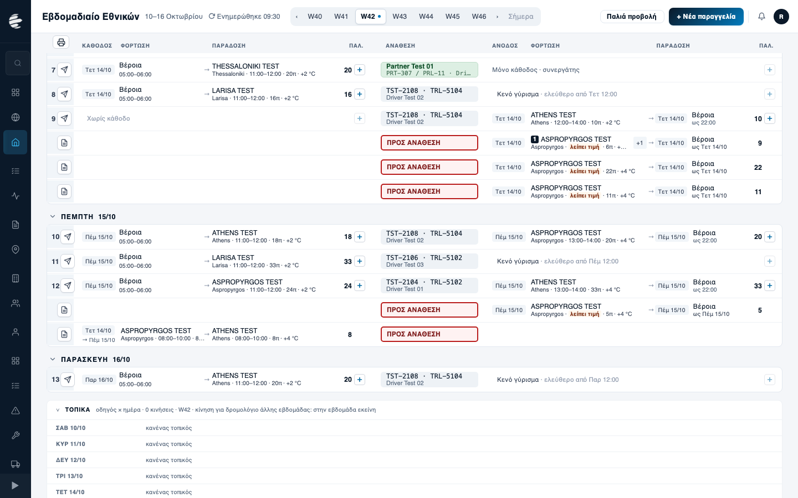
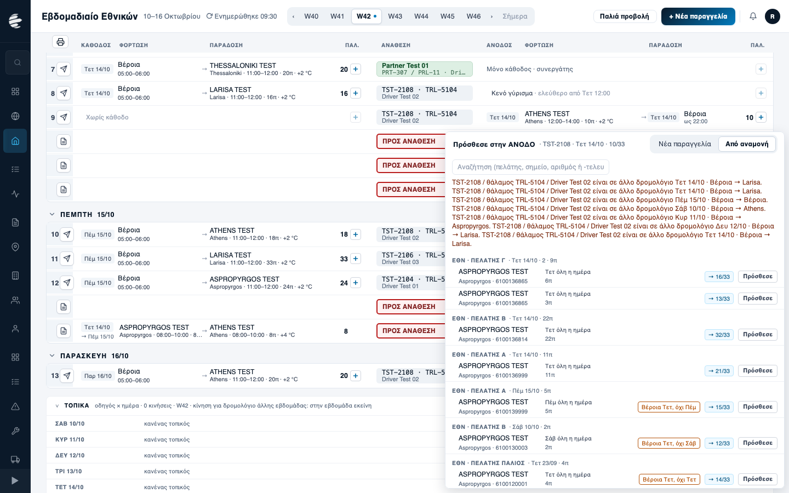
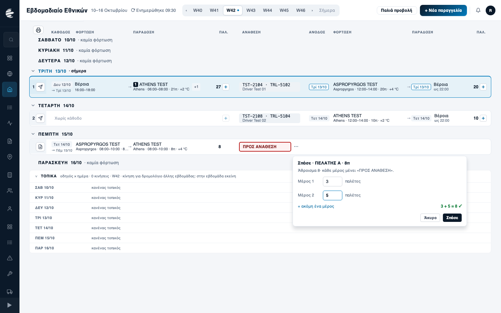
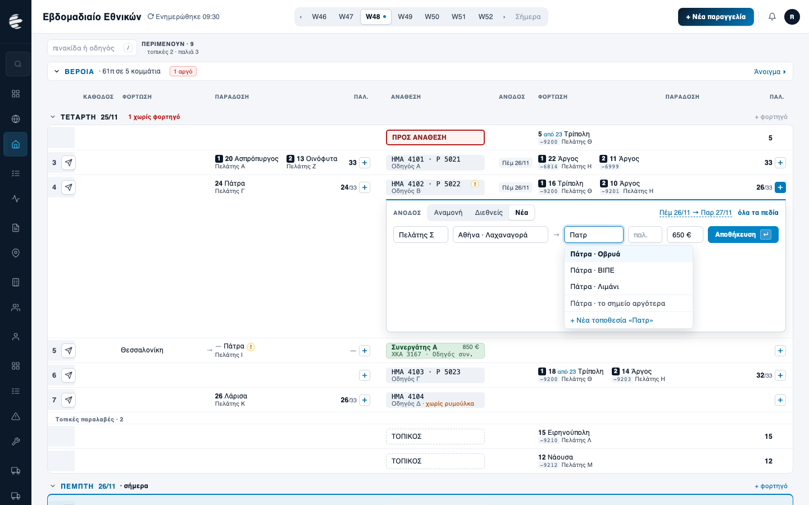
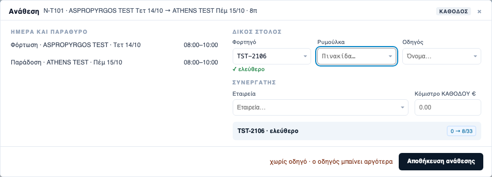
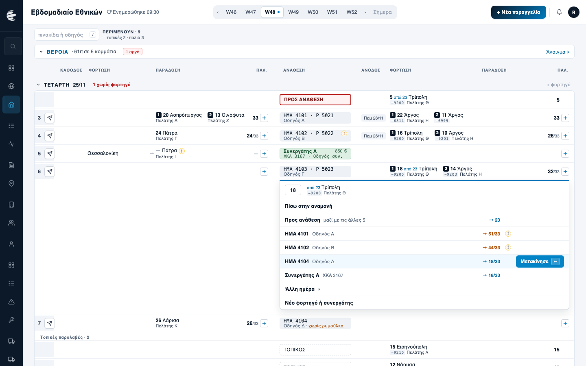

# Εβδομαδιαίο Εθνικών: πρόταση ανασχεδιασμού γύρω από τη δουλειά του dispatcher (26/11/2026)

**Κατάσταση: ΠΡΟΤΑΣΗ. Κανένας κώδικας εφαρμογής, καμία αλλαγή σε βάση, Worker ή ρόλους.** Περιμένει έγκριση owner.

Ζητήθηκε από τον owner στις 26/11, μετά την καταχώρηση δύο πραγματικών εβδομάδων εθνικών (W47, W48) μέσα από την οθόνη, ως dispatcher (25–26/11). Πρόσωπα και πελάτες δεν αναφέρονται, γιατί το repo είναι δημόσιο· όλα τα ονόματα στις εικόνες είναι συνθετικά («Πελάτης Α», «Οδηγός Β», «HMA 4101»).

- Mock-up σε HTML, πάνω στο ίδιο το `assets/style.css` της εφαρμογής: [`board-redesign-2026-11-26/mock.html`](board-redesign-2026-11-26/mock.html) (9 καταστάσεις, κουμπιά κάτω δεξιά). Το CSS που προσθέτει η πρόταση είναι μόνο το μπλοκ `.nb-*` μέσα στο αρχείο.
- Οι εικόνες και των δύο πλευρών είναι χωρίς τις γραμματοσειρές web (το rig τις κόβει), για να συγκρίνονται ίσα· το `mock.html` ανοιγμένο σε browser δείχνει τις κανονικές.
- Εικόνες «σήμερα»: η σημερινή οθόνη από το rig (`tests/critics/wn5-rig-kit.js`, ψεύτικο `/plan/*`, συνθετικά δεδομένα). Τίποτα δεν διαβάστηκε ή γράφτηκε στην παραγωγή για αυτή την πρόταση.

## Α. Τι κάνει ο dispatcher σε αυτή την οθόνη

Η μονάδα σκέψης του είναι **μία γραμμή φορτηγού ανά ημέρα**: φορτηγό, ρυμούλκα, οδηγός (ή συνεργάτης με πινακίδες), ένα φορτίο ΚΑΘΟΔΟΥ και ένα ΑΝΟΔΟΥ, το καθένα μια σύντομη γραμμή: «22 από εδώ + 11 από εκεί, 33 παλέτες». Περίπου 6 φορτηγά την ημέρα, 28 γραμμές την εβδομάδα.

Τα βήματα μετρήθηκαν στον κώδικα και στο rig (κλικ και πεδία), όχι με χρονόμετρο δίπλα στον dispatcher.

| # | Η δουλειά, με τα λόγια του | Σήμερα | Στόχος |
|---|---|---|---|
| 1 | «Βάζω στο φορτηγό ένα φορτίο που περιμένει» | 4: «+», κλικ στην αναζήτηση, γράφω, «Πρόσθεσε». Πάνω από τη λίστα, κόκκινο κείμενο ως 15 γραμμές | 3: «+», γράφω, Enter. Ο κέρσορας είναι ήδη στην αναζήτηση, η προειδοποίηση είναι ένα «!» |
| 2 | «Σπάω ένα φορτίο σε 2–3 φορτηγά, ως τις 33» | περίπου 12 για δύο φορτηγά: πίσω στην αναμονή, «⋯ Σπάσε», μέρη, «Σπάσε», και μετά ανάθεση κάθε μέρους χωριστά | 6: σε κάθε φορτηγό γράφω πόσες παλέτες παίρνει και Enter. Οι υπόλοιπες μένουν στην αναμονή |
| 3 | «Ανοίγω μικρή εθνική παραγγελία πάνω στο φορτηγό» | 10–12: φόρμα με τύπο, πελάτη, τιμή, ανταλλαγή παλετών, σημεία, ημέρες, και άρνηση αν λείπει κάτι | 5–7: πελάτης, από, προς (παλέτες και τιμή όποτε τις μάθει), Enter. Η ημέρα έρχεται από τη γραμμή, η παράδοση προτείνεται |
| 4 | «Ορίζω φορτηγό, ρυμούλκα, οδηγό, ή συνεργάτη με πινακίδες και κόμιστρο» | 4, αλλά το δεύτερο Enter αποθηκεύει ρυμούλκα και οδηγό που δεν διάλεξε | 4–5: οι προτάσεις φαίνονται γκρι και μπαίνουν μόνο με Tab. Συνεργάτης σε μία γραμμή |
| 5 | «Αλλάζω γνώμη: άλλο φορτηγό, ή πίσω στην αναμονή» | 4–5: μενού, «Μεταφορά σε…», ψάξιμο στη λίστα (το «πίσω στην αναμονή» είναι τελευταίο), «Μεταφορά», κάποιες φορές ερώτηση | 1–2: σύρσιμο, ή μενού και επιλογή. Καμία ερώτηση, «Αναίρεση» δίπλα στη γραμμή |
| 6 | «Φέρνω μια διεθνή παραγγελία στα εθνικά» | περίπου 9: φεύγω από τον πίνακα, Παραγγελίες, αναζήτηση, άνοιγμα, «Επεξεργασία», κουτάκι, «Αποθήκευση», πίσω, ψάξιμο | 4: «+», «Διεθνείς», τα 4 τελευταία ψηφία, Enter |
| 7 | «Μοιράζω το απόθεμα της Βέροιας στα φορτηγά» | 4–8 ανά κομμάτι, με χωριστό παράθυρο για το σπάσιμο | το σχεδιάζει χωριστή πρόταση (`2026-11-26-veroia-panel-redesign-proposal.md`)· εδώ κρατιέται μόνο η θέση του |

## Β. Δύο κατευθύνσεις, και η προτεινόμενη

Πρώτα μια διαπίστωση: ο σημερινός πίνακας **μοιάζει ήδη με το Weekly Διεθνών** (ίδια πλακίδια, ίδια χρώματα, ίδιες κεφαλίδες ημερών). Ό,τι κοστίζει χρόνο δεν είναι η εμφάνιση· είναι ότι κάθε κίνηση ανοίγει ξεχωριστό παράθυρο με δικούς του κανόνες.

### Κατεύθυνση Α: «Η γραμμή του φορτηγού» (προτείνεται)

Ο πίνακας μένει όπως το Weekly. Αλλάζουν έξι πράγματα:

1. **Η γραμμή δείχνει ό,τι γράφει ο dispatcher στο φύλλο του.** Κάθε κομμάτι: παλέτες και τόπος, και από κάτω τα 4 τελευταία ψηφία («-6814») και ο πελάτης (μία φορά, όταν δύο διπλανά κομμάτια έχουν τον ίδιο). Όλα ορατά, όχι «+1». Κομμάτι που έχει σπάσει γράφεται «18 από 23». Στις παλέτες: σκέτο «33» όταν γέμισε, «26/33» όταν χωρά κι άλλο, «!» όταν ξεπερνά, «—» όταν δεν είναι γνωστές.
2. **Ό,τι είναι αυτονόητο δεν γράφεται.** Η Βέροια δεν γράφεται καθόλου: τόπος φόρτωσης ή παράδοσης φαίνεται μόνο όταν ΔΕΝ είναι η Βέροια («Θεσσαλονίκη →», «→ Πάτρα»). Ημερομηνία στη γραμμή μόνο όταν διαφέρει από την ημέρα της κεφαλίδας. Ώρες μόνο όταν υπάρχουν πραγματικές. Άδεια πλευρά = κενό και ένα «+», χωρίς «Κενό γύρισμα» / «Χωρίς κάθοδο». Τιμή παραγγελίας δεν φαίνεται στη γραμμή· το κόμιστρο του συνεργάτη ναι, γιατί το συμφωνεί ο ίδιος.
3. **Ό,τι δεν έχει φορτηγό είναι η δουλειά της ημέρας:** οι γραμμές «ΠΡΟΣ ΑΝΑΘΕΣΗ» μπαίνουν πρώτες στην ημέρα τους και η κεφαλίδα τις μετρά με κόκκινο («ΤΕΤΑΡΤΗ 25/11 · 1 χωρίς φορτηγό»).
4. **Ένα φορτηγό, μία γραμμή την ημέρα.** Το «+» στην άδεια πλευρά μιας γραμμής βάζει το φορτίο σε ΑΥΤΗ τη γραμμή, χωρίς ερώτηση. Όταν η παραγγελία γράφεται πρώτα και το φορτηγό μετά, το κουμπί της ανάθεσης λέει πού θα μπει: «Στη γραμμή του HMA 4104» (προεπιλογή, Enter) ή «Χωριστά».
5. **Κάθε κίνηση ανοίγει κάτω από τη γραμμή, με μία γεωμετρία:** από τη στήλη «ΑΝΑΘΕΣΗ» ως το τέλος της γραμμής. Το «+» έχει τρεις καρτέλες («Αναμονή», «Διεθνείς», «Νέα»). Το σπάσιμο είναι ο αριθμός παλετών που γράφεις. Κλικ σε κομμάτι = μετακίνηση, και εκεί ξαναενώνεται με το άλλο του μισό.
6. **Τίποτα δεν εξηγείται με κείμενο:** ένα πορτοκαλί «!» με το μήνυμα στο ποντίκι, πάνω στο πράγμα που αφορά (στο φορτηγό, στον τόπο). Κανένας κανόνας δεν αρνείται.

| Σήμερα | Πρόταση |
|---|---|
|  |  |
| «+» από αναμονή  |  |
| Σπάσιμο: χωριστό παράθυρο  | Μέσα στην ίδια λίστα: «7 από 12 · μένουν 5» (η εικόνα από πάνω) |
| Νέα παραγγελία  |  |
| Ανάθεση  |  Συνεργάτης:  |
| Μεταφορά  |  Μετά:  |
| Διεθνής στα εθνικά: δεν γίνεται από τον πίνακα |  |

**Πίνακας Βέροιας:** τον σχεδιάζει άλλο session, σε δική του πρόταση (`docs/national-v5/2026-11-26-veroia-panel-redesign-proposal.md`, φύλλο «κομμάτια × φορτηγά», απόφαση owner 26/11 για την ανάλυση LIDL / OGL). Εδώ κρατιέται η θέση του: μία κλειστή γραμμή 34px πάνω από τον πίνακα, που ανοίγει σε όλο το πλάτος και σπρώχνει τις γραμμές κάτω. Συμφωνημένο μεταξύ των δύο προτάσεων: τα 4 τελευταία ψηφία γράφονται παντού «-6814», και το υπόλοιπο ενός κομματιού λέγεται «μένουν».

Εβδομάδα: η εβδομάδα του TMS μένει Σάββατο–Παρασκευή. Στο κάτω μέρος μπαίνει και το **επόμενο Σάββατο** με ετικέτα «W49», ώστε η εβδομάδα του φύλλου του (Κυριακή–Σάββατο) να φαίνεται ολόκληρη σε μία οθόνη. Η γραμμή που παραδίδει Σάββατο δείχνει μόνο «Σάβ 28/11», όχι «1 · W49».

### Κατεύθυνση Β: «Πάγκος σύνθεσης»

Μία ημέρα τη φορά. Αριστερά ό,τι περιμένει, δεξιά τα φορτηγά ως κάρτες με μπάρα χωρητικότητας· σέρνεις κομμάτια.

| | Α: η γραμμή του φορτηγού | Β: πάγκος σύνθεσης |
|---|---|---|
| Μοιάζει με το Weekly | ναι, είναι το ίδιο πλέγμα | όχι, νέα οθόνη |
| Όλη η εβδομάδα σε μία ματιά | ναι | όχι, μία ημέρα |
| Σύνθεση φορτηγού ως 33 | γράφεις αριθμό | σέρνεις |
| Τι μαθαίνει ξανά ο dispatcher | σχεδόν τίποτα | όλη την οθόνη |
| Μέγεθος δουλειάς | 4 κύματα, το πρώτο μόνο μικρές αλλαγές | ένα μεγάλο, όλα μαζί |

**Σύσταση: Α.**

Κόστος της Α που πρέπει να φαίνεται: δύο κομμάτια χωρούν δίπλα-δίπλα σε μια πλευρά· το τρίτο πάει σε δεύτερη σειρά και η γραμμή εκείνη ψηλώνει. Όταν ανοίγει ένα πλαίσιο κάτω από μια γραμμή, οι επόμενες γραμμές κατεβαίνουν.

## Γ. Εύρημα → απάντηση → τι αγγίζει → μέγεθος

S = ως μισή μέρα, M = 1–2 μέρες, L = πάνω από 2 μέρες. «FE» = μόνο οθόνες. Ό,τι θέλει βάση, Worker ή αλλάζει το τι μπορεί να κάνει ένας ρόλος είναι σημειωμένο **απόφαση owner**.

| # | Εύρημα | Απάντηση στο σχέδιο | Αγγίζει | Μέγ. |
|---|---|---|---|---|
| 1 | Προειδοποίηση «σε άλλο δρομολόγιο»: τοίχος ως 15 γραμμές (μαζεύει κάθε ημέρα κάθε γραμμής της λίστας) | Ένα «!» δίπλα στο φορτηγό, μόνο για την ημέρα της γραμμής, κείμενο στο ποντίκι | FE: `wn5_actions.js` (`plus` → `refresh`, `_busyOf`) | S |
| 2 | «Μόνο αυτό το σημείο» πιάνει μόνο το πρώτο σημείο | Κάθε σημείο είναι δική του γραμμή στη λίστα, με το δικό του κομμάτι | FE: `weekly_natl_v5.js` (`_rowHTML`, `data-piece`), `wn5_assign.js` (`ptOf`) | S |
| 3 | Αναζήτηση και «Σπάσε» ανοίγουν χωρίς κέρσορα· Esc θέλει δύο πατήματα | Ο κέρσορας στην αναζήτηση με το άνοιγμα· ένα Esc κλείνει όταν δεν έχει γραφτεί κάτι που χάνεται | FE: `wn5_actions.js` (`plus`, `onKey`), `wn5_veroia.js` (`split`) | S |
| 4 | Σπάσιμο: χωριστό παράθυρο, τίτλος με πελάτη αντί για σημείο | Δεν υπάρχει παράθυρο: γράφεις λιγότερες παλέτες στη γραμμή, «μένουν Ν στην αναμονή» | FE πάνω στα υπάρχοντα `plan_split_piece` (114) και `/plan/legs`, δύο κλήσεις στη σειρά. Μία ατομική κλήση θα ήθελε βάση: **απόφαση owner** | M |
| 5 | Ημέρα παράδοσης δεν προτείνεται στην ΑΝΟΔΟ | Φόρτωση + 1 και στις δύο κατευθύνσεις, γκρι ως πρόταση | FE: `wn5_forms.js` (`_orderRefresh`) | S |
| 6 | «Αποθήκευση ως νέα τοποθεσία» ανοίγει μόνη της και μένει ανοιχτή (διπλές τοποθεσίες) | «+ Νέα τοποθεσία…» μόνο ως τελευταία, ρητή επιλογή· κλείνει όταν διαλέξεις υπαρκτή | FE: `wn5_forms.js` (`locDrop`, `newLoc`) | S |
| 7 | ΑΝΟΔΟΣ ζητά «άφιξη στη Βέροια» ενώ το φορτίο δεν πάει Βέροια | Το πεδίο φαίνεται μόνο όταν μια παράδοση είναι η Βέροια | FE: `wn5_forms.js` (`askV`) | S |
| 8 | Γραμμή με παράδοση Σάββατο δείχνει «1 · W49» μέσα στην W48 | Μόνο η ημέρα παράδοσης· το επόμενο Σάββατο φαίνεται ως όγδοη ημέρα | FE: `core/wn5-logic.js` (`boardNumbers`, `away`), δεύτερη ανάγνωση `/plan/board` | M |
| 9 | Εβδομάδα φύλλου (Κυρ–Σάβ) ≠ εβδομάδα TMS (Σάβ–Παρ) | Ο ορισμός ΔΕΝ αλλάζει (ζει σε `core/tms-week.js`, Worker, SQL 056)· απαντά το #8 | αλλαγή ορισμού = βάση + Worker + κάθε οθόνη: **απόφαση owner**, δεν προτείνεται | — |
| 10 | «Πίσω στην αναμονή» κάτω από 434 συνεργάτες | Πρώτη επιλογή· μετά ΟΛΑ τα φορτηγά της ημέρας με το σύνολο που θα βγει· μερική μετακίνηση γράφοντας λιγότερες παλέτες· συνεργάτης με αναζήτηση | FE: `wn5_actions.js` (`_assignHTML`) | S |
| 11 | Η μεταφορά σε φορτηγό δεν ρωτά, η επιστροφή στην αναμονή ρωτά | Καμία δεν ρωτά· κάτω από τη γραμμή που πήρε το φορτίο μένει μια λεπτή γραμμή «ήρθε από… · Αναίρεση». Όπου η βάση δείχνει πραγματικές συνέπειες, η ερώτηση μένει | FE: `wn5_actions.js` (`twoStep`), αναίρεση = η αντίστροφη κίνηση | M |
| 12 | Δεύτερο Enter αποθηκεύει σιωπηλά ρυμούλκα / οδηγό που προτάθηκαν· η προτεινόμενη ρυμούλκα ήταν λάθος σε 2 από 5 φορτηγά και έμοιαζε επιβεβαιωμένη | Η πρόταση φαίνεται ως πρόταση (μπλε, διακεκομμένη, με την ημέρα από την οποία έρχεται)· το Enter περνά πεδίο-πεδίο, και αποθηκεύεται μόνο ό,τι πέρασε από τα μάτια του | FE: `wn5_assign.js` (`_vehicleOf`, `_focusNext`) | S |
| 13 | Ο οδηγός που προτείνεται μπορεί να είναι λάθος για σήμερα | Αν το φορτηγό έχει ήδη γραμμή εκείνη την ημέρα, οδηγός και ρυμούλκα έρχονται από αυτήν (όχι από το ιστορικό). Αλλιώς πρόταση με την ημέρα της, και «!» αν οδηγεί αλλού | FE: `wn5_assign.js` | S |
| 14 | Συνεργάτης: εταιρεία, πινακίδες, οδηγός, κόμιστρο σε διαφορετικά σημεία | Μία γραμμή, ένα πεδίο «Φορτηγό ή συνεργάτης», προτείνεται το τελευταίο κόμιστρο | FE: `wn5_assign.js` (τα πεδία υπάρχουν από την 115) | S |
| 15 | Για Veroia Switch πρέπει να φύγει από τον πίνακα | Καρτέλα «Διεθνείς» στο «+»: βρίσκει τη διεθνή με τα 4 τελευταία, «Φέρε στα εθνικά» | FE: γράφει το πεδίο της διεθνούς μέσω του υπάρχοντος API παραγγελιών. Ο dispatcher το κάνει ΗΔΗ σήμερα από τη φόρμα διεθνούς, άρα δεν είναι νέο δικαίωμα, είναι συντόμευση· τα κομμάτια τα φτιάχνει η βάση όπως σήμερα. Στον owner μένει μόνο αν θα ειδοποιείται το γραφείο διεθνών | M |
| 16 | Γραμμή: ένα σημείο και «+1», παλέτες χωρίς όριο | Όλα τα κομμάτια ορατά, παλέτες μπροστά, 4 τελευταία, «26/33» (το όριο από το `LoadPlan`, όχι σταθερό 33) | FE: `weekly_natl_v5.js` (`_ptsHTML`, `_palHTML`) | M |
| 17 | Η γραμμή ξεκινά πάντα από παραγγελία, ποτέ από φορτηγό | «+ φορτηγό» στην κεφαλίδα κάθε ημέρας | Θέλει έλεγχο αν η βάση δέχεται δρομολόγιο χωρίς φορτίο· αν όχι: **απόφαση owner** | M–L |
| 18 | Πίνακας Βέροιας: μία λίστα, μία γραμμή τη φορά | Χωριστή πρόταση (άλλο session)· εδώ μόνο η θέση του | — | — |
| 19 | Λέξεις: «ΚΥΚΛΟΙ ΤΗΣ ΤΕΤΑΡΤΗΣ», «σκέλος ενός κύκλου», ώρες «05:00–06:00» που δεν είναι πραγματικές, «Κενό γύρισμα», «Χωρίς κάθοδο», το κουμπί «Παλιά προβολή» | Φεύγουν | FE: `wn5_actions.js`, `wn5_forms.js` | S |
| 20 | Η φόρμα νέας παραγγελίας αρνείται (π.χ. ανταλλαγή παλετών χωρίς επιλογή) | Η γρήγορη γραμμή δεν ρωτά· ανταλλαγή «Όχι» ως προεπιλογή, αλλάζει από «όλα τα πεδία» | FE: `wn5_forms.js` (`_check`). Η προεπιλογή ανταλλαγής: **απόφαση owner** | S |
| 21 | Αναζήτηση τοποθεσίας: το ακριβές όνομα βγαίνει 5ο, πρώτο ένα άσχετο που περιέχει τα ίδια γράμματα (αλφαβητική σειρά)· παραλίγο λάθος τόπος | Σειρά: ακριβές όνομα, μετά όσα αρχίζουν έτσι, μετά όσα το περιέχουν. Δίπλα η πόλη, για να ξεχωρίζουν τα ίδια ονόματα | FE: ο κοινός κατάλογος τοποθεσιών των φορμών (`core/form-helpers.js`, `wn5_forms.js`) | S |
| 22 | Κάθοδος που γράφεται ΜΕΤΑ την άνοδο του ίδιου φορτηγού γίνεται δεύτερη γραμμή με «κενό γύρισμα» | Ένα φορτηγό, μία γραμμή την ημέρα: ό,τι ανατίθεται σε φορτηγό που έχει ήδη γραμμή εκείνη την ημέρα μπαίνει στην άδεια πλευρά της | FE: `wn5_assign.js`. Θέλει έλεγχο αν ο κανόνας σειράς στάσεων της βάσης το δέχεται· αν όχι: **απόφαση owner** | M |
| 23 | Η προεπιλογή «στο ίδιο φορτίο / νέο φορτίο» αλλάζει ανά περίπτωση και δεν λέει ποιο φορτίο εννοεί (σε έναν οδηγό εννοούσε το χθεσινό) | Το κουμπί ονομάζει τι θα γίνει: «Στη γραμμή του HMA 4104» ή «Χωριστά». Καμία σιωπηλή προεπιλογή | FE: `wn5_assign.js` | S |
| 24 | Το «ΠΡΟΣ ΑΝΑΘΕΣΗ» είναι στο τέλος της ημέρας, μικρό | Πρώτο στην ημέρα του· η κεφαλίδα μετρά «Ν χωρίς φορτηγό» | FE: `weekly_natl_v5.js` (`_dayRowsHTML`, `_dayHTML`) | S |
| 25 | Στις μισές εθνικές δεν είναι γνωστό το σημείο παράδοσης («για Αθήνα»)· σήμερα διαλέγεται λάθος τόπος ή φτιάχνεται διπλός | Στη λίστα τόπων: «Πάτρα · το σημείο αργότερα». Στη γραμμή φαίνεται η πόλη με «!» ώσπου να οριστεί | Θέλει τόπο-πόλη στη βάση ή σημάδι «προς επιβεβαίωση» στην παραγγελία: **απόφαση owner** | M |
| 26 | Πελάτες και συνεργάτες ψάχνονται με την επωνυμία, ενώ στο φύλλο γράφονται με το σύντομο όνομά τους | Η αναζήτηση βρίσκει και το σύντομο όνομα | Θέλει πεδίο «σύντομο όνομα» σε πελάτες / συνεργάτες (βάση + Worker): **απόφαση owner** | M |
| 27 | Για να βρεθεί μια γραμμή χρειάζεται κύλιση | Το «/» πάνω αριστερά δέχεται ψηφία πινακίδας ή όνομα οδηγού και πηδά στη γραμμή | FE: `weekly_natl_v5.js` (`search`) | S |

### Χωριστά: δύο μικρές διορθώσεις στη φόρμα διεθνούς (όχι μέρος του ανασχεδιασμού)

| Σφάλμα | Αιτία | Διόρθωση | Μέγ. |
|---|---|---|---|
| Το «Αποθήκευση» της φόρμας διεθνούς δεν πατιέται κάποιες φορές, χωρίς κανένα μήνυμα | Το τελευταίο μήνυμα (`#toast`) μένει αόρατο αλλά πάνω από τη σελίδα και πιάνει το κλικ. Στα 1440×900 πέφτει πάνω στο κουμπί | Το κρυμμένο μήνυμα να μη δέχεται κλικ (`core/ui.js`, μία γραμμή). Απόδειξη: κλικ στο κουμπί μετά από μήνυμα, και η εγγραφή στον πίνακα | S |
| Μετά από αποθήκευση με Veroia Switch βγαίνει κουμπί «Revert: rec…» | Το κουμπί αναίρεσης παίρνει όνομα από πεδία που η παραγγελία δεν έχει και πέφτει στον κωδικό (`core/utils.js`, `core/api.js`) | Όνομα από το `PlainRef.orderOf` (πελάτης, φόρτωση → παράδοση · ημέρα) | S |

### Σειρά κατασκευής που προτείνω, αν εγκριθεί η Α

1. Τα μικρά (S) της λίστας: #1, 2, 3, 5, 6, 7, 10, 12, 13, 14, 19, 21, 23, 24, 27 και οι δύο χωριστές διορθώσεις.
2. Η γραμμή και το «+» κάτω από αυτήν: #16, 4, 20, 22.
3. Μετακίνηση με αναίρεση, επόμενο Σάββατο: #11, 8.
4. «Διεθνείς» στο «+»: #15, και όσα θέλουν βάση αν εγκριθούν: #17, 25, 26.

Κάθε κύμα σε δικό του PR, με screenshots ζητήθηκε ↔ έγινε και `/code-review`.

## Δ. Ερωτήσεις για τον owner

1. **Κατεύθυνση Α ή Β;** Σύσταση: Α. Μοιάζει με το Weekly, κρατά όλη την εβδομάδα, και το πρώτο κύμα είναι μόνο μικρές αλλαγές.
2. **Όταν ο dispatcher εθνικών φέρνει μια διεθνή στα εθνικά από τον πίνακα, να ειδοποιείται το γραφείο διεθνών;** (Το ίδιο το κάνει ήδη σήμερα από τη φόρμα διεθνούς· αλλάζει μόνο ότι γίνεται από τον πίνακα.) Σύσταση: ναι.
3. **Σημείο παράδοσης «αργότερα» (μόνο πόλη), με ορατό «!» στη γραμμή:** το θέλεις; Χρειάζεται μικρή αλλαγή στη βάση. Σύσταση: ναι· σήμερα μπαίνει λάθος τόπος ή διπλός.
4. **Σύντομο όνομα σε πελάτες και συνεργάτες** (αυτό που γράφεται στο φύλλο), για να τους βρίσκει η αναζήτηση: το θέλεις; Χρειάζεται νέο πεδίο σε βάση και Worker. Σύσταση: ναι.
5. **Ανταλλαγή παλετών στη γρήγορη νέα παραγγελία:** προεπιλογή «Όχι», και αλλάζει από «όλα τα πεδία»; Σύσταση: ναι.

**Αποφασισμένα από τον συντονιστή (26/11), δεν ρωτιούνται ξανά:** η εβδομάδα μένει Σάββατο–Παρασκευή και φαίνεται και το επόμενο Σάββατο· «Αναίρεση» αντί για ερώτηση σε κάθε μετακίνηση· ένα φορτηγό, μία γραμμή την ημέρα· ο Πίνακας Βέροιας ανήκει στην άλλη πρόταση.

## Πώς κρίθηκε το σχέδιο (κριτήριο owner 26/11)

Τρεις κριτές πάνω στις εικόνες, σε γύρους: «μοιάζει με το Weekly Διεθνών;», «πόσα βήματα για κάθε δουλειά;», «τι μπορεί να φύγει από την οθόνη;». 
- **Γύρος 1 (δική μου κριτική):** γραμμές πίσω στα 44px, κανένα υποσέλιδο με εξήγηση, «+ φορτηγό» στην κεφαλίδα της ημέρας, «/33» μόνο όταν χωρά κι άλλο, ένα κουμπί ανά λίστα.
- **Γύρος 2 (τρεις ανεξάρτητοι κριτές, βαθμοί 4,5–7 στα 10):** μία γεωμετρία για όλα τα πλαίσια, δεμένη στη στήλη «ΑΝΑΘΕΣΗ»· ένα στυλ κύριου κουμπιού· το «!» ποτέ πάνω σε πεδίο· η λίστα δείχνει πάντα όλες τις παλέτες του φορτίου, εκτός από τη γραμμή που πείραξε ο χρήστης· ο οδηγός έρχεται από τη γραμμή του φορτηγού της ίδιας ημέρας· η μετακίνηση χωρίστηκε σε «πριν» και «μετά»· έφυγαν κεφαλίδες πλαισίων που επαναλάμβαναν τη γραμμή, ημερομηνίες που λέει ήδη η ημέρα, τιμές παραγγελιών, ετικέτες, σήματα πλήκτρων.
- **Δεν δέχτηκα:** γραμμές 32px (το 44 είναι του σημερινού πίνακα εθνικών, όχι αλλαγή αυτής της πρότασης)· αφαίρεση του κόμιστρου συνεργάτη από τη γραμμή (το συμφωνεί ο dispatcher)· «+» και μενού γραμμής μόνο στο hover (το Weekly τα έχει πάντα ορατά).
- **Γύρος 3 (βαθμοί 6–9):** το κομμάτι ξαναενώνεται με το άλλο του μισό από τη μετακίνηση· «18 από 23» με λέξεις, για να μη μοιάζει με το «26/33»· το «!» πάνω στο φορτηγό που αφορά· κουμπί με όνομα στη γραμμή που διαλέγεις· λεπτή γραμμή αναίρεσης.
- **Κριτική συντονιστή (από τις δύο ημέρες καταχώρησης):** «ΠΡΟΣ ΑΝΑΘΕΣΗ» πρώτο και μετρημένο στην κεφαλίδα, η Βέροια δεν γράφεται, πελάτης μία φορά, «—» για άγνωστες παλέτες, σημείο «αργότερα», σύντομα ονόματα, «/» που πηδά στη γραμμή.
- **Γύρος 4, τελικός (βαθμοί 7–9 σε κάθε οθόνη και στις τρεις ερωτήσεις):** δύο εμπόδια διορθώθηκαν (το «+» που άνοιξε το πλαίσιο γίνεται γεμάτο μπλε και το πλαίσιο γράφει «ΑΝΟΔΟΣ»· η γραμμή της «Νέας» δεν κόβει πεδία). Ό,τι έμεινε είναι λεπτομέρεια κατασκευής: μικρές μετατοπίσεις 4–6px.

## Αν αυτό σπάσει, πώς θα το μάθω;

Είναι σχέδιο, δεν τρέχει. Όταν χτιστεί, κάθε κύμα μετριέται στον πίνακα και όχι στην οθόνη: ίδιος αριθμός γραμμών `rt_legs` με τα «Πρόσθεσε» που πατήθηκαν, και μετά από κάθε «Αναίρεση» το φορτίο ξανά εκεί που ήταν.

## Σημείωση για το rig

Το `tests/critics/wn5-rig-kit.js` δεν απαντά στο νέο `POST /changes` (#346): κάθε rig εθνικών τελειώνει πλέον με ένα σφάλμα κονσόλας «fresh-on-return: changes read failed». Δεν επηρεάζει την πρόταση· θέλει δική του μικρή διόρθωση.
