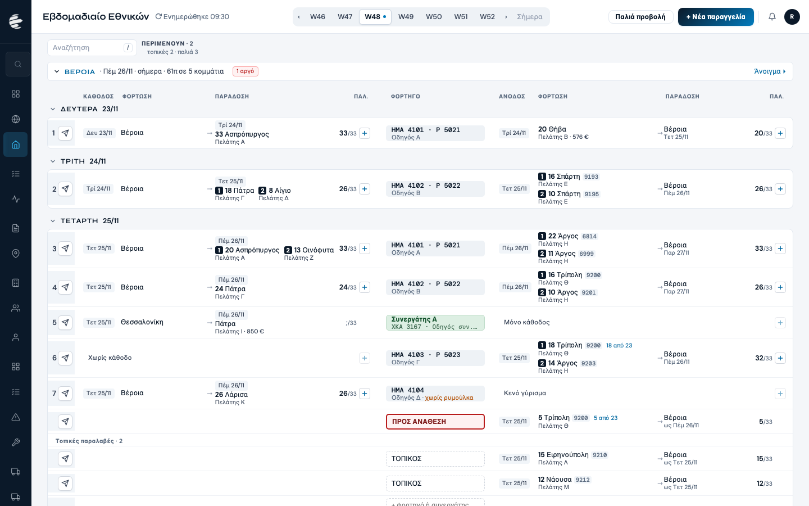
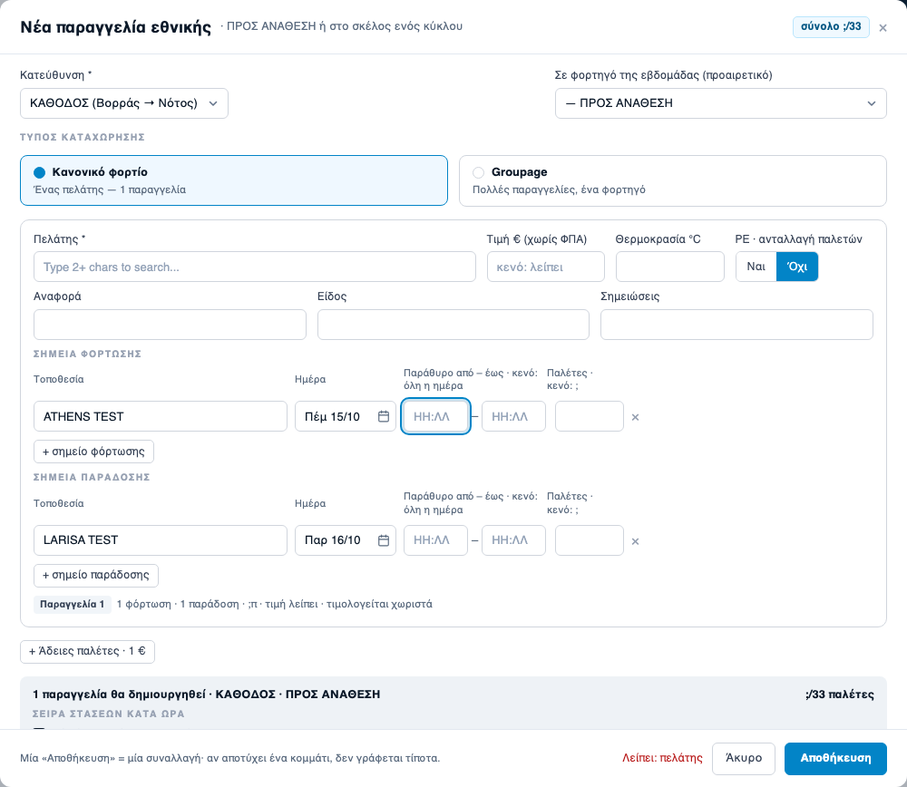
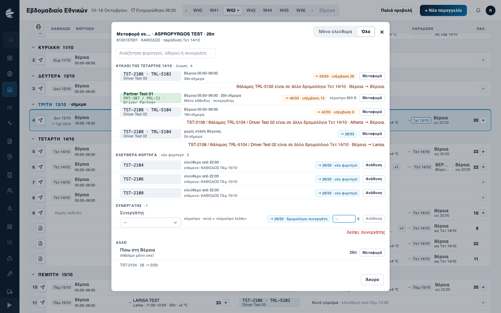
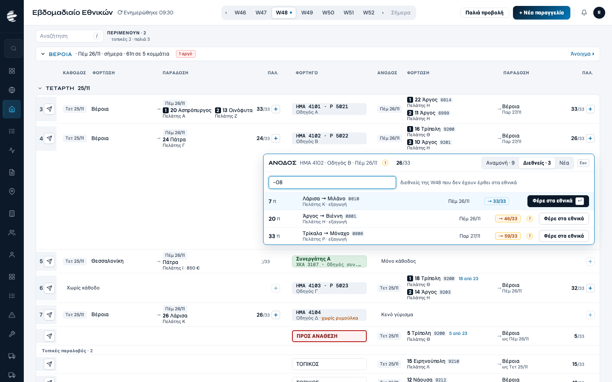
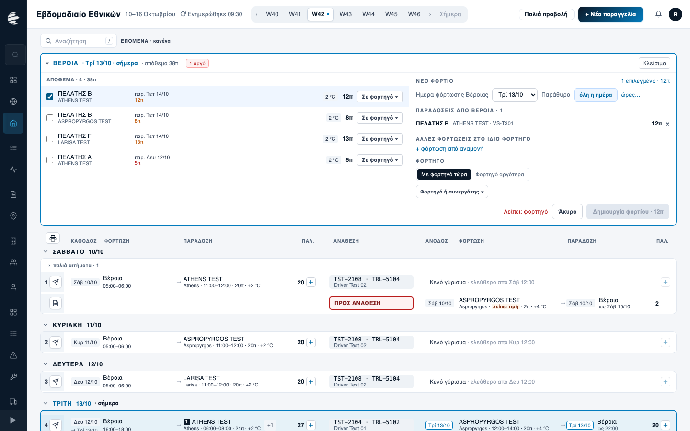
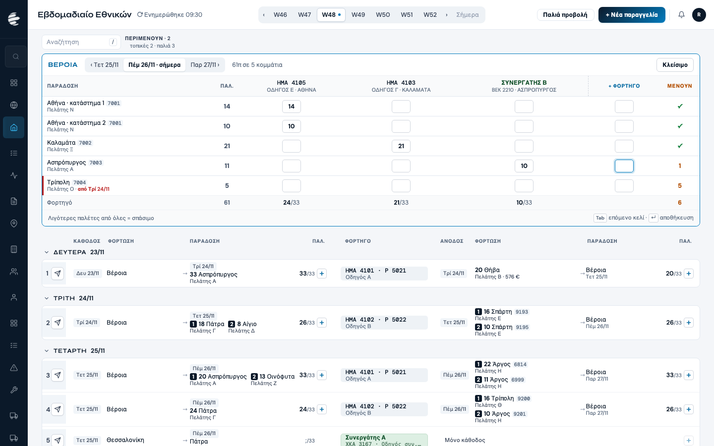
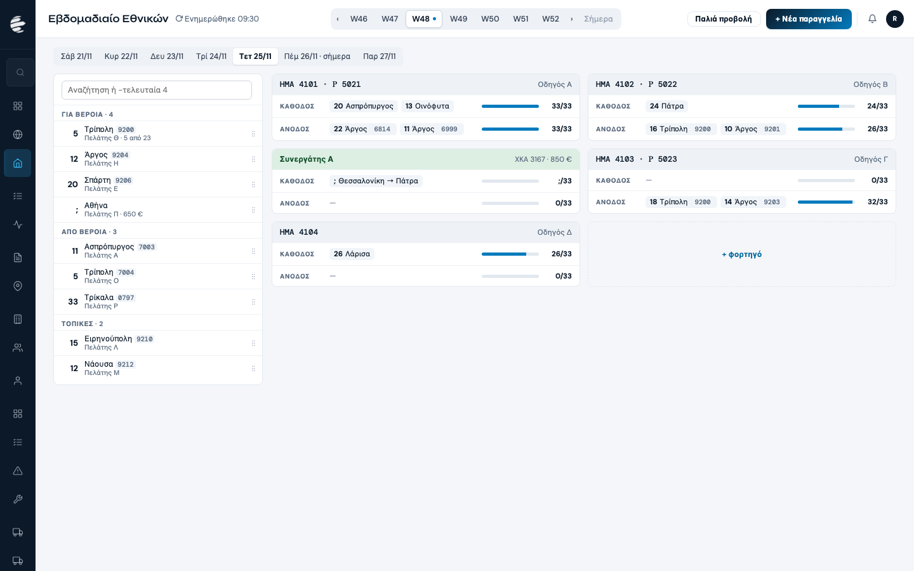

# Εβδομαδιαίο Εθνικών: πρόταση ανασχεδιασμού γύρω από τη δουλειά του dispatcher (26/11/2026)

**Κατάσταση: ΠΡΟΤΑΣΗ. Κανένας κώδικας εφαρμογής, καμία αλλαγή σε βάση, Worker ή ρόλους.** Περιμένει έγκριση owner.

Ζητήθηκε από τον owner στις 26/11, μετά την καταχώρηση δύο πραγματικών εβδομάδων εθνικών (W47, W48) μέσα από την οθόνη, ως dispatcher (25–26/11). Πρόσωπα και πελάτες δεν αναφέρονται, γιατί το repo είναι δημόσιο· όλα τα ονόματα στις εικόνες είναι συνθετικά («Πελάτης Α», «Οδηγός Β», «HMA 4101»).

- Mock-up σε HTML, πάνω στο ίδιο το `assets/style.css` της εφαρμογής: [`board-redesign-2026-11-26/mock.html`](board-redesign-2026-11-26/mock.html) (9 καταστάσεις, κουμπιά κάτω δεξιά). Το CSS που προσθέτει η πρόταση είναι μόνο το μπλοκ `.nb-*` μέσα στο αρχείο.
- Εικόνες «σήμερα»: η σημερινή οθόνη από το rig (`tests/critics/wn5-rig-kit.js`, ψεύτικο `/plan/*`, συνθετικά δεδομένα). Τίποτα δεν διαβάστηκε ή γράφτηκε στην παραγωγή για αυτή την πρόταση.

## Α. Τι κάνει ο dispatcher σε αυτή την οθόνη

Η μονάδα σκέψης του είναι **μία γραμμή φορτηγού ανά ημέρα**: φορτηγό, ρυμούλκα, οδηγός (ή συνεργάτης με πινακίδες), ένα φορτίο ΚΑΘΟΔΟΥ και ένα ΑΝΟΔΟΥ, το καθένα μια σύντομη γραμμή: «22 από εδώ + 11 από εκεί, 33 παλέτες». Περίπου 6 φορτηγά την ημέρα, 28 γραμμές την εβδομάδα.

Τα βήματα μετρήθηκαν στον κώδικα και στο rig (κλικ και πεδία), όχι με χρονόμετρο δίπλα στον dispatcher.

| # | Η δουλειά, με τα λόγια του | Σήμερα | Στόχος |
|---|---|---|---|
| 1 | «Βάζω στο φορτηγό ένα φορτίο που περιμένει» | 4: «+», κλικ στην αναζήτηση, γράφω, «Πρόσθεσε». Πάνω από τη λίστα, κόκκινο κείμενο ως 15 γραμμές | 3: «+», γράφω, Enter. Ο κέρσορας είναι ήδη στην αναζήτηση, η προειδοποίηση είναι ένα «!» |
| 2 | «Σπάω ένα φορτίο σε 2–3 φορτηγά, ως τις 33» | περίπου 12 για δύο φορτηγά: πίσω στην αναμονή, «⋯ Σπάσε», μέρη, «Σπάσε», και μετά ανάθεση κάθε μέρους χωριστά | 6: σε κάθε φορτηγό γράφω πόσες παλέτες παίρνει και Enter. Οι υπόλοιπες μένουν στην αναμονή |
| 3 | «Ανοίγω μικρή εθνική παραγγελία πάνω στο φορτηγό» | 10–12: φόρμα με τύπο, πελάτη, τιμή, ανταλλαγή παλετών, σημεία, ημέρες, και άρνηση αν λείπει κάτι | 5–7: πελάτης, από, προς (παλέτες και τιμή όποτε τις μάθει), Enter. Η ημέρα έρχεται από τη γραμμή, η παράδοση προτείνεται |
| 4 | «Ορίζω φορτηγό, ρυμούλκα, οδηγό, ή συνεργάτη με πινακίδες και κόμιστρο» | 4, αλλά το δεύτερο Enter αποθηκεύει ρυμούλκα και οδηγό που δεν διάλεξε | 4–5: οι προτάσεις φαίνονται γκρι και μπαίνουν μόνο με Tab. Συνεργάτης σε μία γραμμή |
| 5 | «Αλλάζω γνώμη: άλλο φορτηγό, ή πίσω στην αναμονή» | 4–5: μενού, «Μεταφορά σε…», ψάξιμο στη λίστα (το «πίσω στην αναμονή» είναι τελευταίο), «Μεταφορά», κάποιες φορές ερώτηση | 1–2: σύρσιμο, ή μενού και επιλογή. Καμία ερώτηση, «Αναίρεση» για 8 δευτερόλεπτα |
| 6 | «Φέρνω μια διεθνή παραγγελία στα εθνικά» | περίπου 9: φεύγω από τον πίνακα, Παραγγελίες, αναζήτηση, άνοιγμα, «Επεξεργασία», κουτάκι, «Αποθήκευση», πίσω, ψάξιμο | 4: «+», «Διεθνείς», τα 4 τελευταία ψηφία, Enter |
| 7 | «Μοιράζω το απόθεμα της Βέροιας στα φορτηγά» | 4–8 ανά κομμάτι, με χωριστό παράθυρο για το σπάσιμο | ένας αριθμός ανά κελί: κομμάτια κάτω, φορτηγά δεξιά |

## Β. Δύο κατευθύνσεις, και η προτεινόμενη

Πρώτα μια διαπίστωση: ο σημερινός πίνακας **μοιάζει ήδη με το Weekly Διεθνών** (ίδια πλακίδια, ίδια χρώματα, ίδιες κεφαλίδες ημερών). Ό,τι κοστίζει χρόνο δεν είναι η εμφάνιση· είναι ότι κάθε κίνηση ανοίγει ξεχωριστό παράθυρο με δικούς του κανόνες.

### Κατεύθυνση Α: «Η γραμμή του φορτηγού» (προτείνεται)

Ο πίνακας μένει όπως το Weekly. Αλλάζουν τρία πράγματα:

1. **Η γραμμή δείχνει ό,τι γράφει ο dispatcher στο φύλλο του:** κάθε κομμάτι με τις παλέτες του μπροστά, τον τόπο και τα 4 τελευταία ψηφία, όλα ορατά (όχι «+1»), και σύνολο «26/33». Ώρες μόνο όταν υπάρχουν πραγματικές.
2. **Κάθε κίνηση γίνεται κάτω από τη γραμμή, στο ίδιο σημείο:** «+» ανοίγει ένα πλαίσιο με τρεις καρτέλες («Αναμονή», «Διεθνείς», «Νέα»). Το σπάσιμο είναι ο αριθμός παλετών που γράφεις, όχι άλλο παράθυρο.
3. **Τίποτα δεν εξηγείται με κείμενο:** ένα πορτοκαλί «!» με το μήνυμα στο ποντίκι. Κανένας κανόνας δεν αρνείται.

| Σήμερα | Πρόταση |
|---|---|
|  |  |
| «+» από αναμονή  |  |
| Σπάσιμο: χωριστό παράθυρο  | Μέσα στην ίδια λίστα: «7 από 12, μένουν 5 στην αναμονή» (η εικόνα από πάνω) |
| Νέα παραγγελία  |  |
| Ανάθεση  |  Συνεργάτης:  |
| Μεταφορά  |  |
| Διεθνής στα εθνικά: δεν γίνεται από τον πίνακα |  |
| Πίνακας Βέροιας  |  |

Ο Πίνακας Βέροιας γίνεται ο πίνακας μοιρασιάς που κρατά σήμερα ο dispatcher σε δικό του φύλλο (απόφαση owner 26/11: η ανάλυση LIDL / OGL γίνεται μέσα στον Πίνακα Βέροιας): κομμάτια προς τα κάτω, τα φορτηγά που φορτώνουν Βέροια εκείνη την ημέρα προς τα δεξιά, ένας αριθμός ανά κελί, «ΜΕΝΟΥΝ» στο τέλος. Είναι ζήτημα σχεδίασης σε αυτή την πρόταση, όχι κώδικας.

Εβδομάδα: η εβδομάδα του TMS μένει Σάββατο–Παρασκευή. Στο κάτω μέρος μπαίνει και το **επόμενο Σάββατο** με ετικέτα «W49», ώστε η εβδομάδα του φύλλου του (Κυριακή–Σάββατο) να φαίνεται ολόκληρη σε μία οθόνη. Η γραμμή που παραδίδει Σάββατο δείχνει μόνο «Σάβ 28/11», όχι «1 · W49».

### Κατεύθυνση Β: «Πάγκος σύνθεσης»

Μία ημέρα τη φορά. Αριστερά ό,τι περιμένει, δεξιά τα φορτηγά ως κάρτες με μπάρα χωρητικότητας· σέρνεις κομμάτια.

| | Α: η γραμμή του φορτηγού | Β: πάγκος σύνθεσης |
|---|---|---|
| Μοιάζει με το Weekly | ναι, είναι το ίδιο πλέγμα | όχι, νέα οθόνη |
| Όλη η εβδομάδα σε μία ματιά | ναι | όχι, μία ημέρα |
| Σύνθεση φορτηγού ως 33 | γράφεις αριθμό | σέρνεις |
| Τι μαθαίνει ξανά ο dispatcher | σχεδόν τίποτα | όλη την οθόνη |
| Μέγεθος δουλειάς | 5 κύματα, το πρώτο μόνο μικρές αλλαγές | ένα μεγάλο, όλα μαζί |

**Σύσταση: Α**, με μία ιδέα από τη Β (ο Πίνακας Βέροιας ως «κομμάτια × φορτηγά»).

Κόστος της Α που πρέπει να φαίνεται: η γραμμή με δύο ή περισσότερα κομμάτια γίνεται ψηλότερη (περίπου 66px αντί για 44). Έξι φορτηγά της ίδιας ημέρας χωρούν ακόμη σε μία οθόνη 1440×900, όχι όμως δύο γεμάτες ημέρες μαζί.

## Γ. Εύρημα → απάντηση → τι αγγίζει → μέγεθος

S = ως μισή μέρα, M = 1–2 μέρες, L = πάνω από 2 μέρες. «FE» = μόνο οθόνες. Ό,τι θέλει βάση, Worker ή αλλάζει το τι μπορεί να κάνει ένας ρόλος είναι σημειωμένο **απόφαση owner**.

| # | Εύρημα | Απάντηση στο σχέδιο | Αγγίζει | Μέγ. |
|---|---|---|---|---|
| 1 | Προειδοποίηση «σε άλλο δρομολόγιο»: τοίχος ως 15 γραμμές (μαζεύει κάθε ημέρα κάθε γραμμής της λίστας) | Ένα «!» δίπλα στο φορτηγό, μόνο για την ημέρα της γραμμής, κείμενο στο ποντίκι | FE: `wn5_actions.js` (`plus` → `refresh`, `_busyOf`) | S |
| 2 | «Μόνο αυτό το σημείο» πιάνει μόνο το πρώτο σημείο | Κάθε σημείο είναι δική του γραμμή στη λίστα, με το δικό του κομμάτι | FE: `weekly_natl_v5.js` (`_rowHTML`, `data-piece`), `wn5_assign.js` (`ptOf`) | S |
| 3 | Αναζήτηση και «Σπάσε» ανοίγουν χωρίς κέρσορα· Esc θέλει δύο πατήματα | Ο κέρσορας στην αναζήτηση με το άνοιγμα· ένα Esc κλείνει όταν δεν έχει γραφτεί κάτι που χάνεται | FE: `wn5_actions.js` (`plus`, `onKey`), `wn5_veroia.js` (`split`) | S |
| 4 | Σπάσιμο: χωριστό παράθυρο, τίτλος με πελάτη αντί για σημείο | Δεν υπάρχει παράθυρο: γράφεις λιγότερες παλέτες στη γραμμή, «μένουν Ν στην αναμονή» | FE πάνω στα υπάρχοντα `plan_split_piece` (114) και `/plan/legs`, δύο κλήσεις στη σειρά. Μία ατομική κλήση θα ήθελε βάση: **απόφαση owner** | M |
| 5 | Ημέρα παράδοσης δεν προτείνεται στην ΑΝΟΔΟ | Φόρτωση + 1 και στις δύο κατευθύνσεις, γκρι ως πρόταση | FE: `wn5_forms.js` (`_orderRefresh`) | S |
| 6 | «Αποθήκευση ως νέα τοποθεσία» ανοίγει μόνη της και μένει ανοιχτή (διπλές τοποθεσίες) | «+ Νέα τοποθεσία…» μόνο ως τελευταία, ρητή επιλογή· κλείνει όταν διαλέξεις υπαρκτή | FE: `wn5_forms.js` (`locDrop`, `newLoc`) | S |
| 7 | ΑΝΟΔΟΣ ζητά «άφιξη στη Βέροια» ενώ το φορτίο δεν πάει Βέροια | Το πεδίο φαίνεται μόνο όταν μια παράδοση είναι η Βέροια | FE: `wn5_forms.js` (`askV`) | S |
| 8 | Γραμμή με παράδοση Σάββατο δείχνει «1 · W49» μέσα στην W48 | Μόνο η ημέρα παράδοσης· το επόμενο Σάββατο φαίνεται ως όγδοη ημέρα | FE: `core/wn5-logic.js` (`boardNumbers`, `away`), δεύτερη ανάγνωση `/plan/board` | M |
| 9 | Εβδομάδα φύλλου (Κυρ–Σάβ) ≠ εβδομάδα TMS (Σάβ–Παρ) | Ο ορισμός ΔΕΝ αλλάζει (ζει σε `core/tms-week.js`, Worker, SQL 056)· απαντά το #8 | αλλαγή ορισμού = βάση + Worker + κάθε οθόνη: **απόφαση owner**, δεν προτείνεται | — |
| 10 | «Πίσω στην αναμονή» κάτω από 434 συνεργάτες | Πρώτη επιλογή· μετά τα φορτηγά της ημέρας· συνεργάτης με αναζήτηση | FE: `wn5_actions.js` (`_assignHTML`) | S |
| 11 | Η μεταφορά σε φορτηγό δεν ρωτά, η επιστροφή στην αναμονή ρωτά | Καμία δεν ρωτά· «Αναίρεση» 8 δευτ. για όλες. Όπου η βάση δείχνει πραγματικές συνέπειες, η ερώτηση μένει | FE: `wn5_actions.js` (`twoStep`), αναίρεση = η αντίστροφη κίνηση | M |
| 12 | Δεύτερο Enter αποθηκεύει σιωπηλά ρυμούλκα / οδηγό που προτάθηκαν | Οι προτάσεις είναι γκρι και μπαίνουν μόνο με Tab· το Enter αποθηκεύει μόνο όσα έχουν ✓ | FE: `wn5_assign.js` (`_vehicleOf`, `_focusNext`) | S |
| 13 | Ο οδηγός που προτείνεται μπορεί να είναι λάθος για σήμερα | Η πρόταση λέει από πότε είναι («τελευταίος Δευ 23/11») και βγάζει «!» αν οδηγεί αλλού εκείνη την ημέρα | FE: `wn5_assign.js` | S |
| 14 | Συνεργάτης: εταιρεία, πινακίδες, οδηγός, κόμιστρο σε διαφορετικά σημεία | Μία γραμμή, ένα πεδίο «Φορτηγό ή συνεργάτης», προτείνεται το τελευταίο κόμιστρο | FE: `wn5_assign.js` (τα πεδία υπάρχουν από την 115) | S |
| 15 | Για Veroia Switch πρέπει να φύγει από τον πίνακα | Καρτέλα «Διεθνείς» στο «+»: βρίσκει τη διεθνή με τα 4 τελευταία, «Φέρε στα εθνικά» | FE: γράφει το πεδίο της διεθνούς μέσω του υπάρχοντος API παραγγελιών (ο dispatcher το γράφει ήδη από τη φόρμα)· τα κομμάτια τα φτιάχνει η βάση όπως σήμερα. Αλλάζει το ποιος αγγίζει διεθνή παραγγελία: **απόφαση owner** | M |
| 16 | Γραμμή: ένα σημείο και «+1», παλέτες χωρίς όριο | Όλα τα κομμάτια ορατά, παλέτες μπροστά, 4 τελευταία, «26/33» (το όριο από το `LoadPlan`, όχι σταθερό 33) | FE: `weekly_natl_v5.js` (`_ptsHTML`, `_palHTML`) | M |
| 17 | Η γραμμή ξεκινά πάντα από παραγγελία, ποτέ από φορτηγό | «+ φορτηγό ή συνεργάτης» στο τέλος κάθε ημέρας | Θέλει έλεγχο αν η βάση δέχεται δρομολόγιο χωρίς φορτίο· αν όχι: **απόφαση owner** | M–L |
| 18 | Πίνακας Βέροιας: μία λίστα, μία γραμμή τη φορά | Πίνακας «κομμάτια × φορτηγά», ένας αριθμός ανά κελί | FE: `wn5_veroia.js`, πάνω στις υπάρχουσες κλήσεις | L |
| 19 | Λέξεις: «ΚΥΚΛΟΙ ΤΗΣ ΤΕΤΑΡΤΗΣ», «σκέλος ενός κύκλου», ώρες «05:00–06:00» που δεν είναι πραγματικές | Φεύγουν· η κεφαλίδα «ΑΝΑΘΕΣΗ» γίνεται «ΦΟΡΤΗΓΟ» | FE: `wn5_actions.js`, `wn5_forms.js` | S |
| 20 | Η φόρμα νέας παραγγελίας αρνείται (π.χ. ανταλλαγή παλετών χωρίς επιλογή) | Η γρήγορη γραμμή δεν ρωτά· ανταλλαγή «Όχι» ως προεπιλογή, αλλάζει από «όλα τα πεδία» | FE: `wn5_forms.js` (`_check`). Η προεπιλογή ανταλλαγής: **απόφαση owner** | S |

### Χωριστά: δύο μικρές διορθώσεις στη φόρμα διεθνούς (όχι μέρος του ανασχεδιασμού)

| Σφάλμα | Αιτία | Διόρθωση | Μέγ. |
|---|---|---|---|
| Το «Αποθήκευση» της φόρμας διεθνούς δεν πατιέται κάποιες φορές, χωρίς κανένα μήνυμα | Το τελευταίο μήνυμα (`#toast`) μένει αόρατο αλλά πάνω από τη σελίδα και πιάνει το κλικ. Στα 1440×900 πέφτει πάνω στο κουμπί | Το κρυμμένο μήνυμα να μη δέχεται κλικ (`core/ui.js`, μία γραμμή). Απόδειξη: κλικ στο κουμπί μετά από μήνυμα, και η εγγραφή στον πίνακα | S |
| Μετά από αποθήκευση με Veroia Switch βγαίνει κουμπί «Revert: rec…» | Το κουμπί αναίρεσης παίρνει όνομα από πεδία που η παραγγελία δεν έχει και πέφτει στον κωδικό (`core/utils.js`, `core/api.js`) | Όνομα από το `PlainRef.orderOf` (πελάτης, φόρτωση → παράδοση · ημέρα) | S |

### Σειρά κατασκευής που προτείνω, αν εγκριθεί η Α

1. Τα μικρά (S) της λίστας: #1, 2, 3, 5, 6, 7, 10, 12, 13, 14, 19 και οι δύο χωριστές διορθώσεις.
2. Η γραμμή και το «+» κάτω από αυτήν: #16, 4, 20.
3. Μετακίνηση με αναίρεση, επόμενο Σάββατο: #11, 8.
4. «Διεθνείς» στο «+»: #15 (μετά την απόφαση).
5. Πίνακας Βέροιας: #18, και το #17 αν το επιτρέπει η βάση.

Κάθε κύμα σε δικό του PR, με screenshots ζητήθηκε ↔ έγινε και `/code-review`.

## Δ. Ερωτήσεις για τον owner

1. **Κατεύθυνση Α ή Β;** Σύσταση: Α. Μοιάζει με το Weekly, κρατά όλη την εβδομάδα, και το πρώτο κύμα είναι μόνο μικρές αλλαγές.
2. **Να φέρνει ο dispatcher εθνικών μια διεθνή παραγγελία στα εθνικά από τον πίνακα;** Αυτό ανοίγει το Veroia Switch στη διεθνή χωρίς να περάσει από το γραφείο διεθνών. Σύσταση: ναι, με ειδοποίηση στο γραφείο διεθνών.
3. **Εβδομάδα:** μένει Σάββατο–Παρασκευή και φαίνεται και το επόμενο Σάββατο στο κάτω μέρος; Σύσταση: ναι. Αλλαγή του ορισμού της εβδομάδας δεν προτείνεται.
4. **«Αναίρεση» αντί για ερώτηση** σε κάθε μετακίνηση φορτίου; Σύσταση: ναι, ίδιος τρόπος παντού.
5. **Πίνακας Βέροιας ως «κομμάτια × φορτηγά»:** είναι αυτή η μορφή που θέλεις για την ανάλυση LIDL / OGL; Σύσταση: ναι, και χτίζεται τελευταίο, αφού δοκιμαστεί το «γράφω παλέτες = σπάσιμο» στο «+».

## Αν αυτό σπάσει, πώς θα το μάθω;

Είναι σχέδιο, δεν τρέχει. Όταν χτιστεί, κάθε κύμα μετριέται στον πίνακα και όχι στην οθόνη: ίδιος αριθμός γραμμών `rt_legs` με τα «Πρόσθεσε» που πατήθηκαν, και μετά από κάθε «Αναίρεση» το φορτίο ξανά εκεί που ήταν.

## Σημείωση για το rig

Το `tests/critics/wn5-rig-kit.js` δεν απαντά στο νέο `POST /changes` (#346): κάθε rig εθνικών τελειώνει πλέον με ένα σφάλμα κονσόλας «fresh-on-return: changes read failed». Δεν επηρεάζει την πρόταση· θέλει δική του μικρή διόρθωση.
