# Εβδομαδιαίο Εθνικών: πρόταση ανασχεδιασμού γύρω από τη δουλειά του dispatcher (26/11/2026)

**Κατάσταση: ΠΡΟΤΑΣΗ. Κανένας κώδικας εφαρμογής, καμία αλλαγή σε βάση, Worker ή ρόλους.** Περιμένει έγκριση owner. Η τρέχουσα μορφή του σχεδίου είναι η πρώτη ενότητα («Το άλμα»).

## Το άλμα (26/11, μετά την απόρριψη του owner): η γραμμή γράφεται όπως τη γράφει

Ο owner είδε το σχέδιο των επόμενων ενοτήτων (πίνακας πάνω στο στυλ της επανασχεδίασης) και δεν το δέχτηκε:
«Θέλω κι άλλη βελτίωση. Δε μου αρκεί. Δεν είναι μια εφαρμογή και οθόνες τις οποίες θα τις είχε σχεδιάσει ο Στιβ Τζομπς και η ομάδα του.»
Ήταν ένας καθαρός, σωστός πίνακας· δεν είχε μία ιδέα. Ό,τι ακολουθεί σε αυτή την ενότητα **αντικαθιστά την όψη** των ενοτήτων Β.
Το περιεχόμενο (πίνακας ευρημάτων, αποφάσεις owner) ισχύει όπως είναι.

**Ζωντανό πρωτότυπο:** [`board-redesign-2026-11-26/prototype.html`](board-redesign-2026-11-26/prototype.html).
Ανοίγει μόνο του σε browser, δεν μιλά με καμία βάση, 28 γραμμές φορτηγών μιας εβδομάδας με συνθετικά ονόματα.

**Η μία ιδέα:** η μονάδα του dispatcher είναι μια γραμμή κειμένου, «22 Άργος -6814 + 11 -6999». Η οθόνη είναι αυτό το φύλλο, που καταλαβαίνει τι γράφεις.
Αριστερά από την πινακίδα ό,τι κατεβαίνει, δεξιά ό,τι ανεβαίνει. Κλικ σε μια πλευρά (ή βελάκια και Enter) και ο κέρσορας είναι μέσα στη γραμμή.

| Γράφεις | Γίνεται |
|---|---|
| `22 Άργος 6814` | Βρίσκει το φορτίο -6814 που περιμένει, παίρνει 22 από τις 33· οι 11 μένουν γραμμή χωρίς φορτηγό |
| `7 9214`, `-9214` | Το ίδιο με τα 4 ψηφία μόνο. 4 ψηφία ή παύλα = αναφορά και πρέπει να ταιριάζει· αλλιώς «δεν βρέθηκε», ποτέ άλλη παραγγελία |
| `17 Κασάπης Πάτρα 850` | Νέα εθνική παραγγελία με λόγια: παλέτες, πελάτης, τόπος, τιμή |
| `4104` στο «φορτηγό;» | Ανάθεση. Αν το φορτηγό έχει ήδη γραμμή εκείνη την ημέρα, το φορτίο μπαίνει σε αυτήν |
| `40 Άργος 6814` | «έχει μόνο 33», και το Enter δεν το δέχεται ώσπου να διορθωθεί |
| ⌫ σε άδειο κέρσορα | Το τελευταίο κομμάτι γυρίζει γραμμή χωρίς φορτηγό, στην ημέρα από την οποία ήρθε. Τίποτα δεν σβήνεται |
| `N` ή «νέα γραμμή» | Νέα γραμμή φορτηγού στην ημέρα |
| ⌘Z ή «αναίρεση» | Πάντα διαθέσιμη |

**Κανόνες ησυχίας:** πινακίδα και οδηγός σε κάθε γραμμή, ρυμούλκα μόνο στη γραμμή που δουλεύεις. Αριθμός παλετών μόνο όταν περισσεύουν («5 πάνω») ή στην πλευρά που γράφεις («χωρούν 11»).
«άδειο γύρισμα» μόνο για δικό μας φορτηγό που γυρίζει άδειο σήμερα ή αύριο. Κόκκινο μόνο για φορτίο χωρίς φορτηγό, πορτοκαλί για προειδοποίηση, μπλε μόνο για τον κέρσορα και την πρόταση.
Χωρίς κεφαλίδες στηλών, χωρίς πλαίσια, χωρίς καρτέλες, χωρίς «Πρόσθεσε». Μία λωρίδα πάνω, «Σε θέλουν», με το «Μοίρασμα» στο δεξί της άκρο. Ό,τι πέρασε είναι αχνό, ανοιχτό και γράφεται (καταχώρηση εκ των υστέρων).
Ό,τι γράφτηκε και δεν ολοκληρώθηκε μένει στη γραμμή, σημαδεμένο.

**Αφαίρεση, μετρημένη** (ίδιο παράθυρο 1440×900, απέναντι στο σχέδιο που απορρίφθηκε): ορατά στοιχεία 351 → 169 (52% λιγότερα)· κουμπιά και εικονίδια 99 → 6· γραμμές στην οθόνη 15 → 14, γιατί κάθε ημέρα κρατά χώρο για μία νέα γραμμή.

| Απορρίφθηκε | Τώρα, σε ηρεμία |
|---|---|
|  | 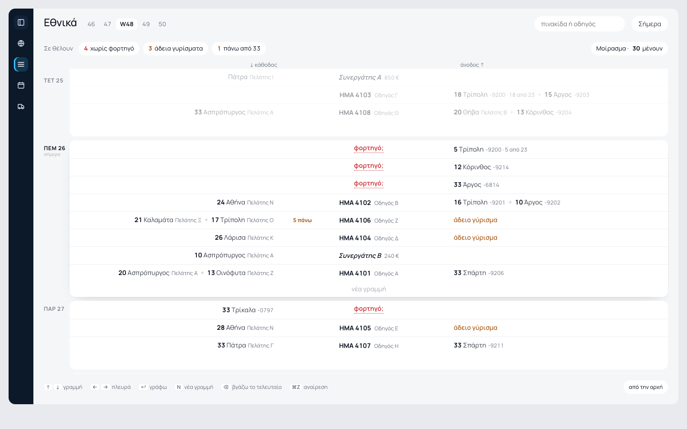 |
| Γράφει «22 Άργος 6814» 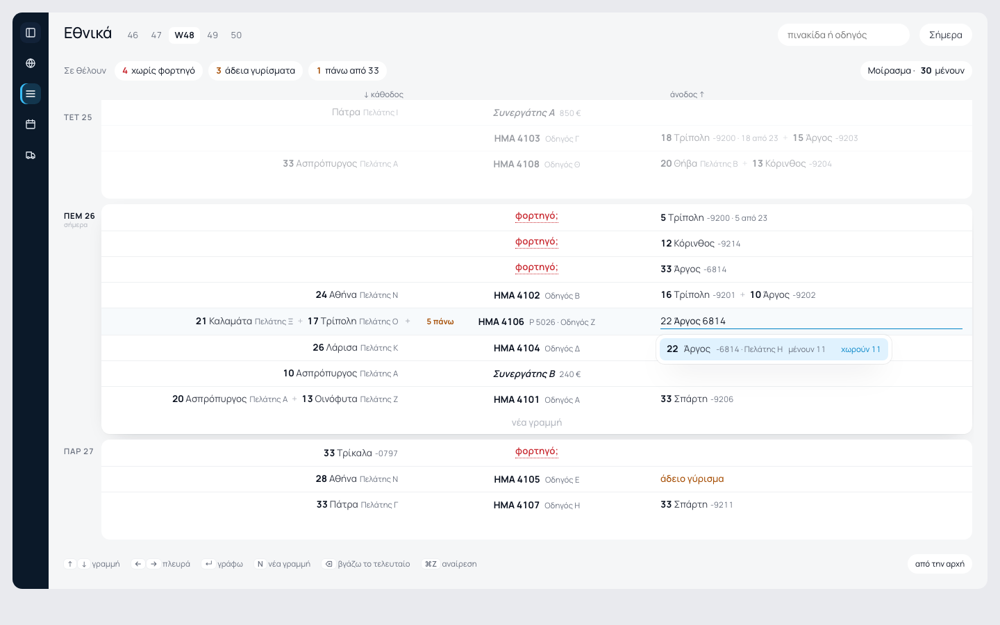 | Μετά το Enter 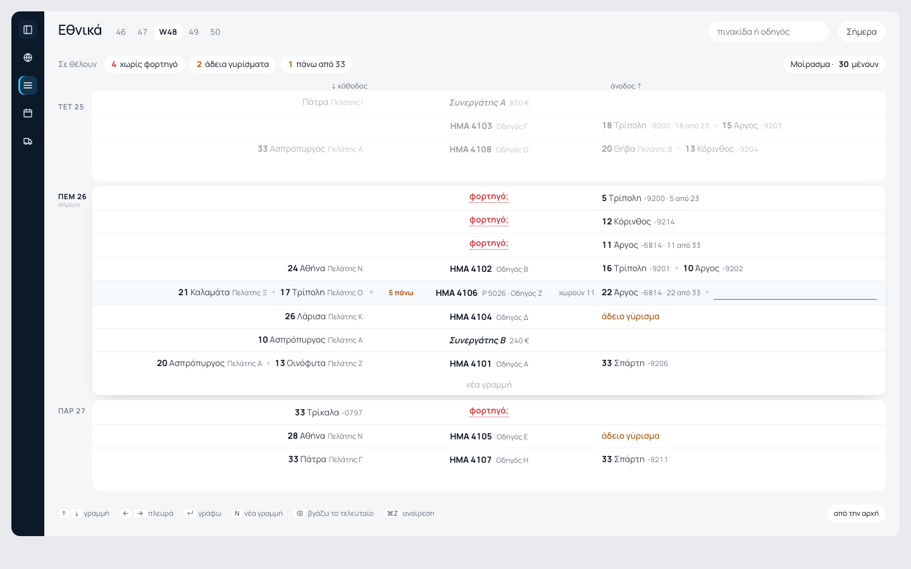 |
| Το φορτίο χωρίς φορτηγό μπήκε στη γραμμή του HMA 4104 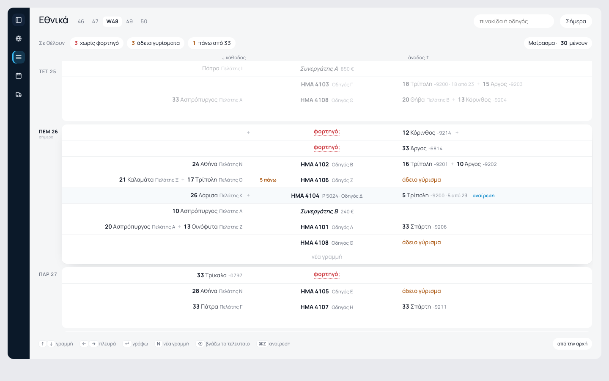 | Νέα παραγγελία με λόγια 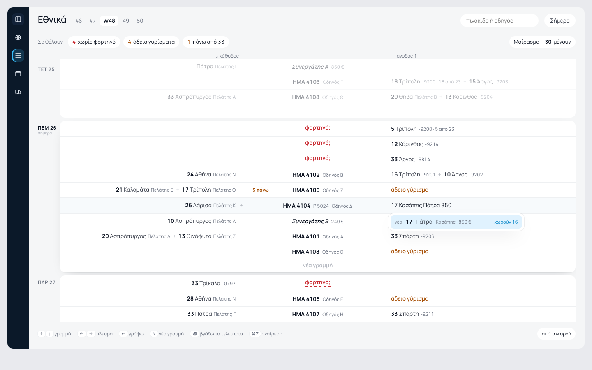 |

**Τρεις ιδέες δοκιμάστηκαν σε πρόχειρο**, με κριτή που ρωτούσε μόνο «ποια θα έδειχνες στη σκηνή;»: Α η γραμμή που γράφεται (επιλέχθηκε)·
Β «το φορτηγό γεμίζει» (μπάρα 33 θέσεων: δείχνει μόνο το πόσο γεμάτο, και το σύρσιμο είναι πιο αργό από το γράψιμο)·
Γ «μία απόφαση τη φορά» (κρύβει την εβδομάδα από κάποιον που αλλάζει σχέδιο όλη μέρα· κρατήθηκε ως η λωρίδα «Σε θέλουν»).
Εικόνες: `img/idea-b.png`, `img/idea-c.png`.

**Κριτές (ανεξάρτητοι, ο τελευταίος οδήγησε ο ίδιος το πρωτότυπο).** Ιδέα / ηρεμία / το μάτι πέφτει σωστά / τέχνη / ασφάλεια από σιωπηλά λάθη:
πρώτος 7 / 6 / 5 / 5 / —· δεύτερος 9 / 7 / 7 / 6 / 4· τρίτος 9 / 7,5 / 8 / 7 / 5,5. Κάθε «εμπόδιο» που βρήκαν διορθώθηκε και έγινε έλεγχος:
23 έλεγχοι συμπεριφοράς περνούν (`prototype-checks-1.js`, `prototype-checks-2.js`· τρέχουν με Playwright πάνω στο αρχείο), μεταξύ τους ότι οι παλέτες διατηρούνται σε κάθε κίνηση.
**Όριο:** μετά τις τελευταίες διορθώσεις το πρωτότυπο δεν ξαναβαθμολογήθηκε από ανεξάρτητο κριτή.

**Τι ΔΕΝ αποδεικνύει το πρωτότυπο:** ότι οι πραγματικές γραμμές του φύλλου του διαβάζονται σωστά (πραγματικά ονόματα πελατών, τόποι με δύο λέξεις, αναφορές που λείπουν ή έχουν 3 ψηφία, 15+ φορτηγά την ημέρα)·
ότι οτιδήποτε από αυτά αντέχει πραγματική αποθήκευση, δεύτερο χρήστη ή άρνηση της βάσης. Το «τίποτα δεν χάνεται» εδώ είναι αριθμητική στη μνήμη, πάνω σε οκτώ επινοημένα φορτηγά.
Το πρώτο βήμα πριν από κώδικα θα ήταν να περάσουν από τον αναλυτή οι πραγματικές γραμμές δύο εβδομάδων του φύλλου, χωρίς καμία εγγραφή.

**Τα δύο skills μετά την ιδέα:** από το `emil-design-eng` μένουν το κομμάτι που μπαίνει με 180ms, η πρόταση που ανοίγει από τον κέρσορα σε 125ms (και προς τα πάνω κοντά στο τέλος του φύλλου), καμία κίνηση στην πλοήγηση με πλήκτρα, `prefers-reduced-motion`.
Από το `ui-ux-pro-max`: ορατή εστίαση, αντίθεση 4,5:1 σε ό,τι διαβάζεται, νόημα ποτέ μόνο με χρώμα («φορτηγό;», «άδειο γύρισμα», «5 πάνω» είναι λέξεις).

---

## Το ιστορικό της πρότασης (ό,τι ακολουθεί γράφτηκε πριν από το άλμα)

Ζητήθηκε από τον owner στις 26/11, μετά την καταχώρηση δύο πραγματικών εβδομάδων εθνικών (W47, W48) μέσα από την οθόνη, ως dispatcher (25–26/11). Πρόσωπα και πελάτες δεν αναφέρονται, γιατί το repo είναι δημόσιο· όλα τα ονόματα στις εικόνες είναι συνθετικά («Πελάτης Α», «Οδηγός Β», «HMA 4101»).

- **Στυλ (απόφαση owner 26/11):** το mock είναι χτισμένο πάνω στο σύστημα σχεδίασης της επανασχεδίασης (`docs/design/redesign-2026-11/`, η οθόνη του Εβδομαδιαίου Διεθνών στο PR 331), όχι πάνω στο `assets/style.css` της ζωντανής εφαρμογής. Τα λόγια του: «είναι μια καλή βάση… να κάνεις τις απαραίτητες αλλαγές που θεωρείς και να βασίσουμε το νέο weekly πάνω σε αυτό». Το περιεχόμενο της πρότασης δεν άλλαξε· άλλαξε το δέρμα.
- Mock-up σε HTML: [`board-redesign-2026-11-26/mock.html`](board-redesign-2026-11-26/mock.html) (10 καταστάσεις, κουμπιά κάτω δεξιά), σε πραγματικό μέγεθος 1440×900. Το `redesign-system.css` δίπλα του είναι αντίγραφο, χωρίς αλλαγή, του στυλ της επανασχεδίασης (για να ανοίγει το mock πριν μπει το PR 331)· ό,τι προσθέτει η πρόταση είναι το μπλοκ `<style>` μέσα στο `mock.html`.
- Αλλαγές πάνω στη βάση (αποφάσεις συντονιστή, από τη συμβουλή που κράτησε ο owner 25/11): μενού σκούρο όπως στη ζωντανή εφαρμογή, ψυχρό μπλε, το κουμπί του μενού ψηλά.
- Εικόνες «σήμερα»: η σημερινή οθόνη από το rig (`tests/critics/wn5-rig-kit.js`, ψεύτικο `/plan/*`, συνθετικά δεδομένα). Τίποτα δεν διαβάστηκε ή γράφτηκε στην παραγωγή για αυτή την πρόταση.

## Α. Τι κάνει ο dispatcher σε αυτή την οθόνη

Η μονάδα σκέψης του είναι **μία γραμμή φορτηγού ανά ημέρα**: φορτηγό, ρυμούλκα, οδηγός (ή συνεργάτης με πινακίδες), ένα φορτίο ΚΑΘΟΔΟΥ και ένα ΑΝΟΔΟΥ, το καθένα μια σύντομη γραμμή: «22 από εδώ + 11 από εκεί, 33 παλέτες». Περίπου 6 φορτηγά την ημέρα, 28 γραμμές την εβδομάδα.

Τα βήματα μετρήθηκαν στον κώδικα και στο rig (κλικ και πεδία), όχι με χρονόμετρο δίπλα στον dispatcher.

| # | Η δουλειά, με τα λόγια του | Σήμερα | Στόχος |
|---|---|---|---|
| 1 | «Βάζω στο φορτηγό ένα φορτίο που περιμένει» | 4: «+», κλικ στην αναζήτηση, γράφω, «Πρόσθεσε». Πάνω από τη λίστα, κόκκινο κείμενο ως 15 γραμμές | 3: «+», γράφω, Enter. Ο κέρσορας είναι ήδη στην αναζήτηση, η προειδοποίηση είναι ένα «!» |
| 2 | «Σπάω ένα φορτίο σε 2–3 φορτηγά, ως τις 33» | περίπου 12 για δύο φορτηγά: πίσω στην αναμονή, «⋯ Σπάσε», μέρη, «Σπάσε», και μετά ανάθεση κάθε μέρους χωριστά | 6: σε κάθε φορτηγό γράφω πόσες παλέτες παίρνει και Enter. Οι υπόλοιπες μένουν στην αναμονή |
| 3 | «Ανοίγω μικρή εθνική παραγγελία πάνω στο φορτηγό» | 10–12: φόρμα με τύπο, πελάτη, τιμή, ανταλλαγή παλετών, σημεία, ημέρες, και άρνηση αν λείπει κάτι | 5–7: πελάτης, από, προς (παλέτες και τιμή όποτε τις μάθει), Enter. Η ημέρα έρχεται από τη γραμμή, η παράδοση προτείνεται |
| 4 | «Ορίζω φορτηγό, ρυμούλκα, οδηγό, ή συνεργάτη με πινακίδες και κόμιστρο» | 4, αλλά το δεύτερο Enter αποθηκεύει ρυμούλκα και οδηγό που δεν διάλεξε | 4–5: οι προτάσεις φαίνονται ως προτάσεις (μπλε, διακεκομμένες) και το Enter περνά πεδίο-πεδίο. Συνεργάτης σε μία γραμμή |
| 5 | «Αλλάζω γνώμη: άλλο φορτηγό, ή πίσω στην αναμονή» | 4–5: μενού, «Μεταφορά σε…», ψάξιμο στη λίστα (το «πίσω στην αναμονή» είναι τελευταίο), «Μεταφορά», κάποιες φορές ερώτηση | 1–2: σύρσιμο, ή μενού και επιλογή. Καμία ερώτηση, «Αναίρεση» δίπλα στη γραμμή |
| 6 | «Φέρνω μια διεθνή παραγγελία στα εθνικά» | περίπου 9: φεύγω από τον πίνακα, Παραγγελίες, αναζήτηση, άνοιγμα, «Επεξεργασία», κουτάκι, «Αποθήκευση», πίσω, ψάξιμο | 4: «+», «Διεθνείς», τα 4 τελευταία ψηφία, Enter |
| 7 | «Μοιράζω το απόθεμα της Βέροιας στα φορτηγά» | 4–8 ανά κομμάτι, με χωριστό παράθυρο για το σπάσιμο | το σχεδιάζει χωριστή πρόταση (`2026-11-26-veroia-panel-redesign-proposal.md`)· εδώ κρατιέται μόνο η θέση του |

## Β. Δύο κατευθύνσεις, και η προτεινόμενη

Πρώτα μια διαπίστωση: ο σημερινός πίνακας **μοιάζει ήδη με το Weekly Διεθνών** (ίδια πλακίδια, ίδια χρώματα, ίδιες κεφαλίδες ημερών). Ό,τι κοστίζει χρόνο δεν είναι η εμφάνιση· είναι ότι κάθε κίνηση ανοίγει ξεχωριστό παράθυρο με δικούς του κανόνες.

Η βάση του στυλ, το Εβδομαδιαίο Διεθνών της επανασχεδίασης:

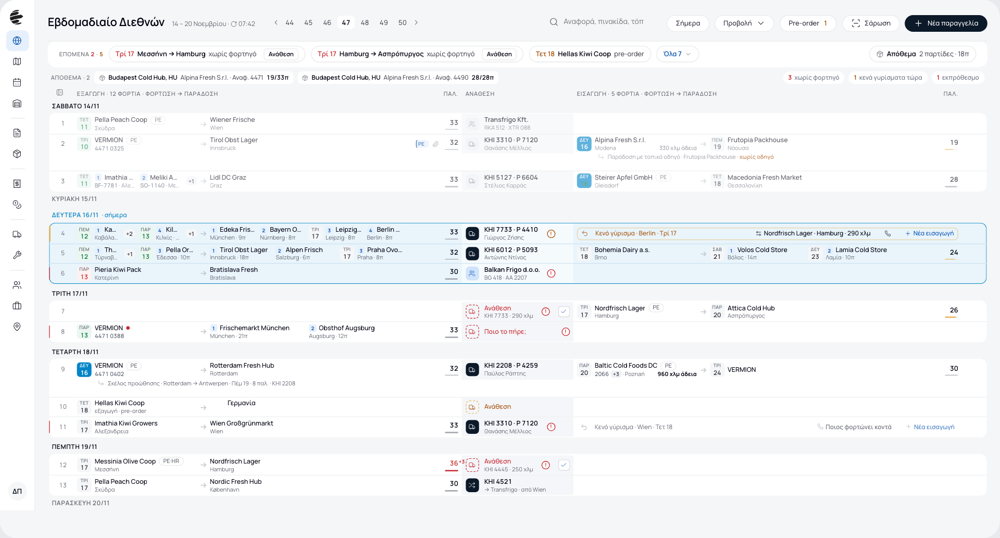

Και το σημερινό Weekly Διεθνών της ζωντανής εφαρμογής, για σύγκριση:

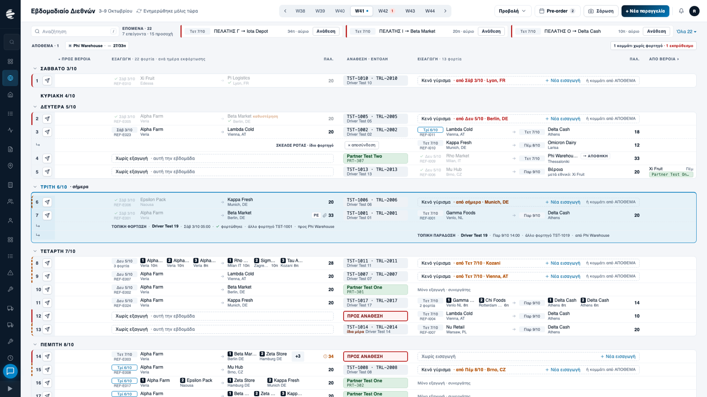

### Κατεύθυνση Α: «Η γραμμή του φορτηγού» (προτείνεται)

Ο πίνακας κρατά τη δομή του Weekly (ημέρες, μία γραμμή ανά φορτηγό, ανάθεση στη μέση) και παίρνει το στυλ της επανασχεδίασης. Από τη βάση κρατά: τυπογραφία και κενά, τη λωρίδα πάνω από τον πίνακα (εδώ «Χωρίς φορτηγό · Ν» με κουμπιά «Ανάθεση»), τα μικρά πλακίδια ημέρας («ΠΕΜ 26»), το κόκκινο διακεκομμένο «Ανάθεση», το «Κενό γύρισμα» ως ενέργεια μέσα στη γραμμή, και τον διακόπτη «Σήμερα» (τι φορτώνει και τι παραδίδει σήμερα). Πάνω σε αυτά, έξι πράγματα:

1. **Η γραμμή δείχνει ό,τι γράφει ο dispatcher στο φύλλο του.** Κάθε κομμάτι: παλέτες και τόπος, και από κάτω τα 4 τελευταία ψηφία («-6814») και ο πελάτης (μία φορά, όταν δύο διπλανά κομμάτια έχουν τον ίδιο). Όλα ορατά, όχι «+1». Κομμάτι που έχει σπάσει γράφεται «18 από 23». Στις παλέτες: σκέτο «33» όταν γέμισε, «26/33» όταν χωρά κι άλλο, «!» όταν ξεπερνά, «—» όταν δεν είναι γνωστές.
2. **Ό,τι είναι αυτονόητο δεν γράφεται.** Η Βέροια δεν γράφεται καθόλου: τόπος φόρτωσης ή παράδοσης φαίνεται μόνο όταν ΔΕΝ είναι η Βέροια («Θεσσαλονίκη →», «→ Πάτρα»). Ημερομηνία στη γραμμή μόνο όταν διαφέρει από την ημέρα της κεφαλίδας. Ώρες μόνο όταν υπάρχουν πραγματικές. Άδεια πλευρά = κενό και ένα «+», χωρίς «Κενό γύρισμα» / «Χωρίς κάθοδο». Τιμή παραγγελίας δεν φαίνεται στη γραμμή· το κόμιστρο του συνεργάτη ναι, γιατί το συμφωνεί ο ίδιος.
3. **Ό,τι δεν έχει φορτηγό είναι η δουλειά της ημέρας:** οι γραμμές «ΠΡΟΣ ΑΝΑΘΕΣΗ» μπαίνουν πρώτες στην ημέρα τους και η κεφαλίδα τις μετρά με κόκκινο («ΤΕΤΑΡΤΗ 25/11 · 1 χωρίς φορτηγό»).
4. **Ένα φορτηγό, μία γραμμή την ημέρα.** Το «+» στην άδεια πλευρά μιας γραμμής βάζει το φορτίο σε ΑΥΤΗ τη γραμμή, χωρίς ερώτηση. Όταν η παραγγελία γράφεται πρώτα και το φορτηγό μετά, το κουμπί της ανάθεσης λέει πού θα μπει: «Στη γραμμή του HMA 4104» (προεπιλογή, Enter) ή «Χωριστά».
5. **Κάθε κίνηση ανοίγει κάτω από τη γραμμή, με μία γεωμετρία:** από τη στήλη «ΑΝΑΘΕΣΗ» ως το τέλος της γραμμής. Το «+» έχει τρεις καρτέλες («Αναμονή», «Διεθνείς», «Νέα»). Το σπάσιμο είναι ο αριθμός παλετών που γράφεις. Κλικ σε κομμάτι = μετακίνηση, και εκεί ξαναενώνεται με το άλλο του μισό.
6. **Τίποτα δεν εξηγείται με κείμενο:** ένα πορτοκαλί «!» με το μήνυμα στο ποντίκι, πάνω στο πράγμα που αφορά (στο φορτηγό, στον τόπο). Κανένας κανόνας δεν αρνείται.

| Σήμερα | Πρόταση |
|---|---|
|  |  «Σήμερα»: 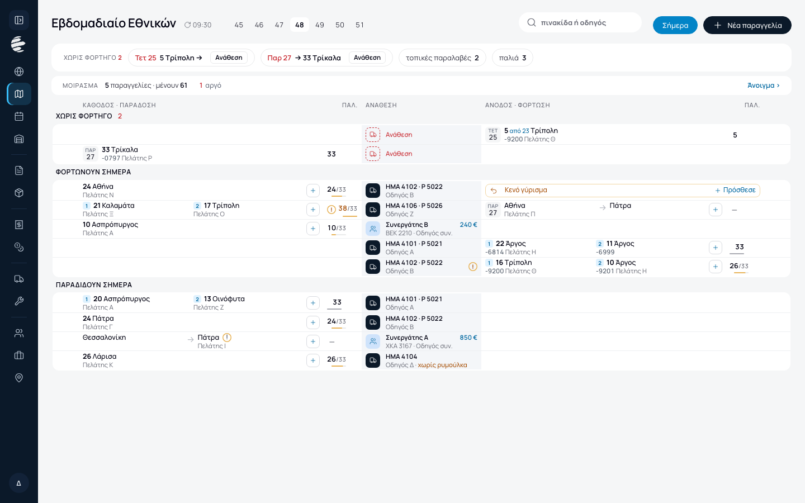 |
| «+» από αναμονή  | 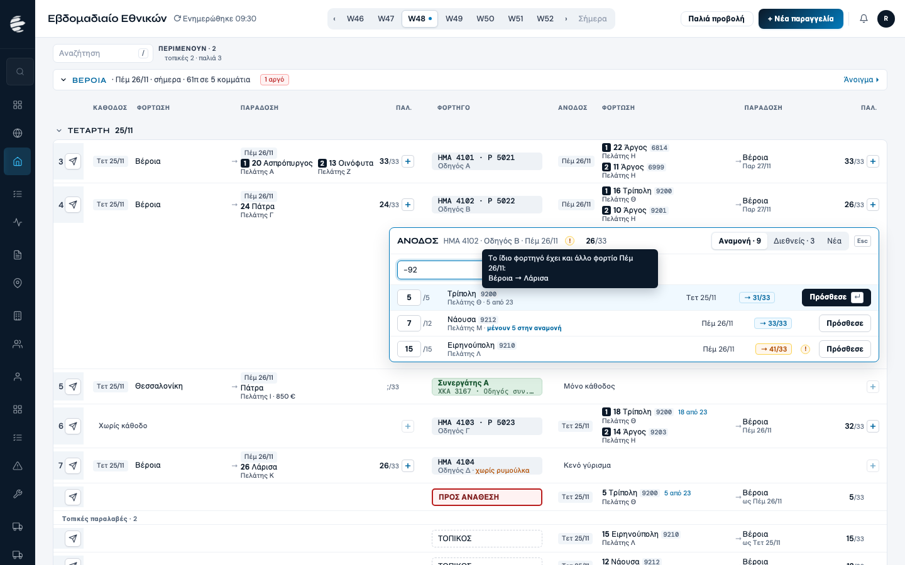 |
| Σπάσιμο: χωριστό παράθυρο  | Μέσα στην ίδια λίστα: «7 από 12 · μένουν 5» (η εικόνα από πάνω) |
| Νέα παραγγελία  |  |
| Ανάθεση  | 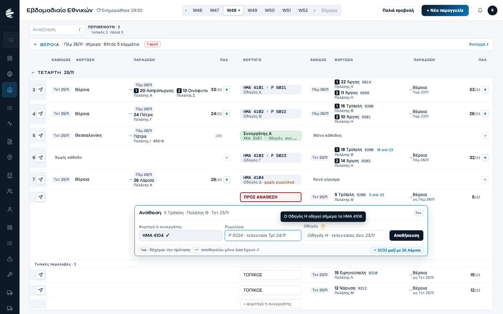 Συνεργάτης: 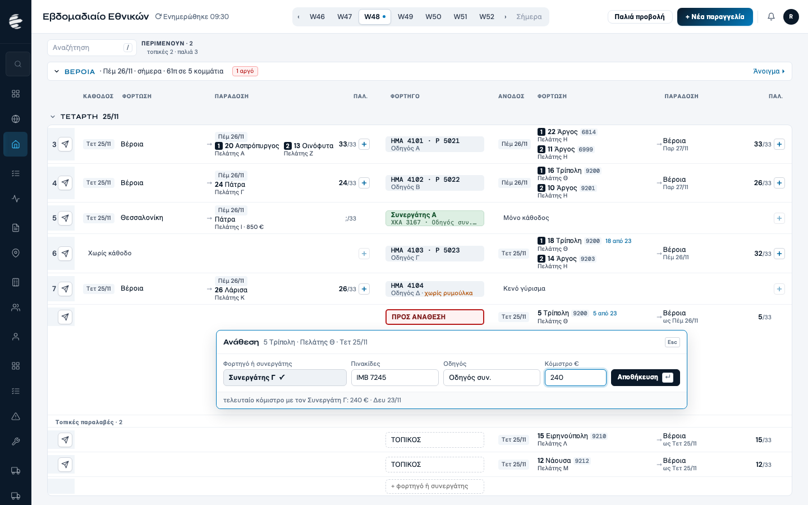 |
| Μεταφορά  |  Μετά: 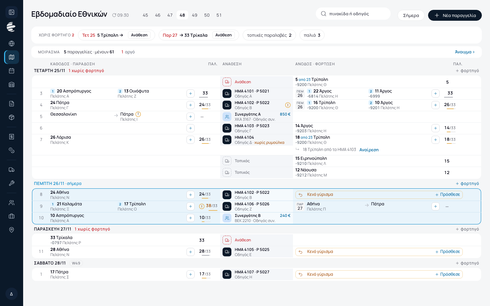 |
| Διεθνής στα εθνικά: δεν γίνεται από τον πίνακα |  |

**Πίνακας Βέροιας:** τον σχεδιάζει άλλο session, σε δική του πρόταση (`docs/national-v5/2026-11-26-veroia-panel-redesign-proposal.md`, φύλλο «κομμάτια × φορτηγά», απόφαση owner 26/11 για την ανάλυση LIDL / OGL). Εδώ κρατιέται η θέση του: μία κλειστή γραμμή 34px πάνω από τον πίνακα, που ανοίγει σε όλο το πλάτος και σπρώχνει τις γραμμές κάτω. Συμφωνημένο μεταξύ των δύο προτάσεων: τα 4 τελευταία ψηφία γράφονται παντού «-6814», και το υπόλοιπο ενός κομματιού λέγεται «μένουν».

Εβδομάδα: η εβδομάδα του TMS μένει Σάββατο–Παρασκευή. Στο κάτω μέρος μπαίνει και το **επόμενο Σάββατο** με ετικέτα «W49», ώστε η εβδομάδα του φύλλου του (Κυριακή–Σάββατο) να φαίνεται ολόκληρη σε μία οθόνη. Η γραμμή που παραδίδει Σάββατο δείχνει μόνο «Σάβ 28/11», όχι «1 · W49».

### Κατεύθυνση Β: «Πάγκος σύνθεσης»

Μία ημέρα τη φορά. Αριστερά ό,τι περιμένει, δεξιά τα φορτηγά ως κάρτες με μπάρα χωρητικότητας· σέρνεις κομμάτια.

| | Α: η γραμμή του φορτηγού | Β: πάγκος σύνθεσης |
|---|---|---|
| Μοιάζει με το Weekly | ναι, είναι το ίδιο πλέγμα | όχι, νέα οθόνη |
| Όλη η εβδομάδα σε μία ματιά | ναι | όχι, μία ημέρα |
| Σύνθεση φορτηγού ως 33 | γράφεις αριθμό | σέρνεις |
| Τι μαθαίνει ξανά ο dispatcher | σχεδόν τίποτα | όλη την οθόνη |
| Μέγεθος δουλειάς | 4 κύματα, το πρώτο μόνο μικρές αλλαγές | ένα μεγάλο, όλα μαζί |

**Σύσταση: Α.**

Κόστος της Α που πρέπει να φαίνεται: όταν ανοίγει ένα πλαίσιο κάτω από μια γραμμή, οι επόμενες γραμμές κατεβαίνουν.

**Πυκνότητα, μετρημένη:** η γραμμή είναι 34px (σήμερα 44). Σε 1440×900 χωρούν 15 γραμμές φορτηγών και 5 κεφαλίδες ημερών κάτω από τις δύο λωρίδες. Ο στόχος «τέσσερις ημέρες με 6 φορτηγά» (24 γραμμές) ΔΕΝ χωρά σε μία οθόνη χωρίς κύλιση· χωρούν τρεις γεμάτες ημέρες. Για τις 24 θα έπρεπε να φύγει μία από τις δύο λωρίδες ή η γραμμή να πέσει κάτω από 28px, που δεν το προτείνω. Απόφαση συντονιστή 26/11: δεν θυσιάζεται τίποτα· τρεις γεμάτες ημέρες στα 34px με τις δύο λωρίδες.

## Γ. Εύρημα → απάντηση → τι αγγίζει → μέγεθος

S = ως μισή μέρα, M = 1–2 μέρες, L = πάνω από 2 μέρες. «FE» = μόνο οθόνες. Ό,τι θέλει βάση, Worker ή αλλάζει το τι μπορεί να κάνει ένας ρόλος είναι σημειωμένο **απόφαση owner**.

| # | Εύρημα | Απάντηση στο σχέδιο | Αγγίζει | Μέγ. |
|---|---|---|---|---|
| 1 | Προειδοποίηση «σε άλλο δρομολόγιο»: τοίχος ως 15 γραμμές (μαζεύει κάθε ημέρα κάθε γραμμής της λίστας) | Ένα «!» δίπλα στο φορτηγό, μόνο για την ημέρα της γραμμής, κείμενο στο ποντίκι | FE: `wn5_actions.js` (`plus` → `refresh`, `_busyOf`) | S |
| 2 | «Μόνο αυτό το σημείο» πιάνει μόνο το πρώτο σημείο | Κάθε σημείο είναι δική του γραμμή στη λίστα, με το δικό του κομμάτι | FE: `weekly_natl_v5.js` (`_rowHTML`, `data-piece`), `wn5_assign.js` (`ptOf`) | S |
| 3 | Αναζήτηση και «Σπάσε» ανοίγουν χωρίς κέρσορα· Esc θέλει δύο πατήματα | Ο κέρσορας στην αναζήτηση με το άνοιγμα· ένα Esc κλείνει όταν δεν έχει γραφτεί κάτι που χάνεται | FE: `wn5_actions.js` (`plus`, `onKey`), `wn5_veroia.js` (`split`) | S |
| 4 | Σπάσιμο: χωριστό παράθυρο, τίτλος με πελάτη αντί για σημείο | Δεν υπάρχει παράθυρο: γράφεις λιγότερες παλέτες στη γραμμή, «μένουν Ν στην αναμονή» | FE πάνω στα υπάρχοντα `plan_split_piece` (114) και `/plan/legs`, δύο κλήσεις στη σειρά. Μία ατομική κλήση θα ήθελε βάση: **απόφαση owner** | M |
| 5 | Ημέρα παράδοσης δεν προτείνεται στην ΑΝΟΔΟ | Φόρτωση + 1 και στις δύο κατευθύνσεις, ως πρόταση (μπλε) | FE: `wn5_forms.js` (`_orderRefresh`) | S |
| 6 | «Αποθήκευση ως νέα τοποθεσία» ανοίγει μόνη της και μένει ανοιχτή (διπλές τοποθεσίες) | «+ Νέα τοποθεσία…» μόνο ως τελευταία, ρητή επιλογή· κλείνει όταν διαλέξεις υπαρκτή | FE: `wn5_forms.js` (`locDrop`, `newLoc`) | S |
| 7 | ΑΝΟΔΟΣ ζητά «άφιξη στη Βέροια» ενώ το φορτίο δεν πάει Βέροια | Το πεδίο φαίνεται μόνο όταν μια παράδοση είναι η Βέροια | FE: `wn5_forms.js` (`askV`) | S |
| 8 | Γραμμή με παράδοση Σάββατο δείχνει «1 · W49» μέσα στην W48 | Μόνο η ημέρα παράδοσης· το επόμενο Σάββατο φαίνεται ως όγδοη ημέρα | FE: `core/wn5-logic.js` (`boardNumbers`, `away`), δεύτερη ανάγνωση `/plan/board` | M |
| 9 | Εβδομάδα φύλλου (Κυρ–Σάβ) ≠ εβδομάδα TMS (Σάβ–Παρ) | Ο ορισμός ΔΕΝ αλλάζει (ζει σε `core/tms-week.js`, Worker, SQL 056)· απαντά το #8 | αλλαγή ορισμού = βάση + Worker + κάθε οθόνη: **απόφαση owner**, δεν προτείνεται | — |
| 10 | «Πίσω στην αναμονή» κάτω από 434 συνεργάτες | Πρώτη επιλογή· μετά ΟΛΑ τα φορτηγά της ημέρας με το σύνολο που θα βγει· μερική μετακίνηση γράφοντας λιγότερες παλέτες· συνεργάτης με αναζήτηση | FE: `wn5_actions.js` (`_assignHTML`) | S |
| 11 | Η μεταφορά σε φορτηγό δεν ρωτά, η επιστροφή στην αναμονή ρωτά | Καμία δεν ρωτά· κάτω από τη γραμμή που πήρε το φορτίο μένει μια λεπτή γραμμή «ήρθε από… · Αναίρεση». Όπου η βάση δείχνει πραγματικές συνέπειες, η ερώτηση μένει | FE: `wn5_actions.js` (`twoStep`), αναίρεση = η αντίστροφη κίνηση | M |
| 12 | Δεύτερο Enter αποθηκεύει σιωπηλά ρυμούλκα / οδηγό που προτάθηκαν· η προτεινόμενη ρυμούλκα ήταν λάθος σε 2 από 5 φορτηγά και έμοιαζε επιβεβαιωμένη | Η πρόταση φαίνεται ως πρόταση (μπλε, διακεκομμένη, με την ημέρα από την οποία έρχεται)· το Enter περνά πεδίο-πεδίο, και αποθηκεύεται μόνο ό,τι πέρασε από τα μάτια του | FE: `wn5_assign.js` (`_vehicleOf`, `_focusNext`) | S |
| 13 | Ο οδηγός που προτείνεται μπορεί να είναι λάθος για σήμερα | Αν το φορτηγό έχει ήδη γραμμή εκείνη την ημέρα, οδηγός και ρυμούλκα έρχονται από αυτήν (όχι από το ιστορικό). Αλλιώς πρόταση με την ημέρα της, και «!» αν οδηγεί αλλού | FE: `wn5_assign.js` | S |
| 14 | Συνεργάτης: εταιρεία, πινακίδες, οδηγός, κόμιστρο σε διαφορετικά σημεία | Μία γραμμή, ένα πεδίο «Φορτηγό ή συνεργάτης», προτείνεται το τελευταίο κόμιστρο | FE: `wn5_assign.js` (τα πεδία υπάρχουν από την 115) | S |
| 15 | Για Veroia Switch πρέπει να φύγει από τον πίνακα | Καρτέλα «Διεθνείς» στο «+»: βρίσκει τη διεθνή με τα 4 τελευταία, «Φέρε στα εθνικά» | FE: γράφει το πεδίο της διεθνούς μέσω του υπάρχοντος API παραγγελιών. Ο dispatcher το κάνει ΗΔΗ σήμερα από τη φόρμα διεθνούς, άρα δεν είναι νέο δικαίωμα, είναι συντόμευση· τα κομμάτια τα φτιάχνει η βάση όπως σήμερα. Στον owner μένει μόνο αν θα ειδοποιείται το γραφείο διεθνών | M |
| 16 | Γραμμή: ένα σημείο και «+1», παλέτες χωρίς όριο | Όλα τα κομμάτια ορατά, παλέτες μπροστά, 4 τελευταία, «26/33» (το όριο από το `LoadPlan`, όχι σταθερό 33) | FE: `weekly_natl_v5.js` (`_ptsHTML`, `_palHTML`) | M |
| 17 | Η γραμμή ξεκινά πάντα από παραγγελία, ποτέ από φορτηγό | «+ φορτηγό» στην κεφαλίδα κάθε ημέρας | Θέλει έλεγχο αν η βάση δέχεται δρομολόγιο χωρίς φορτίο· αν όχι: **απόφαση owner** | M–L |
| 18 | Πίνακας Βέροιας: μία λίστα, μία γραμμή τη φορά | Χωριστή πρόταση (άλλο session)· εδώ μόνο η θέση του | — | — |
| 19 | Λέξεις: «ΚΥΚΛΟΙ ΤΗΣ ΤΕΤΑΡΤΗΣ», «σκέλος ενός κύκλου», ώρες «05:00–06:00» που δεν είναι πραγματικές, «Κενό γύρισμα», «Χωρίς κάθοδο», το κουμπί «Παλιά προβολή» | Φεύγουν | FE: `wn5_actions.js`, `wn5_forms.js` | S |
| 20 | Η φόρμα νέας παραγγελίας αρνείται (π.χ. ανταλλαγή παλετών χωρίς επιλογή) | Η γρήγορη γραμμή δεν ρωτά· ανταλλαγή «Όχι» ως προεπιλογή, αλλάζει από «όλα τα πεδία» | FE: `wn5_forms.js` (`_check`). Η προεπιλογή ανταλλαγής: **απόφαση owner** | S |
| 21 | Αναζήτηση τοποθεσίας: το ακριβές όνομα βγαίνει 5ο, πρώτο ένα άσχετο που περιέχει τα ίδια γράμματα (αλφαβητική σειρά)· παραλίγο λάθος τόπος | Σειρά: ακριβές όνομα, μετά όσα αρχίζουν έτσι, μετά όσα το περιέχουν. Δίπλα η πόλη, για να ξεχωρίζουν τα ίδια ονόματα | FE: ο κοινός κατάλογος τοποθεσιών των φορμών (`core/form-helpers.js`, `wn5_forms.js`) | S |
| 22 | Κάθοδος που γράφεται ΜΕΤΑ την άνοδο του ίδιου φορτηγού γίνεται δεύτερη γραμμή με «κενό γύρισμα» | Ένα φορτηγό, μία γραμμή την ημέρα: ό,τι ανατίθεται σε φορτηγό που έχει ήδη γραμμή εκείνη την ημέρα μπαίνει στην άδεια πλευρά της | FE: `wn5_assign.js`. Θέλει έλεγχο αν ο κανόνας σειράς στάσεων της βάσης το δέχεται· αν όχι: **απόφαση owner** | M |
| 23 | Η προεπιλογή «στο ίδιο φορτίο / νέο φορτίο» αλλάζει ανά περίπτωση και δεν λέει ποιο φορτίο εννοεί (σε έναν οδηγό εννοούσε το χθεσινό) | Το κουμπί ονομάζει τι θα γίνει: «Στη γραμμή του HMA 4104» ή «Χωριστά». Καμία σιωπηλή προεπιλογή | FE: `wn5_assign.js` | S |
| 24 | Το «ΠΡΟΣ ΑΝΑΘΕΣΗ» είναι στο τέλος της ημέρας, μικρό | Πρώτο στην ημέρα του· η κεφαλίδα μετρά «Ν χωρίς φορτηγό» | FE: `weekly_natl_v5.js` (`_dayRowsHTML`, `_dayHTML`) | S |
| 25 | Στις μισές εθνικές δεν είναι γνωστό το σημείο παράδοσης («για Αθήνα»)· σήμερα διαλέγεται λάθος τόπος ή φτιάχνεται διπλός | Στη λίστα τόπων: «Πάτρα · το σημείο αργότερα». Στη γραμμή φαίνεται η πόλη με «!» ώσπου να οριστεί | Θέλει τόπο-πόλη στη βάση ή σημάδι «προς επιβεβαίωση» στην παραγγελία: **απόφαση owner** | M |
| 26 | Πελάτες και συνεργάτες ψάχνονται με την επωνυμία, ενώ στο φύλλο γράφονται με το σύντομο όνομά τους | Η αναζήτηση βρίσκει και το σύντομο όνομα | Θέλει πεδίο «σύντομο όνομα» σε πελάτες / συνεργάτες (βάση + Worker): **απόφαση owner** | M |
| 27 | Για να βρεθεί μια γραμμή χρειάζεται κύλιση | Το «/» πάνω αριστερά δέχεται ψηφία πινακίδας ή όνομα οδηγού και πηδά στη γραμμή | FE: `weekly_natl_v5.js` (`search`) | S |

### Χωριστά: δύο μικρές διορθώσεις στη φόρμα διεθνούς (όχι μέρος του ανασχεδιασμού)

| Σφάλμα | Αιτία | Διόρθωση | Μέγ. |
|---|---|---|---|
| Το «Αποθήκευση» της φόρμας διεθνούς δεν πατιέται κάποιες φορές, χωρίς κανένα μήνυμα | Το τελευταίο μήνυμα (`#toast`) μένει αόρατο αλλά πάνω από τη σελίδα και πιάνει το κλικ. Στα 1440×900 πέφτει πάνω στο κουμπί | Το κρυμμένο μήνυμα να μη δέχεται κλικ (`core/ui.js`, μία γραμμή). Απόδειξη: κλικ στο κουμπί μετά από μήνυμα, και η εγγραφή στον πίνακα | S |
| Μετά από αποθήκευση με Veroia Switch βγαίνει κουμπί «Revert: rec…» | Το κουμπί αναίρεσης παίρνει όνομα από πεδία που η παραγγελία δεν έχει και πέφτει στον κωδικό (`core/utils.js`, `core/api.js`) | Όνομα από το `PlainRef.orderOf` (πελάτης, φόρτωση → παράδοση · ημέρα) | S |

### Σειρά κατασκευής που προτείνω, αν εγκριθεί η Α

1. Τα μικρά (S) της λίστας: #1, 2, 3, 5, 6, 7, 10, 12, 13, 14, 19, 21, 23, 24, 27 και οι δύο χωριστές διορθώσεις.
2. Η γραμμή και το «+» κάτω από αυτήν: #16, 4, 20, 22.
3. Μετακίνηση με αναίρεση, επόμενο Σάββατο: #11, 8.
4. «Διεθνείς» στο «+»: #15, και όσα θέλουν βάση αν εγκριθούν: #17, 25, 26.

Κάθε κύμα σε δικό του PR, με screenshots ζητήθηκε ↔ έγινε και `/code-review`.

## Δ. Αποφάσεις owner 26/11 (ήταν οι πέντε ερωτήσεις)

Τα λόγια του: «Στις πέντε ερωτήσεις, κράτα τη σύσταση.»

1. **Κατεύθυνση Α**, η γραμμή του φορτηγού.
2. **Ο dispatcher εθνικών φέρνει μια διεθνή στα εθνικά από τον πίνακα, με ειδοποίηση στο γραφείο διεθνών.** Το ίδιο το κάνει ήδη σήμερα από τη φόρμα διεθνούς· αλλάζει μόνο ότι γίνεται από τον πίνακα.
3. **Σημείο παράδοσης «αργότερα»** (μόνο πόλη), με ορατό «!» στη γραμμή: ναι.
4. **Σύντομο όνομα σε πελάτες και συνεργάτες**, για να τους βρίσκει η αναζήτηση: ναι.
5. **Ανταλλαγή παλετών «Όχι» ως προεπιλογή** στη γρήγορη νέα παραγγελία: ναι.

Τα (3) και (4) είναι απόφαση σχεδίου. Κάθε migration και κάθε αλλαγή στον Worker που θα χρειαστούν θέλουν ξανά ρητή έγκριση του owner τη στιγμή της εκτέλεσης (dry run, μετά τις 15:00), όπως ορίζει το `CLAUDE.md`. Καμία από τις πέντε δεν ξεκλειδώνει κώδικα: το επόμενο βήμα είναι η έγκριση του τελικού σχεδίου από τον owner.

**Αποφάσεις συντονιστή (26/11):** η εβδομάδα μένει Σάββατο–Παρασκευή και φαίνεται και το επόμενο Σάββατο· «Αναίρεση» αντί για ερώτηση σε κάθε μετακίνηση· ένα φορτηγό, μία γραμμή την ημέρα· ο Πίνακας Βέροιας ανήκει στην άλλη πρόταση.

## Τα δύο skills σχεδίασης (owner 26/11): τι εφαρμόστηκε, τι όχι

**`emil-design-eng`** (λεπτομέρειες αλληλεπίδρασης). Όλα είναι στο `<style>` του mock.

| Πριν | Μετά | Γιατί |
|---|---|---|
| Τα κουμπιά δεν αντιδρούν στο πάτημα | `transform: scale(.97)` στο `:active`, 140ms με δυνατή καμπύλη εξόδου | Η οθόνη δείχνει ότι άκουσε |
| Το πλαίσιο κάτω από τη γραμμή εμφανίζεται από το πουθενά | Μπαίνει από την άκρη της γραμμής του: διαφάνεια και 4px, 140ms, `transform-origin: top` | Ανήκει στη γραμμή του, όχι στη σελίδα |
| Ίδια κίνηση με ποντίκι και με πληκτρολόγιο | Όταν ανοίγει με πλήκτρο, καμία κίνηση | Το «+» πατιέται δεκάδες φορές τη μέρα· η κίνηση θα το έκανε να μοιάζει αργό |
| Η λίστα τόπων ανοίγει από το κέντρο | Ανοίγει από την πάνω αριστερή γωνία του πεδίου της, 125ms | Το popover βγαίνει από εκεί που πατήθηκε |
| `transition` χωρίς ιδιότητες | Μόνο `transform`, `opacity` και χρώμα περιγράμματος, ονομαστικά | Όχι `transition: all` |
| Hover παντού | Μόνο σε συσκευή με ποντίκι (`hover: hover`) | Στην αφή το hover κολλάει |
| Καμία πρόβλεψη για μειωμένη κίνηση | `prefers-reduced-motion`: καμία μετακίνηση | Όποιος το έχει ζητήσει δεν βλέπει κίνηση |
| Η «Αναίρεση» ως μήνυμα που πετάγεται | Λεπτή γραμμή κάτω από τη γραμμή που πήρε το φορτίο, μόνο με διαφάνεια | Μένει εκεί που έγινε η αλλαγή και δεν σκεπάζει κουμπιά |

Δεν εφαρμόστηκαν: κίνηση με ελατήριο και σταδιακή είσοδος των γραμμών (διακοσμητικά σε οθόνη που δουλεύεται όλη μέρα)· θόλωμα στις αλλαγές κατάστασης (δεν υπάρχει αλλαγή που να το χρειάζεται).

**`ui-ux-pro-max`** (ιεραρχία, πυκνότητα, προσβασιμότητα), από τη βάση οδηγιών του.

| Οδηγία | Τι έγινε |
|---|---|
| Αντίθεση κειμένου 4,5:1 | «+ φορτηγό» και «—» έφυγαν από το αχνό γκρι (2,3:1) και πήραν το γκρι των δεύτερων γραμμών (5,5:1). Εφαρμόστηκε |
| Ορατή εστίαση σε κάθε χειριστήριο | Διπλός δακτύλιος στο `:focus-visible` για κουμπιά, καρτέλες, «+», «!». Εφαρμόστηκε |
| Μέγεθος στόχου για web: 24 CSS px | Το «+» έγινε 24px· το «!» μένει 16px στο μάτι και 24px στο ποντίκι. Εφαρμόστηκε |
| Κουμπιά μόνο με εικονίδιο θέλουν όνομα | `aria-label` στο «+», στο μενού, στην αποστολή στον οδηγό. Εφαρμόστηκε |
| Όχι μόνο χρώμα για το νόημα | Ήδη έτσι: «χωρίς φορτηγό» = λέξη και διακεκομμένο, υπέρβαση = «!» και αριθμός |
| Αναίρεση αντί για «Είσαι σίγουρος;» στις συνηθισμένες κινήσεις | Ήδη έτσι· η ερώτηση μένει μόνο όπου η βάση δείχνει πραγματικές συνέπειες |
| Δεύτερες γραμμές κάτω από 12px | Από 11 σε 11,5px. Στα 12 κόβονται ονόματα πελατών· **δεν** εφαρμόστηκε πλήρως |
| Στόχοι 44px | **Απορρίφθηκε:** είναι οδηγία για αφή· σε γραφείο με ποντίκι θα έριχνε την οθόνη κάτω από δύο ημέρες |
| Μαζική επιλογή γραμμών με κουτάκια | **Απορρίφθηκε:** προσθέτει στήλη και θόρυβο· ο dispatcher δουλεύει ένα φορτηγό τη φορά |

## Πώς κρίθηκε το σχέδιο (κριτήριο owner 26/11)

Τρεις κριτές πάνω στις εικόνες, σε γύρους: «μοιάζει με το Weekly Διεθνών;», «πόσα βήματα για κάθε δουλειά;», «τι μπορεί να φύγει από την οθόνη;». 
- **Γύρος 1 (δική μου κριτική):** γραμμές πίσω στα 44px, κανένα υποσέλιδο με εξήγηση, «+ φορτηγό» στην κεφαλίδα της ημέρας, «/33» μόνο όταν χωρά κι άλλο, ένα κουμπί ανά λίστα.
- **Γύρος 2 (τρεις ανεξάρτητοι κριτές, βαθμοί 4,5–7 στα 10):** μία γεωμετρία για όλα τα πλαίσια, δεμένη στη στήλη «ΑΝΑΘΕΣΗ»· ένα στυλ κύριου κουμπιού· το «!» ποτέ πάνω σε πεδίο· η λίστα δείχνει πάντα όλες τις παλέτες του φορτίου, εκτός από τη γραμμή που πείραξε ο χρήστης· ο οδηγός έρχεται από τη γραμμή του φορτηγού της ίδιας ημέρας· η μετακίνηση χωρίστηκε σε «πριν» και «μετά»· έφυγαν κεφαλίδες πλαισίων που επαναλάμβαναν τη γραμμή, ημερομηνίες που λέει ήδη η ημέρα, τιμές παραγγελιών, ετικέτες, σήματα πλήκτρων.
- **Δεν δέχτηκα:** γραμμές 32px (το 44 είναι του σημερινού πίνακα εθνικών, όχι αλλαγή αυτής της πρότασης)· αφαίρεση του κόμιστρου συνεργάτη από τη γραμμή (το συμφωνεί ο dispatcher)· «+» και μενού γραμμής μόνο στο hover (το Weekly τα έχει πάντα ορατά).
- **Γύρος 3 (βαθμοί 6–9):** το κομμάτι ξαναενώνεται με το άλλο του μισό από τη μετακίνηση· «18 από 23» με λέξεις, για να μη μοιάζει με το «26/33»· το «!» πάνω στο φορτηγό που αφορά· κουμπί με όνομα στη γραμμή που διαλέγεις· λεπτή γραμμή αναίρεσης.
- **Κριτική συντονιστή (από τις δύο ημέρες καταχώρησης):** «ΠΡΟΣ ΑΝΑΘΕΣΗ» πρώτο και μετρημένο στην κεφαλίδα, η Βέροια δεν γράφεται, πελάτης μία φορά, «—» για άγνωστες παλέτες, σημείο «αργότερα», σύντομα ονόματα, «/» που πηδά στη γραμμή.
- **Γύρος 5, νέο στυλ (απόφαση owner 26/11):** ολόκληρο το mock ξαναχτίστηκε πάνω στο σύστημα της επανασχεδίασης· ο πρώτος κριτής ρωτά πλέον «μοιάζει με το Weekly της επανασχεδίασης;». Βαθμοί 8–9 στην όψη, 6–9 στα βήματα, 7–9 στο «τι φεύγει». Ένα εμπόδιο (η όψη «Σήμερα» έκρυβε το καθυστερημένο φορτίο χωρίς φορτηγό) και επτά μικρά, όλα διορθωμένα: η Βέροια έφυγε και από τη λωρίδα, ετικέτες πάνω από τα πεδία της «Νέας», επιλεγμένο κομμάτι στη μετακίνηση, «Ένωσε με τις άλλες 5». **Όριο:** οι εικόνες μετά από αυτές τις διορθώσεις δεν ξαναβαθμολογήθηκαν από ανεξάρτητο κριτή· ελέγχθηκαν μόνο από τον συντάκτη.
- **Γύρος 4, τελικός στο προηγούμενο στυλ (βαθμοί 7–9 σε κάθε οθόνη και στις τρεις ερωτήσεις):** δύο εμπόδια διορθώθηκαν (το «+» που άνοιξε το πλαίσιο γίνεται γεμάτο μπλε και το πλαίσιο γράφει «ΑΝΟΔΟΣ»· η γραμμή της «Νέας» δεν κόβει πεδία). Ό,τι έμεινε είναι λεπτομέρεια κατασκευής: μικρές μετατοπίσεις 4–6px.

## Αν αυτό σπάσει, πώς θα το μάθω;

Είναι σχέδιο, δεν τρέχει. Όταν χτιστεί, κάθε κύμα μετριέται στον πίνακα και όχι στην οθόνη: ίδιος αριθμός γραμμών `rt_legs` με τα «Πρόσθεσε» που πατήθηκαν, και μετά από κάθε «Αναίρεση» το φορτίο ξανά εκεί που ήταν.

## Σημείωση για το rig

Το `tests/critics/wn5-rig-kit.js` δεν απαντά στο νέο `POST /changes` (#346): κάθε rig εθνικών τελειώνει πλέον με ένα σφάλμα κονσόλας «fresh-on-return: changes read failed». Δεν επηρεάζει την πρόταση· θέλει δική του μικρή διόρθωση.
