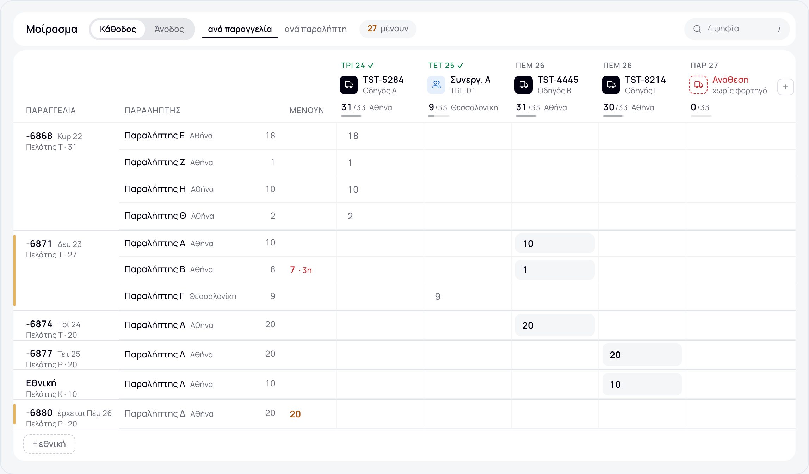
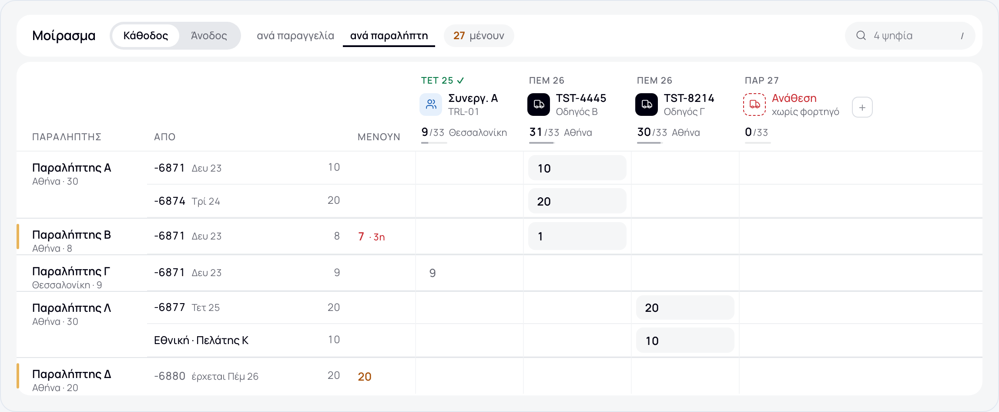
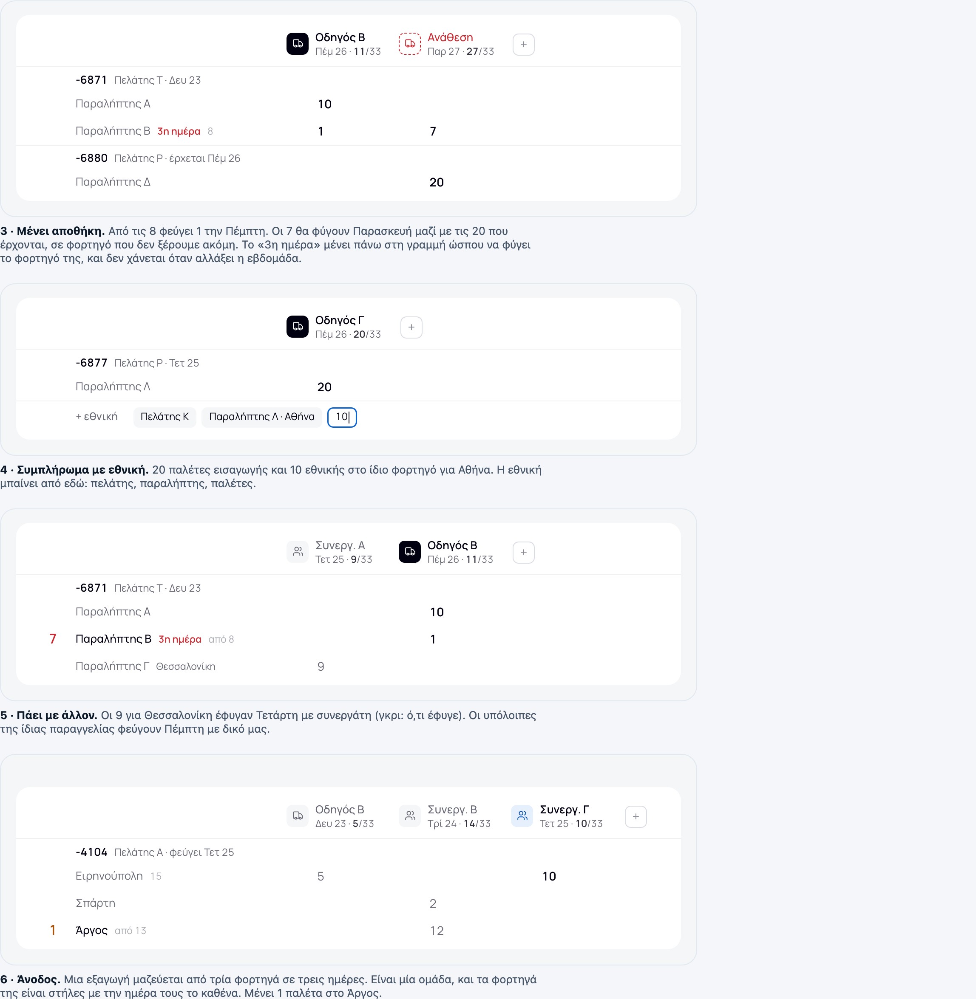
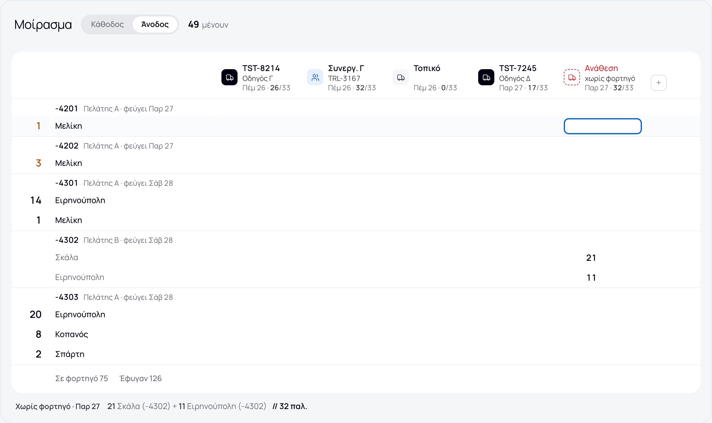
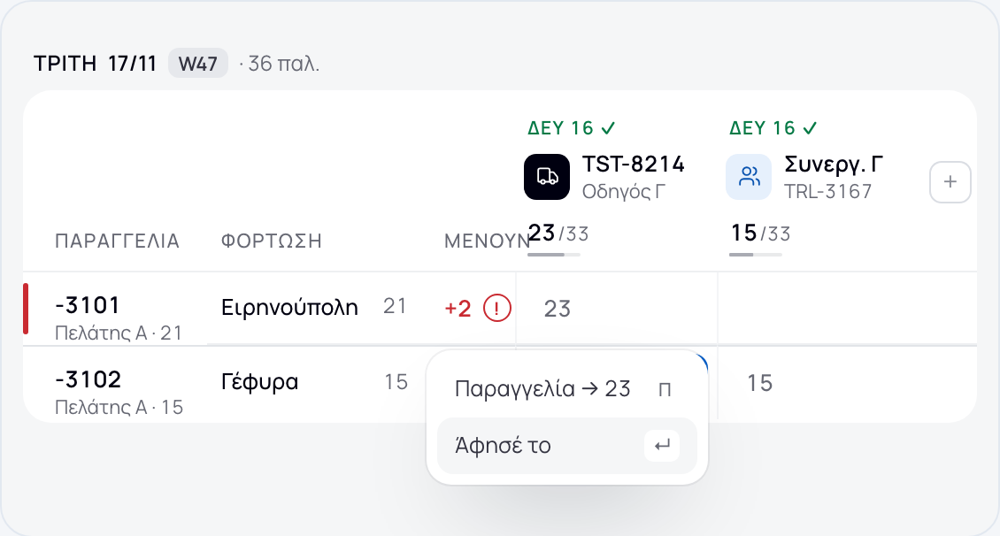
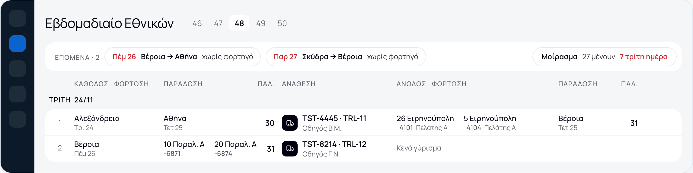

# «Πίνακας Βέροιας» → «Μοίρασμα»: πρόταση επανασχεδιασμού (26/11/2026)

**Κατάσταση:** πρόταση για έγκριση από τον owner. Κανένας κώδικας εφαρμογής, καμία αλλαγή σε βάση, Worker ή ρόλους.
Το ζωντανό mock-up (πληκτρολόγιο και ποντίκι) είναι σε ιδιωτική σελίδα Artifact του owner
(https://claude.ai/artifact/PTra3W4Zhi2XbskoxE6idd, ανοίγει μόνο σε εκείνον). Εδώ μένουν το κείμενο και έξι εικόνες με
συνθετικά ονόματα. Το repo είναι δημόσιο: πρόσωπα, πελάτες και συνεργάτες δεν αναφέρονται.

Ζητήθηκε από τον owner στις 26/11: να ξανασχεδιαστεί ο πίνακας του Εβδομαδιαίου Εθνικών όπου οι παλέτες που περνούν
από τη Βέροια μοιράζονται σε φορτηγά, και να βρεθεί το σωστό του όνομα («δεν είναι πραγματικά πίνακας Βέροιας»).

**Στυλ (απόφαση owner 26/11):** το mock-up είναι χτισμένο πάνω στο σύστημα σχεδίασης της επανασχεδίασης
(`docs/design/redesign-2026-11/`, το Εβδομαδιαίο Διεθνών των PR #331 και #334), που ο owner δέχτηκε ως βάση για το νέο
Weekly: ίδια γράμματα, κενά, πλακίδιο φορτηγού, κόκκινο διακεκομμένο «Ανάθεση», κυκλάκι «!». Το μενού αριστερά μένει
σκούρο (συντονιστής, συμβουλή που κράτησε ο owner 25/11).

**Διόρθωση κατεύθυνσης από τον owner (26/11, μέσω συντονιστή):** η πρώτη μορφή της πρότασης έγερνε στην άνοδο (τα
φορτία εξαγωγής που μαζεύονται). Ο πίνακας είναι πρώτα απ' όλα **ό,τι ήρθε με τις εισαγωγές και περιμένει στη
Βέροια, και η σύνθεση των φορτηγών της καθόδου**. Η άνοδος είναι μία από τις δουλειές του, όχι η κύρια.

## Το επιχείρημα

Σήμερα ο dispatcher γράφει το ίδιο πράγμα **τρεις φορές** σε ένα αρχείο δίπλα στο TMS: λίστα ανά παραγγελία, λίστα «τι
μένει», λίστα ανά φορτηγό. Στον πίνακα που προτείνεται το γράφει **μία φορά**, και κάθε αριθμός υπάρχει μία φορά: το
«τι μένει», το «πόσες ημέρες κάθεται» και το «πόσο γέμισε το φορτηγό» βγαίνουν μόνα τους.

| | |
|---|---|
| Κάθοδος, ανά παραγγελία |  |
| Κάθοδος, ανά παραλήπτη |  |
| Μένει αποθήκη · συμπλήρωμα με εθνική · πάει με άλλον · άνοδος |  |
| Άνοδος, όλη η εβδομάδα |  |
| Διαφορά «+2» |  |
| Κλειστό, μέσα στο Εβδομαδιαίο |  |

## Οι έξι δουλειές (owner 26/11)

1. **Ένα φορτίο εισαγωγής με 3–4 παραλήπτες.** Κάθε παραλήπτης έχει δική του τύχη: δύο κατεβαίνουν Αθήνα, ένας μένει
   αποθήκη, ένας πάει με άλλον.
2. **Μένει αποθήκη.** Κομμάτι που δεν φεύγει σήμερα, κάθεται 1–3 ημέρες ή περισσότερο και φεύγει αργότερα. Πρέπει να
   φαίνεται πόσες ημέρες κάθεται και να μη χάνεται όταν αλλάζει η εβδομάδα.
3. **Ένωση κομματιών διαφορετικών παραγγελιών για τον ίδιο παραλήπτη** («10 του ενός order με 20 του άλλου, πάνε
   παρέα»).
4. **Συμπλήρωμα φορτηγού με εθνική παραγγελία** (20 εισαγωγής + 10 εθνικής για Αθήνα). Η εθνική μπαίνει από εδώ.
5. **Κομμάτι που «πάει με έναν άλλον»:** συνεργάτης ή άλλο φορτηγό, άλλη ημέρα.
6. **Άνοδος:** εξαγωγή που μαζεύεται από πολλά σημεία, σε 2–3 ημέρες, από 2–3 φορτηγά.

## Τι δείχνει η βάση για τις W44–W48 (μόνο SELECT, 26/11)

Εισαγωγές με Veroia Switch και ημέρα Βέροιας από 24/10 ως 28/11, μη ακυρωμένες. Τα ids δεν γράφονται.

| Τι | Αριθμός | Τι σημαίνει |
|---|---|---|
| Εισαγωγές μέσω Βέροιας | 28 | 20 με έναν παραλήπτη, 1 με δύο, 5 με τρεις, 2 με τέσσερις. 45 κομμάτια. |
| Κομμάτια που σπάστηκαν | 0 | Το «από τις 8 φεύγει 1, μένουν 7» δεν έχει γραφτεί ποτέ στο σύστημα. |
| Φορτηγά με κομμάτια δύο εισαγωγών | 2 από 27 | Και τα δύο για τον ίδιο παραλήπτη (2 + 13· 11 + 6 + 15). Οκτώ τόποι παράδοσης εμφανίζονται σε πάνω από μία εισαγωγή. |
| Κομμάτια που έφυγαν 1–3 ημέρες μετά την ημέρα Βέροιας | 4 από 42 | 84 παλέτες. Υποεκτίμηση: η ημέρα Βέροιας της διεθνούς ξαναγράφεται όταν φορτωθεί το πρώτο κομμάτι (`plan_h_vs_follow`), άρα η «άφιξη» δεν είναι μετρημένη. |
| Κομμάτια που «περιμένουν» ακόμη | 3 | 23 και 25 ημέρες. Στον πραγματικό κόσμο έχουν φύγει· κανείς δεν το έγραψε, και ο πίνακας δεν δείχνει ημέρες. |
| Εθνική που φορτώνει στη Βέροια στο ίδιο φορτηγό με κομμάτι εισαγωγής | 0 | Στο αρχείο του dispatcher υπάρχει κάθε εβδομάδα. Στο σύστημα καμία. |

Πραγματικά σενάρια των εβδομάδων αυτών, ανώνυμα, όπως τα έχει η βάση:

- **Α.** Ένα φορτίο, τέσσερις παραλήπτες, 18 + 1 + 10 + 2 = 31 παλέτες: όλα στο ίδιο φορτηγό, παράδοση την επομένη.
- **Β.** Ένα φορτίο, τέσσερις παραλήπτες, 10 + 2 + 11 + 6 = 29: όλα στο ίδιο φορτηγό.
- **Γ.** Τρία φορτία της ίδιας εβδομάδας (9 + 15 + 2, 13 + 8 + 11, 11 + 6 + 15). Ένα φορτηγό πήρε 2 του πρώτου μαζί με
  13 και 8 του δεύτερου (ο ίδιος παραλήπτης από δύο παραγγελίες: 2 + 13). Άλλο φορτηγό, δύο ημέρες νωρίτερα, πήρε 11
  του δεύτερου με 6 και 15 του τρίτου. Τα 9 και 15 του πρώτου και τα 11 του τρίτου «περιμένουν» ακόμη.
- **Δ.** Ένα φορτίο, δύο παραλήπτες, 27 + 3: ίδιο φορτηγό.
- **Ε.** Ένα φορτίο 30 παλετών έφυγε τρεις ημέρες μετά την ημέρα Βέροιας.

Το συμπέρασμα: το σύστημα σήμερα κρατά μόνο την απλή περίπτωση (ένα φορτίο, ένα φορτηγό, ίδια ημέρα). Το σπάσιμο ενός
παραλήπτη, το «μένει» και το συμπλήρωμα με εθνική γίνονται, αλλά στο αρχείο του dispatcher. Ο πίνακας πρέπει να τα
κάνει πιο εύκολα από το αρχείο, αλλιώς θα μείνουν εκεί. Τα σενάρια του owner (10 + 20 του ίδιου παραλήπτη, 7 που
μένουν τρεις ημέρες, 20 + 10 εθνικής) είναι στο mock-up με αυτούς ακριβώς τους αριθμούς.

### «Μένει αποθήκη» και οι παρτίδες: δύο διαφορετικά πράγματα

- **Παρτίδες** (`stock_lots`, 057, `docs/stock-lots/`): εμπόρευμα πελάτη που **φυλάσσεται** σε αποθήκη και αντλείται με
  νέες παραγγελίες. Μια παρτίδα **δεν** μπορεί να έχει Veroia Switch (κανόνας `lot_vs`) και ένα κομμάτι παρτίδας δεν
  μπαίνει ποτέ στο v5 από τη δημιουργία (`plan_orders_create`, C-24). Δεν υπάρχει FK ή trigger προς `shipments`.
- **«Μένει αποθήκη» εδώ**: κομμάτι εισαγωγής με Veroia Switch που περιμένει φορτηγό καθόδου. Είναι `shipment_pieces`
  του v5, και μόνο αυτό.
- Άρα δεν υπάρχουν δύο πηγές για το ίδιο πράγμα (αρχή 3): το «Μοίρασμα» δείχνει **μόνο** κομμάτια του v5. Προσοχή σε
  μία τρίτη ένδειξη: η Ράμπα γράφει δικό της `stock_status = 'In Stock'` όταν κλείνει μια εισερχόμενη γραμμή
  (`modules/daily_ramp.js`). Αν ο πίνακας δείχνει «ήρθε», πρέπει να το διαβάζει από εκεί ή να το αντικαταστήσει, όχι να
  γράψει τρίτη εκδοχή. Προς απόφαση στο κύμα 2.
- «Παραλήπτης» στη βάση: δεν υπάρχει πεδίο. Το κοινό κλειδί δύο κομματιών είναι ο **τόπος παράδοσης**
  (`nat_to_location_id`). Η ομαδοποίηση «ανά παραλήπτη» είναι ομαδοποίηση ανά τόπο παράδοσης.

## Α. Σκοπός και όνομα

**Σκοπός, σε μία πρόταση:** για κάθε παλέτα που περνά από τη Βέροια (εισαγωγή που κατεβαίνει, εθνική που συμπληρώνει,
εξαγωγή που μαζεύεται), σε ποιο φορτηγό μπαίνει, ποια ημέρα, και τι μένει ακόμη στην αποθήκη.

| Όνομα | Γιατί | Λέξεις που υπάρχουν ήδη στην εφαρμογή |
|---|---|---|
| **Μοίρασμα** (πρόταση) | Το ρήμα της δουλειάς: «μοιράζω τις παλέτες στα φορτηγά»· λέγεται και στο τηλέφωνο («η μοιρασιά του φορτίου»). Χωρίς τόπο και χωρίς μηχανισμό, για κάθοδο και άνοδο. | Υπάρχει ήδη μέσα στον ίδιο πίνακα («N για μοίρασμα», `modules/wn5_veroia.js`). Καμία άλλη σελίδα δεν τη χρησιμοποιεί. |
| Αποθήκη / Απόθεμα Βέροιας | Λέει πού είναι οι παλέτες, όχι τι κάνεις με αυτές. Δεν καλύπτει την άνοδο. | «ΑΠΟΘΕΜΑ» είναι ήδη οι παρτίδες στο Εβδομαδιαίο Διεθνών και η Ράμπα· θα μπερδευτούν. |
| Σύνθεση φορτίων | Καλύπτει το «συνθέτω φορτηγό καθόδου», όχι το «τι μένει» ούτε το σπάσιμο. | Τίτλος της δοκιμαστικής όψης του ίδιου πίνακα (`modules/wn5_compose.js`, `WN_COMPOSE: 'pilot'`). |
| Ανάλυση | Ακούγεται στην ομάδα («η ανάλυση της παραγγελίας»). Λέει ότι σπάει, όχι ότι φεύγει. | Ενότητα «Ανάλυση» στο μενού. |
| Κατανομή παλετών | Ακριβές, αλλά λέξη γραφείου. | «Κατανομή φόρτου» στον Πίνακα Διοίκησης. |

**Αντέχει το «Μοίρασμα» μετά τη διόρθωση;** Ναι. Και οι έξι δουλειές είναι το ίδιο ρήμα: μοιράζω ένα φορτίο στους
παραλήπτες του, μοιράζω τους παραλήπτες στα φορτηγά, και ό,τι δεν μοιράστηκε ακόμη **μένει**. Το «μένει αποθήκη» δεν
είναι άλλη δουλειά· είναι το υπόλοιπο του μοιράσματος, και γι' αυτό η στήλη του λέγεται «ΜΕΝΟΥΝ». Ένα όνομα με
«απόθεμα» θα έλεγε το μισό και θα συγκρουόταν με τις παρτίδες.

Κριτήριο (συντονιστής): το όνομα λέει τη δουλειά, όχι τον τόπο ούτε τον μηχανισμό, και το λέει ο ίδιος στο τηλέφωνο.
Απορρίφθηκαν νωρίς: «Παλέτες ανά φορτηγό», «Σπάσιμο», «Φορτώσεις», «Κομμάτια», «Εσωτερική», κάθε όνομα με «Πίνακας».

## Β. Οι δουλειές, σήμερα και στο «Μοίρασμα»

| Δουλειά | Σήμερα | Στο «Μοίρασμα» |
|---|---|---|
| 1 · Φορτίο με 3–4 παραλήπτες | Ο πίνακας δείχνει κάθε κομμάτι χωριστά, με έντονο τον πελάτη της διεθνούς (ίδιος σε όλες τις γραμμές). «Σε φορτηγό ▾» ανά κομμάτι. | Η παραγγελία είναι μία ομάδα, οι παραλήπτες γραμμές της. Ένας αριθμός ανά παραλήπτη στη στήλη του φορτηγού του. |
| 2 · Μένει αποθήκη | «Σπάσε…» → «μένει στη Βέροια» → «φεύγει ως». Καμία ένδειξη ημερών· ο πίνακας κρύβεται όταν αδειάσει και δένεται με την εβδομάδα. | Ό,τι δεν πήρε φορτηγό μένει στη στήλη «ΜΕΝΟΥΝ» με τις ημέρες του («7 · 3η», κόκκινο από την τρίτη). Η κάθοδος δεν κόβεται σε εβδομάδες. |
| 3 · Ίδιος παραλήπτης, δύο παραγγελίες | Δεν φαίνεται πουθενά ότι είναι ο ίδιος. | «ανά παραλήπτη»: οι ίδιες γραμμές μαζεμένες ανά τόπο παράδοσης. 10 + 20 η μία κάτω από την άλλη. |
| 4 · Συμπλήρωμα με εθνική | «+ Νέα παραγγελία» από το Εβδομαδιαίο, μετά ανάθεση· ή τσεκάρισμα στο «Νέο φορτίο». | «+ εθνική» κάτω από τον πίνακα: πελάτης, παραλήπτης, παλέτες. Γίνεται γραμμή όπως οι άλλες. |
| 5 · Πάει με άλλον | «Σε φορτηγό ▾» → συνεργάτης, για κάθε κομμάτι. | Στήλη συνεργάτη (γαλάζιο πλακίδιο) ή στήλη άλλης ημέρας. «+» ή Ν για νέα. |
| 6 · Άνοδος σε 2–3 ημέρες | «+» στο φορτηγό → «Από αναμονή» → αναζήτηση → «Πρόσθεσε», ανά κομμάτι· σπάσιμο από «⋯». | Η εξαγωγή σε μία ομάδα (ημέρα που φεύγει από τη Βέροια), τα φορτηγά της στήλες με την ημέρα τους. |

Πλήκτρα που μετρήθηκαν πάνω στο mock-up (μετά το κλικ στο πρώτο κουτί): φορτηγό από δύο παραγγελίες 8, σπάσιμο 15 σε
5 + 10: 3, σε άλλο φορτηγό 3, πίσω στην αναμονή 1, «φόρτωσε 23 αντί 21» με διόρθωση παραγγελίας 4.

## Γ. Σχέδιο

**Μία ιδέα για όλες τις δουλειές: γραμμές οι παλέτες που θέλουν φορτηγό, στήλες τα φορτηγά, ένας αριθμός στο κουτί.**

Το ερώτημα μετά τη διόρθωση του owner ήταν αν αυτό αντέχει και τις έξι. Αντέχει τις 1, 5, 6 όπως ήταν. Για τις 2, 3,
4 δεν άντεχε και άλλαξε σε τρία σημεία, χωρίς μπάλωμα:

- **Η γραμμή δεν είναι «σημείο μιας διεθνούς».** Είναι «παλέτες με έναν προορισμό που θέλουν φορτηγό»: παραλήπτης μιας
  εισαγωγής, εθνική παραγγελία που φορτώνει στη Βέροια, σημείο φόρτωσης μιας εξαγωγής. Έτσι η εθνική είναι γραμμή σαν
  τις άλλες (δουλειά 4).
- **Η κάθοδος δεν χωρίζεται σε ημέρες ούτε σε εβδομάδες.** Είναι ένας κυλιόμενος πίνακας «ΣΤΗ ΒΕΡΟΙΑ»: ό,τι ήρθε, ό,τι
  έρχεται, και τα φορτηγά των επόμενων ημερών ως στήλες, το καθένα με την ημέρα του. Αν οι γραμμές χωρίζονταν ανά
  ημέρα, ό,τι μένει θα εμφανιζόταν σε κάθε ημέρα ή θα χανόταν στην αλλαγή εβδομάδας (δουλειά 2). Η άνοδος κρατά τις
  ομάδες ανά ημέρα, γιατί εκεί η ημέρα που φεύγει η εξαγωγή είναι προθεσμία.
- **Οι ίδιες γραμμές ομαδοποιούνται με δύο τρόπους:** ανά παραγγελία (δουλειά 1: τι έγινε το φορτίο που ήρθε) ή ανά
  παραλήπτη (δουλειά 3: τι πάει μαζί). Είναι ταξινόμηση, όχι δεύτερη όψη με δικά της δεδομένα.

Η εναλλακτική «δύο λίστες, όπως το σημερινό αρχείο» (αριστερά οι παραγγελίες με ετικέτες φορτηγών, δεξιά κάρτες ανά
φορτηγό) σχεδιάστηκε και απορρίφθηκε: κάθε αριθμός φαίνεται δύο φορές και θέλει περίπου 13 πλήκτρα εκεί που ο πίνακας
θέλει 8.

### Πώς δουλεύει

- **Κάθοδος (ανοίγει εδώ).** Ομάδα = η παραγγελία που ήρθε («-6871», πελάτης, σύνολο, ημέρα που ήρθε ή «έρχεται Πέμ
  26»). Γραμμή = παραλήπτης και πόλη. «ανά παραλήπτη» ή πλήκτρο Γ: ομάδα = παραλήπτης, γραμμή = από ποια παραγγελία.
- **Στήλη φορτηγού:** το πλακίδιο του Εβδομαδιαίου της επανασχεδίασης (σκούρο το δικό μας, γαλάζιο ο συνεργάτης) με
  πινακίδα και οδηγό, η ημέρα που φορτώνει από πάνω (αλλάζει με κλικ ή Δ όσο δεν έχει φύγει), από κάτω «31/33» με
  τη μικρή μπάρα γεμίσματος και **πού πάει** («Αθήνα»· πορτοκαλί «Αθή · Θεσ» όταν ανακατεύονται προορισμοί). Χωρίς φορτηγό ακόμη: το κόκκινο διακεκομμένο «Ανάθεση», με ημέρα. Έτσι «θα φύγουν Παρασκευή, δεν ξέρω με
  ποιον» γράφεται από τώρα.
- **«ΜΕΝΟΥΝ»**, δίπλα στις παλέτες: κενό όταν όλες έχουν φορτηγό, πορτοκαλί αριθμός όταν μένουν (και πορτοκαλί άκρη
  στην ομάδα), με τις ημέρες που κάθονται. Οι ημέρες («3η») **μένουν πάνω στη γραμμή ώσπου να φύγει το φορτηγό της**,
  ώστε το «θα φύγει Παρασκευή» να ξεχωρίζει από το ξεχασμένο· από την τρίτη ημέρα γίνονται κόκκινες.
- **Ίδιος παραλήπτης, χωρίς να αλλάξεις ομαδοποίηση:** όταν ο κέρσορας είναι σε έναν παραλήπτη, φωτίζονται οι
  γραμμές του ίδιου παραλήπτη από άλλες παραγγελίες. Κόκκινο «+2» με «!» όταν τα φορτηγά γράφουν περισσότερες από την
  παραγγελία. Προειδοποιεί, δεν αρνείται (διορθωτικές κινήσεις, owner 15/11). «Π» διορθώνει την παραγγελία· το Enter
  απλώς συνεχίζει, ώστε ένα λάθος πλήκτρο να μην αλλάζει ποτέ παραγγελία.
- **Σπάσιμο:** δεν υπάρχει κουμπί. Δύο αριθμοί στην ίδια γραμμή (1 στο φορτηγό της Πέμπτης, 7 σε αυτό της Παρασκευής),
  ή ένας αριθμός μικρότερος από τις παλέτες: το υπόλοιπο μένει.
- **Σε άλλο φορτηγό:** σέρνεις τον αριθμό με το ποντίκι, ή τον σβήνεις και τον γράφεις στο άλλο κουτί της ίδιας
  γραμμής (Ctrl X / Ctrl V για όποιον τα ξέρει). Και οι τρεις δρόμοι είναι **μία μεταφορά**, όχι «πίσω στην αναμονή»
  και νέα αποστολή με δύο ίχνη. Πίσω στην αποθήκη: σβήνεις τον αριθμό.
- **Πότε γράφεται (απόφαση συντονιστή 26/11):** αμέσως, χωρίς «Αποθήκευση» για όλο τον πίνακα, με «Αναίρεση». Μονάδα
  είναι η γραμμή: γράφεται μόλις ο κέρσορας φύγει από αυτήν, ώστε ένα σπάσιμο ή μια μεταφορά να είναι μία εγγραφή.
  Όσο είσαι στη γραμμή οι αριθμοί είναι μπλε· μετά, πάνω δεξιά γράφει τι έγινε («✓ σπάσιμο 1 + 7», «✓ σε άλλο
  φορτηγό», «✓ 7 πίσω στην αναμονή»). Χρησιμοποιεί τις υπάρχουσες κλήσεις (`plan_split_piece`, `plan_put_pieces`,
  `plan_move_pieces`). Ένα σπάσιμο με αποστολή είναι δύο κλήσεις στη σειρά: αν η δεύτερη αποτύχει, το κουτί μένει μπλε
  και το λέει με λόγια, και το μέρος μένει στην αποθήκη. Γιατί όχι μία «Αποθήκευση»: ο πίνακας ανανεώνεται και δύο
  άνθρωποι δουλεύουν τον ίδιο, άρα αλλαγές που περιμένουν θα χάνονταν.
- **Ό,τι έχει φύγει** γράφεται γκρι· ό,τι περιμένει, έντονο.
- **«+ εθνική»** ή πλήκτρο Ε: πελάτης, παραλήπτης, παλέτες. Η τιμή μπαίνει αργότερα, όπως στη φόρμα (η τιμή είναι
  προαιρετική από την 080).
- **Παλέτες του συνεργάτη:** ένας αριθμός δίπλα στο σύνολο του φορτηγού του («33/33 · 19 ξένες»), χωρίς παραγγελία.
- **Ένα πεδίο, «/» και τέσσερα ψηφία:** πηγαίνει στην παραγγελία· αν δεν είναι στον πίνακα, Enter τη βάζει, με
  ειδοποίηση στο γραφείο διεθνών (απόφαση owner 26/11 στις ερωτήσεις του PR #348).
- **Άνοδος:** ομάδες ανά ημέρα που φεύγει η εξαγωγή από τη Βέροια. Μια εξαγωγή που μαζεύεται σε 2–3 ημέρες από 3
  φορτηγά μένει σε μία ομάδα· τα φορτηγά της είναι όλα στήλες εκεί, το καθένα με την ημέρα του.
- **Πληκτρολόγιο:** ψηφία (και ένα δεκαδικό), βελάκια / Tab / Enter, «=» όσες μένουν, ⌫, «/», Ν (νέο φορτηγό), Φ (ποιο
  φορτηγό), Δ (ημέρα φορτηγού), Π (διόρθωσε την παραγγελία), Γ (ανά παραγγελία / παραλήπτη), Ε (νέα εθνική), Ctrl Z αναίρεση βήμα-βήμα.
  Τα πλήκτρα διαβάζονται από τη **θέση** τους (`event.code`), όχι από το γράμμα: δουλεύουν ίδια με ελληνική και
  αγγλική διάταξη, χωρίς αλλαγή γλώσσας. Windows: Ctrl. Κεφαλίδες και ομάδα καρφωμένες στην κύλιση.
- **Μέσα στο Εβδομαδιαίο:** η πόρτα είναι ένα χάπι πάνω δεξιά στη γραμμή «ΕΠΟΜΕΝΑ», εκεί που το Εβδομαδιαίο Διεθνών
  της επανασχεδίασης έχει το «Απόθεμα · N παρτίδες»: «Μοίρασμα · 27 μένουν · 7 από 3 ημέρες», πάντα ορατό. Ανοιχτό,
  όλο το πλάτος κάτω από αυτή τη γραμμή. Η γραμμή κάθε φορτηγού στο Εβδομαδιαίο γράφει από πού ήρθε κάθε κομμάτι στη
  μορφή που όρισε η πρόταση του πίνακα Εθνικών (PR #348). Κοινή λέξη στις δύο προτάσεις: «ΜΕΝΟΥΝ / μένουν».
- **Χωρίς λόγια στην οθόνη:** καμία επεξήγηση· ό,τι θέλει εξήγηση είναι ένα «!» με κείμενο στο ποντίκι.

## Δ. Ανάγκη → απάντηση → τι αγγίζει → μέγεθος

S = λίγες ημέρες, M = περίπου μία εβδομάδα, L = πάνω από μία εβδομάδα με δοκιμές.

| Ανάγκη | Απάντηση | Τι αγγίζει | Μέγεθος |
|---|---|---|---|
| Ό,τι περιμένει στη Βέροια, ανά παραγγελία ή ανά παραλήπτη, με τα φορτηγά του | ο πίνακας της καθόδου | Νέα οθόνη στη θέση των `modules/wn5_veroia.js` και `modules/wn5_compose.js`. Το `plan_board.hub[]` στέλνει ήδη κάθε κομμάτι στη Βέροια χωρίς κάτω όριο ημέρας, με `order_id`, `nat_to_location_id`, παλέτες, `nat_ready_day`. Από την 087 ένα κομμάτι εισαγωγής μπαίνει στον σημερινό πίνακα μόνο με το ✈· στον νέο μπαίνει κάθε κομμάτι στη Βέροια. | L · κύμα 1, μόνο οθόνη |
| Πόσες ημέρες κάθεται | «7 · 3η» | Κύμα 1: από την ημέρα Βέροιας της διεθνούς (`nat_ready_day`), που όμως ξαναγράφεται στην πρώτη φόρτωση. Για σωστό μέτρημα θέλει ημέρα άφιξης που δεν αλλάζει. | S · κύμα 1 κατά προσέγγιση· κύμα 2 **απόφαση owner** (βάση) |
| Σπάσιμο, αποστολή, μεταφορά, πίσω | αριθμοί σε κουτιά· η γραμμή γράφεται μόλις φύγεις, με «Αναίρεση» | Οι κινήσεις υπάρχουν (`plan_split_piece`, `plan_put_pieces`, `plan_move_pieces`). Μόνο οθόνη. «Όλες ή καμία» για πολλές γραμμές: δεύτερο βήμα, μόνο αν η χρήση το ζητήσει (βάση + Worker). | M · κύμα 1 |
| Ίδιος παραλήπτης από δύο παραγγελίες | «ανά παραλήπτη» | Ομαδοποίηση ανά `nat_to_location_id`. Μόνο οθόνη. Δύο εγγραφές τόπου για τον ίδιο παραλήπτη δεν θα ενωθούν (υπάρχουν διπλοί τόποι). | S · κύμα 1 |
| Εθνική από εδώ | «+ εθνική» | Η υπάρχουσα δημιουργία εθνικής (`WN5Form`, `POST /plan/orders`): πελάτης υποχρεωτικός, τιμή προαιρετική. Εγγραφή παραγγελίας: δοκιμή στη ζωντανή πριν βγει (κανόνας `CLAUDE.md`). | M · κύμα 1 |
| Φορτηγό αργότερα, με ημέρα | στήλη «Ανάθεση» | Τα πρόχειρα φορτία της 102 (`plan_drafts`, `/plan/drafts`), ζωντανά ως δοκιμή. Κρατούν ολόκληρα κομμάτια: το μέρος σπάει πρώτα. | M · κύμα 1 |
| Άνοδος, πλήρης | ομάδες ανά ημέρα | Για την εβδομάδα που δείχνει το `plan_board`: `waiting[]` και τα `legs[]` των φορτηγών. Για ό,τι παραδόθηκε ή είναι σε φορτηγό άλλης εβδομάδας θέλει νέα ανάγνωση. | κύμα 1 μία εβδομάδα· κύμα 2 **απόφαση owner** (βάση, Worker) |
| Διαφορά πλάνου και φορτωμένων | κόκκινο «+N», «Π» | υπάρχει: `POST /plan/vs/day` («Ορισμός παλετών στη διεθνή», 092)· μόνο οθόνη | S · κύμα 1 |
| Παλέτες του συνεργάτη | «19 ξένες» | νέα στήλη στο δρομολόγιο, όπως οι «Πινακίδες» της 115, και ένα κλειδί στο `plan_board` | S · κύμα 2 · **απόφαση owner** (βάση) |
| Παραγγελία που δεν είναι στον πίνακα | «/», 4 ψηφία, Enter | γράφει «Veroia Switch» και ημέρα Βέροιας στη διεθνή, όπως η φόρμα της. Ο dispatcher το κάνει ήδη από εκεί: συντόμευση, όχι νέο δικαίωμα. | M · κύμα 3 · **απόφαση owner 26/11: ναι**, με ειδοποίηση στο γραφείο διεθνών (PR #348) |
| Γρήγορο όσο το Excel | πληκτρολόγιο ίδιο σε ελληνικά και αγγλικά, σύρσιμο με το ποντίκι | μόνο οθόνη | M · κύμα 1 |
| Αν σπάσει, πώς το μαθαίνω; | ο αριθμός μένει μπλε ώσπου να γραφτεί και πάνω δεξιά λέει τι γράφτηκε· αν κάτι δεν γράφτηκε, το κουτί μένει μπλε και το λέει με λόγια | ο κανόνας `pieces_sum` της βάσης· μέτρηση στον πίνακα μετά την πρώτη πραγματική χρήση: πόσα κομμάτια με γονέα, πόσα φορτηγά με εθνική και εισαγωγή μαζί (σήμερα 0 και 0) | μέσα στα παραπάνω |

## Κύματα

| Κύμα | Τι παίρνει ο dispatcher | Τι θέλει |
|---|---|---|
| **1** | Την κάθοδο ολόκληρη: ό,τι περιμένει στη Βέροια ανά παραγγελία ή παραλήπτη, ημέρες που κάθεται (κατά προσέγγιση), σπάσιμο με αριθμούς, μεταφορά, αναίρεση, «+ εθνική», στήλη «Ανάθεση», διαφορά «+2», τέσσερα ψηφία, πληκτρολόγιο. Και την άνοδο για την εβδομάδα που βλέπει. Στη θέση του Πίνακα Βέροιας και της Σύνθεσης. | **Μόνο οθόνη**, πάνω στο σημερινό `plan_board` και στις υπάρχουσες κλήσεις. |
| **2** | Ημέρες αναμονής μετρημένες από την πραγματική άφιξη· η άνοδος συνεχίζει στην επόμενη εβδομάδα και δείχνει ό,τι παραδόθηκε· «ξένες» παλέτες συνεργάτη. | Βάση + Worker: ημέρα άφιξης, νέα ανάγνωση, ένα πεδίο στο δρομολόγιο. **Απόφαση owner.** |
| **3** | Παραγγελία που λείπει μπαίνει με τα τέσσερα ψηφία. Αν η χρήση το ζητήσει, αποθήκευση πολλών γραμμών «όλες ή καμία». | Το πρώτο εγκρίθηκε από τον owner στις 26/11 (PR #348), με ειδοποίηση στο γραφείο διεθνών. Το δεύτερο: βάση + Worker. |

Όρια του κύματος 1, να τα ξέρει ο owner: (α) οι ημέρες αναμονής μετρούν από την ημέρα Βέροιας της διεθνούς, που
αλλάζει στην πρώτη φόρτωση· (β) στην άνοδο, μια εξαγωγή με κομμάτια σε φορτηγό άλλης εβδομάδας φαίνεται με όσα έχει η
εβδομάδα· (γ) τα 3 παλιά κομμάτια που «περιμένουν» 23–25 ημέρες θα εμφανιστούν πρώτα-πρώτα, κόκκινα: θέλουν ένα
καθάρισμα (ανάθεση στο φορτηγό που τα πήρε) πριν από την πρώτη χρήση.

## Ε. Ερωτήσεις προς τον owner (μέσω συντονιστή)

1. **Το όνομα είναι «Μοίρασμα»;** Πρόταση: ναι.
2. **Το «Μοίρασμα» παίρνει τη θέση και του Πίνακα Βέροιας και της «Σύνθεσης φορτίων»;** Η στήλη «Ανάθεση» είναι
   το πρόχειρο φορτίο της Σύνθεσης. Πρόταση: ναι, μία όψη (αρχή 3).
3. **Κάθε κομμάτι εισαγωγής που φτάνει στη Βέροια φαίνεται στον πίνακα μόνο του**, χωρίς το ✈ «Στον Πίνακα Βέροιας»
   της 087; Πρόταση: ναι· αλλιώς ό,τι «μένει» θα φαίνεται μόνο αν κάποιος θυμηθεί να το στείλει εκεί.
4. **Γράφουμε πόσες «ξένες» παλέτες έχει το φορτηγό του συνεργάτη;** Μόνο ο αριθμός. Πρόταση: ναι, στο κύμα 2.

Έχουν ήδη αποφασιστεί: το πότε γράφονται οι αλλαγές (συντονιστής: αμέσως, με αναίρεση) και το ότι ο dispatcher φέρνει
διεθνή στον πίνακα με τα τέσσερα ψηφία, με ειδοποίηση στο γραφείο διεθνών (owner 26/11, PR #348). Από το ίδιο PR
ισχύουν και εδώ το «σημείο παράδοσης αργότερα» και τα «σύντομα ονόματα» για την εθνική που μπαίνει από τον πίνακα.

## Πώς ελέγχθηκε το σχέδιο

- **Γύροι 1–3 (πρώτη μορφή, άνοδος):** τρεις κριτές με ξεχωριστή ερώτηση ο καθένας («μοιάζει με το Εβδομαδιαίο
  Διεθνών;», «πόσα πλήκτρα ανά δουλειά;» με πραγματικό πληκτρολόγιο, «τι μπορεί να φύγει από την οθόνη;»). Ο πρώτος
  γύρος απέρριψε την αρχική μορφή και ξανασχεδιάστηκε: έφυγαν το πλέγμα κελιών, τα ✓, η μπάρα γεμίσματος, οι
  ετικέτες· το κουτί φορτηγού πήρε το μέγεθος του Εβδομαδιαίου· το «χωρίς φορτηγό» έγινε το κόκκινο διακεκομμένο «Ανάθεση»·
  το «ΜΕΝΟΥΝ» ήρθε δίπλα στις παλέτες. Στον τρίτο γύρο πέρασαν έξι από οκτώ οθόνες· τα υπόλοιπα σφάλματα
  πληκτρολογίου διορθώθηκαν.
- **Μετά την κριτική του συντονιστή:** εγγραφή ανά γραμμή με αναίρεση, πλήκτρα από τη θέση τους, σύρσιμο, κύματα.
  Επαληθεύτηκαν με σενάριο πληκτρολογίου και ποντικιού (και με γεγονότα ελληνικής διάταξης).
- **Μετά τη διόρθωση του owner:** μελέτη της βάσης (πίνακας πιο πάνω), η κάθοδος ως κύρια όψη, ομαδοποίηση ανά
  παραγγελία / παραλήπτη, ημέρες αναμονής, «+ εθνική».
- **Γύρος 4, κριτής πάνω στις έξι δουλειές (πραγματικά πλήκτρα και ποντίκι):** πέρασαν οι 1 και 6· η 3 μόνο μετά την
  αλλαγή ομαδοποίησης· οι 2, 4, 5 όχι. Διορθώθηκαν: οι ημέρες μένουν στη γραμμή και αφού μπει σε φορτηγό που δεν έχει
  φύγει (2)· φωτίζεται ο ίδιος παραλήπτης και χωρίς αλλαγή ομαδοποίησης (3)· η ημέρα μιας στήλης αλλάζει (5)· ο
  προορισμός κάτω από κάθε φορτηγό· έξι σφάλματα του mock-up (κλικ που χανόταν μετά από πληκτρολόγηση, αναίρεση μετά
  από αλλαγή ομαδοποίησης, πλήκτρα χωρίς επιλεγμένο κουτί, ιστορικό που χανόταν στην αλλαγή καρτέλας, σιωπηλή
  διόρθωση σε φορτηγό που έφυγε). Επαληθεύτηκαν με δικό μου σενάριο· ο κριτής δεν ξαναέτρεξε μετά τις διορθώσεις και
  μετά την αλλαγή στυλ.
- **Δεν μπήκαν στο mock-up, μένουν ως σχέδιο:** με 15 φορτηγά οι τέσσερις πρώτες στήλες καρφώνονται και τα φορτηγά που
  έφυγαν μαζεύονται σε μία στήλη «Έφυγαν · N»· η φόρμα της «+ εθνική» (στο mock-up βάζει έτοιμη γραμμή)· προειδοποίηση
  όταν κομμάτι που δεν έχει φτάσει μπαίνει σε φορτηγό που έχει φύγει· θερμοκρασία με «!» μόνο όταν ανακατεύονται.
- **Τα δύο skills σχεδίασης (owner 26/11).** `emil-design-eng`, εφαρμόστηκαν: καμία κίνηση στις ενέργειες του
  πληκτρολογίου (ο κέρσορας ανάμεσα στα κουτιά δεν «γλιστρά»)· πάτημα με `scale(.97)` στα κουμπιά· τα μικρά παράθυρα
  ανοίγουν από τη γωνία της αφετηρίας τους, 140 ms, από `scale(.97)` και όχι από το μηδέν· οι χρωματικές αλλαγές
  hover πίσω από `@media (hover:hover)`· `prefers-reduced-motion`· κέρσορας «πιάνω» στο σύρσιμο. Απορρίφθηκαν: spring
  και ορμή στο σύρσιμο (ο αριθμός πηγαίνει από κουτί σε κουτί, δεν «πετιέται»), stagger στην είσοδο των γραμμών (τον
  πίνακα τον ανοίγει δεκάδες φορές τη μέρα). `ui-ux-pro-max`, εφαρμόστηκαν: καμία πληροφορία μόνο με χρώμα (το
  πορτοκαλί έχει αριθμό και «3η», το κόκκινο «+2» και «!», το φορτηγό που έφυγε «✓»)· ορατή εστίαση στο κουτί· όλα
  από το πληκτρολόγιο· κείμενο όχι κάτω από 11 px· ο πίνακας κυλά μέσα στο πλαίσιό του σε στενή οθόνη. Απορρίφθηκαν:
  ελάχιστος στόχος 44 px (οθόνη γραφείου με ποντίκι· τα κουτιά είναι 38 px ύψος και 100+ πλάτος), μαζική επεξεργασία
  με κουτάκια επιλογής (το «=» και η ομαδοποίηση ανά παραλήπτη κάνουν την ίδια δουλειά χωρίς νέα στήλη), κάρτες αντί
  για πίνακα σε κινητό (η δουλειά γίνεται σε γραφείο).

Οι εικόνες του σημερινού πίνακα στη σελίδα του owner βγήκαν από τα υπάρχοντα rigs με δοκιμαστικά δεδομένα
(`tests/critics/wn5-rig-kit.js`, `tests/critics/wi4-board-rig.js`), όχι από την παραγωγή. Στη βάση έτρεξαν μόνο SELECT.
