# Νέο Weekly Εθνικών: οι ροές από άκρη σε άκρη (21-10)

> Μόνο ανάγνωση. Πηγές: `main.md` (§5 = αποφάσεις owner, μαζί με τις απαντήσεις της 21/10, που υπερισχύουν), `tech.md`, `design.md` (§3 κανόνες αλληλεπίδρασης), τα κείμενα brainstorming 14/10, 18/10, 19/10 και 20/10, και ο κώδικας `worker/migrations/011_driver_ledger.sql`, `043_invoice_mark_guard.sql` και `modules/daily_ops.js` του worktree.
> Κάθε ροή: ενέργεια χρήστη → διαδρομή Worker / συνάρτηση `plan_*` → πίνακες που γράφονται → τι βλέπουν οι άλλες οθόνες. Κάτω από κάθε διάγραμμα, τα **Κενά / αντιφάσεις**: σημεία όπου η ροή δεν ορίζεται, δύο πηγές διαφωνούν, ή μια απόφαση της 21/10 σπάει κάτι στο `tech.md` / `design.md`.
> Συντομογραφίες: **WI** = Weekly Διεθνών, **WN** = νέο Weekly Εθνικών, **ΗΜ** = Ημερήσιο, **DL** = μισθοδοσία (`dl_entries`), **PL** = παλέτες (`pl_movements`), **L** = ημέρα κυκλοφορίας.
>
> **Απόφαση owner 21/10 (αργά), υπερισχύει της Φ5/Φ7 του `tech.md`: καθαρή αντικατάσταση, χωρίς συνύπαρξη.** Μετρήθηκε στην παραγωγή: στα εθνικά υπάρχουν μόνο δεδομένα-δοκιμής του owner (6 `national_orders`, 1 ομάδα GL, 0 RT με εθνικά σκέλη, 0 `local_moves`). Τα μόνα ζωντανά εθνικά είναι 70 αυτόματα NL των VS (`source_type='Direct'`), με τελευταία ανάθεση στις 10/9. Την ημέρα L: το παλιό `weekly_natl` και η παλιά φόρμα εθνικής φεύγουν την ίδια μέρα, τα δεδομένα-δοκιμής σβήνονται, τα VS με ημέρα κόμβου ≥ L πάνε στο νέο μοντέλο (γέφυρα), και τα παλαιότερα VS NL μένουν ιστορικό μόνο ανάγνωσης. **Δεν υπάρχουν** αναγνώστες χωρισμένοι κατά W, φρουροί παγώματος ούτε B-82. Επίσης: το `ct_round_trips` **δεν έχει** στήλη `deleted_at`, μόνο `status`. Όπου παρακάτω ένα κείμενο πηγής λέει «W», διαβάζεται «L».

---

## 1. Νέα εθνική παραγγελία (και groupage πολλών σημείων)

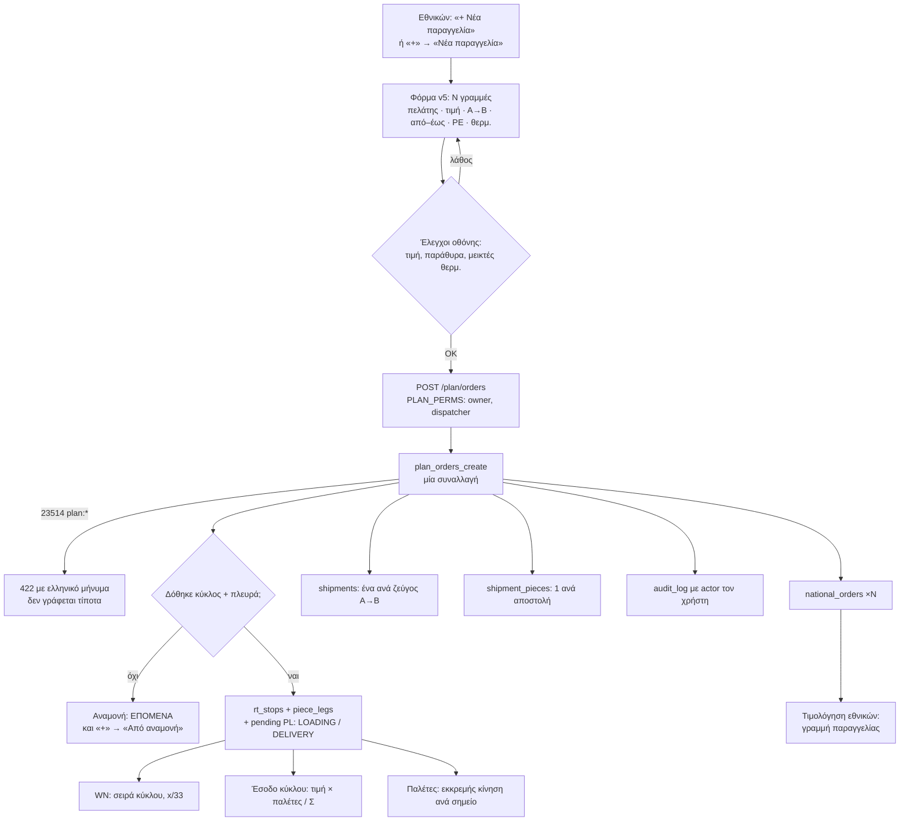

**Κενά / αντιφάσεις**
1. **Τι γράφεται ακόμη στο `national_orders`.** Το `tech.md` (Φ1, αρχιτεκτονική §3) το θέλει «καθαρά εμπορικό». Όμως η τιμολόγηση, η λίστα Παραγγελίες › Εβδομάδα v4, η καρτέλα πελάτη και το CEO dashboard διαβάζουν από εκεί ημερομηνίες φόρτωσης/παράδοσης, κατεύθυνση και παλέτες μέσω facade. Αν το `plan_orders_create` δεν τα γράφει, αυτές οι οθόνες δείχνουν κενά ή 0. Αν τα γράφει, υπάρχει δεύτερη πηγή δίπλα στα `shipments` (αρχή 3). Δεν ορίζεται πουθενά.
2. **Βέροια ως Α ή Β.** Το `tech.md` έχει άρνηση `hub_endpoint` στο `plan_orders_create` και τον φρουρό `plan_chk_hub` («ο κόμβος δεν είναι ποτέ origin/dest», Ρ15). Το `main.md` §5 λέει ότι η Βέροια είναι κανονικός τόπος: είναι το Β στην ΑΝΟΔΟ, και οι άδειες παλέτες από τη Βέροια είναι εθνική παραγγελία 1 € (Α = Βέροια). Με το σημερινό `tech.md`, η φόρμα της Lyra («Veria · Βέροια Cross-Dock») και η «+ Άδειες παλέτες · 1 €» παίρνουν 422.
3. **Groupage με N σημεία φόρτωσης × M παραδόσεις.** «Μία αποστολή ανά ζεύγος σημείων» δεν λέει πόσες παλέτες έχει κάθε ζεύγος όταν και τα δύο είναι >1 (π.χ. Orion Θεσ/νίκη 10π + Kronos 8π → Rentis 12π + Nostos 6π). Η φόρμα `2011:9624` δείχνει παλέτες ανά σημείο, όχι ανά ζεύγος. Χρειάζεται κανόνας φόρμας: μία γραμμή = ένα ζεύγος.
4. **Τιμή υποχρεωτική** στο σχέδιο (e, f), αλλά στις αρνήσεις του `plan_orders_create` υπάρχουν μόνο `no_client`, `no_window`, `hub_endpoint`. Λείπει `no_price` στη βάση (αρχή 4). Αλλιώς μια κλήση χωρίς οθόνη γράφει εθνική χωρίς τιμή (K9.2).
5. **Μεικτές θερμοκρασίες.** Ο B-87 χτυπά σε «> 2 °C διαφορά». Το παράδειγμα του σχεδίου (Δ9) είναι +2 και +4, δηλαδή διαφορά ακριβώς 2: ο έλεγχος δεν θα χτυπούσε. Θέλει «≥ 2» ή ρητό κατώφλι.
6. **Παράκαμψη μέσω facade.** Η παλιά φόρμα φεύγει την ημέρα L, αλλά το `national_orders` μένει στο `TABLES` (NATIONAL ORDERS) με POST/PATCH/DELETE για τον dispatcher. Οποιαδήποτε άλλη διαδρομή (το AI chat, η «Επαναφορά» του Audit Trail, μια ξεχασμένη κλήση) γράφει εθνική χωρίς αποστολές, που δεν εμφανίζεται πουθενά στο WN. Χωρίς φρουρούς παγώματος, χρειάζεται τουλάχιστον έλεγχος B-xx «εθνική χωρίς αποστολή μετά το L», ή αφαίρεση του POST από τον ρόλο στο facade.
7. **Ονόματα.** Το `design.md` γράφει `plan_order_create` ×N και `plan_put_group`· το `tech.md` έχει ένα `plan_orders_create(p jsonb)` και `plan_put_pieces`. Ένα όνομα για κάθε πράξη, πριν γραφτούν τα contract tests.

---

## 2. VS από τη διεθνή → γέφυρα → εθνικό σκέλος (και αλλαγή ή διαγραφή από τον διεθνών)

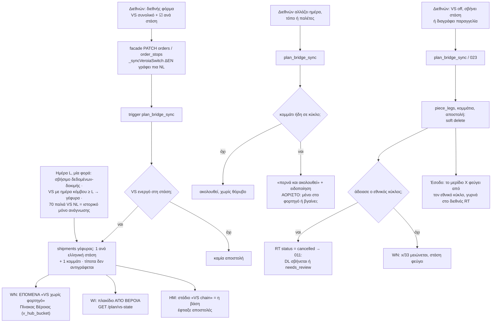

**Κενά / αντιφάσεις**
1. **«Ακολουθεί» αντί για 422.** Το `main.md` §5 (VS): η αλλαγή του διεθνών **περνά**, ο εθνικών ειδοποιείται, δεν απορρίπτεται. Το `tech.md` Φ5 έχει ακόμη `plan:piece_planned` (VS off με κομμάτι σε RT), `plan:bridge_moved` (αλλαγή τόπου με κίνηση) και `plan:bridge_split` (αλλαγή παλετών σε σπασμένο). Το ίδιο το `design.md` (j) γράφει «άρνηση `plan:piece_planned` (O2.2)». Και τα τρία πρέπει να αντικατασταθούν από κανόνες «ακολουθεί».
2. **Τι σημαίνει «ακολουθεί» όταν ο κύκλος έχει και άλλα φορτία.** Ο διεθνών μεταθέτει το VS-118 από Δευ σε Τρί, ενώ το κομμάτι του είναι στο ΚΖΗ 2106 της Δευτέρας μαζί με δύο εθνικές. Δεν ορίζεται αν η κίνηση σβήνεται και το κομμάτι γυρνά σε αναμονή της Τρίτης, αν μετακινείται όλος ο κύκλος, ή αν μένει με ένδειξη «ημέρα VS ≠ ημέρα φορτηγού». **Ερώτηση 1.**
3. **Δύο ώρες για την ίδια παράδοση VS.** Η γέφυρα δεν αντιγράφει τίποτα (το παράθυρο της αποστολής = `order_stops.datetime`), αλλά η στάση του κύκλου έχει δικό της `rt_stops.planned_from/to`. Όταν ο διεθνών αλλάζει το `order_stops.datetime`, δεν λέγεται αν μετακινείται η `rt_stops`. Αν μετακινηθεί, ο φρουρός `plan_chk_stop_seq` («το `planned_from` δεν μειώνεται με το `seq`») μπορεί να ρίξει τη **διεθνή** αποθήκευση με 422, ακριβώς αυτό που το §5 λέει ότι δεν γίνεται.
4. **Δήλωση κόμβου ανά στάση** (απόφαση 19/10, `main.md` §5). Στο `tech.md` ο trigger ακούει μόνο `orders.veroia_switch` και φτιάχνει αποστολή για **κάθε** ελληνική στάση. Δεν υπάρχει στήλη ανά στάση (π.χ. `order_stops.via_hub`) στο DDL της Φ1, ούτε η νέα στήλη checkbox της `orders_intl.js` σε κάποια φάση. Η απόφαση 4 του `tech.md` εμφανίζεται ακόμη «ανοιχτή».
5. **Ειδοποίηση «αμέσως».** Το §5 θέλει ο άλλος να ειδοποιείται. Το `tech.md` έχει μόνο ελέγχους B-xx του 048, ωριαίους. Δεν ορίζεται κανάλι (στοιχείο στα ΕΠΟΜΕΝΑ, σήμανση στην κάρτα, εγγραφή στο `audit_log` που διαβάζει το WN).
6. **Διαγραφή από τον διεθνών με παραστατικά του εθνικού κύκλου.** Αν η διαγραφή της διεθνούς αδειάσει εθνικό κύκλο με μισθοδοσία με ποσό ή γραμμές DKV, ο κανόνας «λίστα παραστατικών + επιβεβαίωση» (§5) δεν έχει πού να εμφανιστεί: το `delete_order_cascade` (`index.js:3367-3400`) δεν έχει dry-run με τις εθνικές συνέπειες.
7. **Η μετατροπή της ημέρας L.** «VS με ημέρα κόμβου ≥ L πάνε στο νέο μοντέλο» σημαίνει ότι, για αυτά, τα υπάρχοντα Direct NL πρέπει να βγουν από τη μέση **στην ίδια συναλλαγή** με τη δημιουργία της γέφυρας. Αλλιώς το X μετριέται δύο φορές: ο κλάδος 034/057 του `ct_v_rt_revenue` διαβάζει το Direct NL και ο νέος κλάδος διαβάζει τα κομμάτια (κίνδυνος 2 της αρχιτεκτονικής). Το `tech.md` δεν έχει αυτό το βήμα: η Φ5 προϋπέθετε συνύπαρξη και αμοιβαία αποκλειστικότητα (`plan:legacy_nl`). Η μέτρηση B-84 (Direct NL + αποστολές = 0) μένει χρήσιμη ως απόδειξη της μετατροπής.
8. **Χωρίς φρουρό παγώματος, πώς ακούγεται μια ξεχασμένη εγγραφή NL;** Το `orders_intl.js` έχει 61 αναφορές σε NL/GL/CL, το `core/order-sync.js` 13, και τα 028/030/069 μετακινούν ακόμη ημερομηνίες NL. Αν μία διαδρομή ξεχαστεί, γράφει NL για VS μετά το L, και ο δεύτερος δρόμος δεν τον βλέπει κανείς (αρχή 1). Πρόταση χωρίς χωρισμό κατά W: ένα **απόλυτο** BEFORE INSERT που αρνείται κάθε νέο NL/GL/CL από το L και μετά, ή τουλάχιστον έλεγχος B-xx «νέα NL/GL/CL μετά το L = 0». Η απόφαση «καθόλου φρουροί» αφορά τους φρουρούς κατά ημέρα· αυτό πρέπει να επιβεβαιωθεί.
9. **Το ιστορικό των 70 VS NL.** Το παλιό board φεύγει την ημέρα L. Τα πλακίδια του WI για παλιές εβδομάδες διαβάζουν σήμερα `nlBySrc` (`weekly_intl.js:710-741`). Αν το WI διαβάζει μόνο `/plan/vs-state`, οι παλιές εβδομάδες δείχνουν «χωρίς εθνικό» για VS που έγιναν. Αν διαβάζει και NL, αυτό είναι αναγνώστης δύο μοντέλων, όχι κατά W αλλά κατά παραγγελία («έχει γέφυρα;»). Πρέπει να γραφτεί ποιο από τα δύο, και πού αλλού βλέπει κανείς αυτό το ιστορικό.
10. **`cross_dock_date` κενό.** Ο trigger φτιάχνει γέφυρα για ημέρα κόμβου ≥ L. Με κενό `cross_dock_date` (ισχύει ακόμη η εκτίμηση, και το 028 εκκρεμεί) δεν ορίζεται αν χρησιμοποιείται η εκτίμηση (εισαγωγή = παράδοση − 1). Αλλιώς το VS μένει χωρίς γέφυρα και το μαθαίνουμε μόνο από τον B-83.
11. **Η 1 ομάδα GL των δοκιμών.** «Τα GROUPAGE LINES δεν σβήνονται ποτέ» και η βάση το επιβάλλει με `ON DELETE RESTRICT`. Το σβήσιμο των δεδομένων-δοκιμής πρέπει να πει τι γίνεται με αυτές τις γραμμές (soft delete; `Status='Unassigned'`;). Αλλιώς η εντολή της ημέρας L αποτυγχάνει ή παραβιάζει τον κανόνα.

---

## 3. Ανάθεση (δικό φορτηγό · συνεργάτης · ένωση με υπάρχοντα κύκλο)

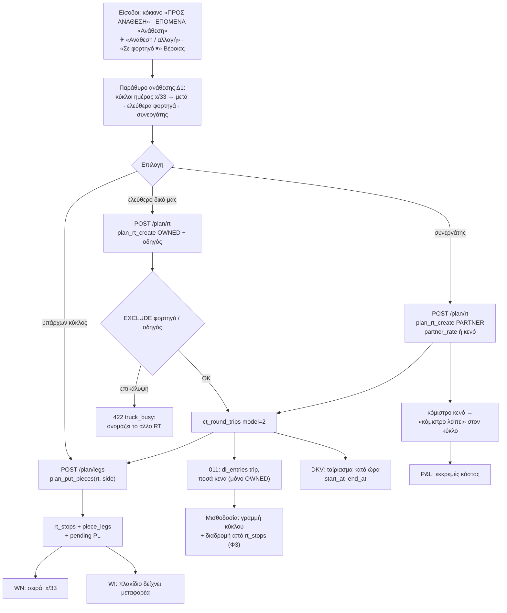

**Κενά / αντιφάσεις**
1. **VS σε φορτηγό άλλης ημέρας.** Το `tech.md` (`plan_put_pieces`, `vs_hub_day`) το αφήνει με προειδοποίηση. Τότε η ημέρα VS της διεθνούς (μία πηγή, §5) λέει Δευτέρα ενώ το κομμάτι φεύγει Τρίτη: δύο αλήθειες. Δεν ορίζεται αν η ανάθεση γράφει και την ημέρα VS (μέσω `plan_vs_set_day`, «ενημερώνει τη διεθνή #…»). **Ερώτηση 3.**
2. **Σειρά εγγραφών στο `plan_rt_create`.** Το CHECK `rt_v2_window` θέλει `start_at` ήδη στο INSERT, ενώ τα `start_at/end_at` τα γράφει ο `rt_v2_window_sync` μετά, από τις `rt_stops`. Επιπλέον το 011 (`011:181-186`) γράφει τη γραμμή DL στο INSERT του RT με `entry_date = new.date_start`, που τη στιγμή εκείνη είναι κενό. Χρειάζεται ρητή σειρά: προσωρινά παράθυρα στο INSERT, ή στάσεις πριν από τον οδηγό.
3. **Προεπιλεγμένο τέλος κύκλου.** Το `plan_rt_create` γράφει «H Δευ 18:00 … H Τετ 07:00». Δεν ορίζεται από πού βγαίνει το τέλος για κύκλο Θεσσαλονίκης αυθημερόν ή Πάτρας τριών ημερών. Αυτό ορίζει ποιο φορτηγό φαίνεται «ελεύθερο», το EXCLUDE, τις ημέρες της μισθοδοσίας και το ταίριασμα DKV.
4. **Συνεργάτης χωρίς `partner_assignments`.** Ο κύκλος PARTNER δεν γράφει PA. Δεν ελέγχθηκε ποιες οθόνες διαβάζουν σήμερα το PA για εθνικό συνεργάτη (κάρτα συνεργάτη, παλέτες συνεργάτη, μήνυμα WhatsApp). Αν το διαβάζουν, δείχνουν σιωπηλά «καμία ανάθεση».
5. **«Κόμιστρο λείπει»** (owner 21/10) δεν έχει έλεγχο ούτε σήμανση στο `tech.md`. Λείπει ένα B-xx «PARTNER `model=2` με κενό `partner_rate`» και η ένδειξη στη σειρά του WN.
6. **Χωρητικότητα x/33** με κιβώτια IFCO: η στήλη `qty_unit` (PALLET/CRATE) υπάρχει, αλλά δεν λέγεται αν τα CRATE μετρούν στο 33.

---

## 4. «+» από αναμονή και από απόθεμα (και μερικό απόθεμα)

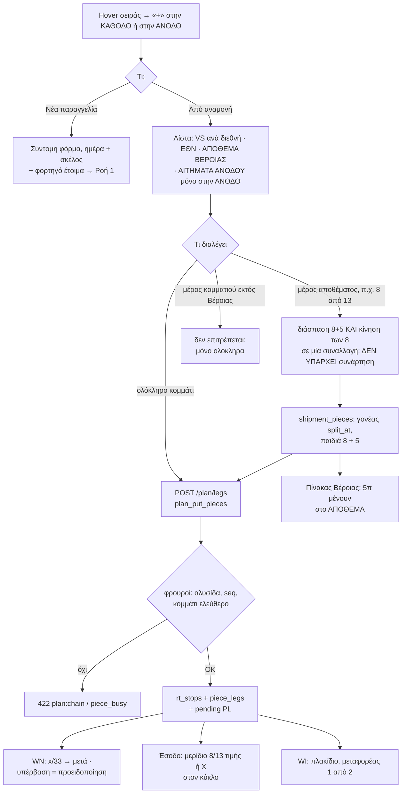

**Κενά / αντιφάσεις**
1. **Το μερικό «+» (owner 21/10) σπάει τέσσερα σημεία:** το `tech.md` (`plan_put_pieces` αρνείται `piece_split`, η Φ4 γράφει «το "πόσες από" φεύγει από το "Από αναμονή"», και το rig `veroia-board-rig.js` ελέγχει «άρνηση εκτός Βέροιας»)· το `design.md` (f: «Να φύγει η ποσότητα», §3 «+»: «ολόκληρα κομμάτια… χωρίς ποσότητα», §3 Σπάσιμο: «Καμία ποσότητα στο +»)· και το ίδιο το `main.md` §5 Οθόνη («Κομμάτι σπάει μόνο στον Πίνακα Βέροιας»), που διαφωνεί με το §5 Μοντέλο. Χρειάζεται μία πράξη split+put σε μία συναλλαγή (π.χ. `plan_put_pieces` με `p_take_pallets`, μόνο για κομμάτι στη Βέροια).
2. **Τι είναι «απόθεμα που βρίσκεται ήδη στη Βέροια».** Η `v_piece_state.at_hub` είναι αληθής και για γέφυρα εισαγωγής **χωρίς** κίνηση, δηλαδή και για το VS που φτάνει σήμερα στις 14:00. Χωρίς «Φορτώθηκε» ή γεγονός άφιξης, η βάση δεν ξεχωρίζει «έφτασε» από «θα φτάσει». **Ερώτηση 5.**
3. **«ΑΠΟΘΕΜΑ ΒΕΡΟΙΑΣ» στο «+»:** το `design.md` (f) το έχει ακόμη ως «θέλει επιβεβαίωση owner» και ο κανόνας 5 του `2011:7737` λέει «απόθεμα μόνο στον Πίνακα Βέροιας». Απαντήθηκε 21/10 (ναι, και από το «+»)· ο κανόνας 5 του Figma πρέπει να αλλάξει.
4. **`leave_by` του υπολοίπου.** Τα 5π που μένουν δεν λέγεται αν κληρονομούν το `leave_by` του γονέα ή αν ζητείται νέο.

---

## 5. Σπάσιμο στη Βέροια και «μένει στη Βέροια»

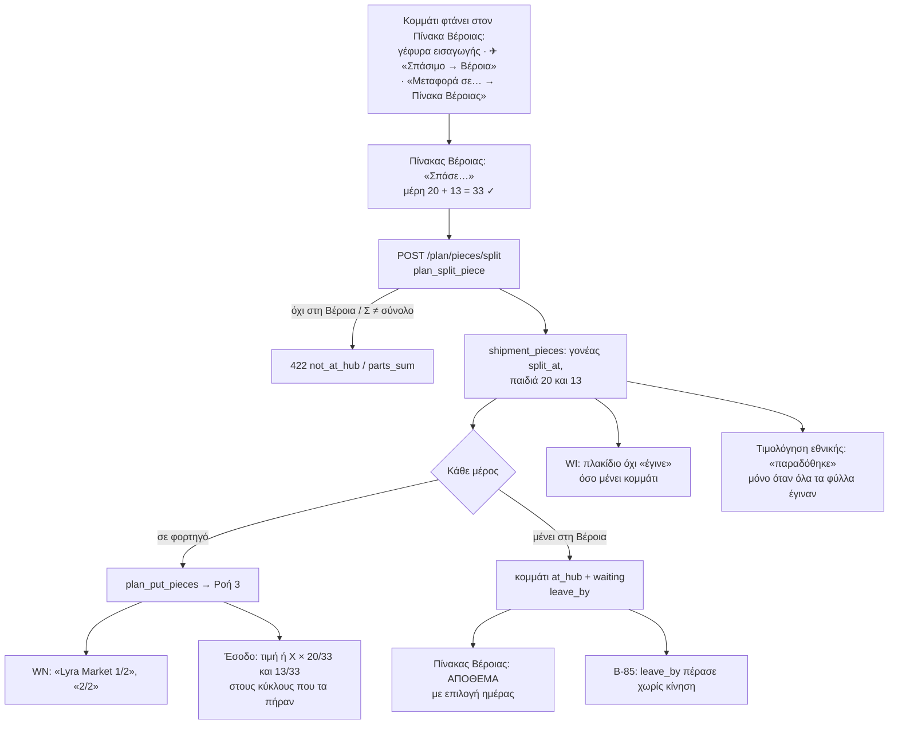

**Κενά / αντιφάσεις**
1. **Ποια είναι η ημέρα VS όταν τα κομμάτια φεύγουν σε δύο ημέρες** (20 τη Δευτέρα, 13 την Τετάρτη). Ήταν ανοιχτό στις 18/10 (Εθνικά Ερ. 6) και δεν απαντήθηκε. Συγκρούεται με το «μία ημέρα VS, πηγή η διεθνής»: αν η μετακίνηση των 13 στην Τετάρτη περάσει από `plan_vs_set_day`, μετακινεί και τα 20 της Δευτέρας. **Ερώτηση 4.**
2. **Αλλαγή παλετών σε σπασμένο VS.** Ο διεθνών κάνει τις 33 → 30 ενώ 20 έχουν φύγει και 13 είναι απόθεμα. Το `tech.md` απαντά `bridge_split` (άρνηση), το §5 θέλει «περνά». Δεν ορίζεται ποιο κομμάτι μικραίνει. Το ίδιο για «φορτώθηκαν 18 από τα 20» (§5: «απλώς διορθώνει την παραγγελία»): το `plan_order_update` αρνείται `split_piece`, και για VS αρνείται `vs_locked`, άρα η διόρθωση δεν έχει δρόμο. **Ερώτηση 6.**
3. **«Μεταφορά σε… → Στον Πίνακα Βέροιας»** για εθνική που δεν περνά από τη Βέροια (Θεσ/νίκη → Αθήνα): το κομμάτι δεν είναι `at_hub`, άρα το «Σπάσε» δίνει `not_at_hub`. Δεν ορίζεται αν η επιλογή κρύβεται ή αν προσθέτει κίνηση προς τη Βέροια.
4. **Τιμολόγηση της διεθνούς VS.** Η διεθνής γίνεται τιμολογήσιμη όταν γραφτεί Delivered από άνθρωπο στο ΗΜ (Χ3). Με 13π απόθεμα ως την Τετάρτη, το ΗΜ μπορεί να γράψει Delivered τη Δευτέρα. Το `tech.md` ορίζει μόνο το «παραδόθηκε» της **εθνικής** (`v_national_order_state`). **Ερώτηση 7.**
5. **`plan_put_piece` / `plan_put_group`** του `design.md` (b, §3) δεν υπάρχουν στο `tech.md` (υπάρχει μόνο `plan_put_pieces`).

---

## 6. «Μεταφορά σε…»

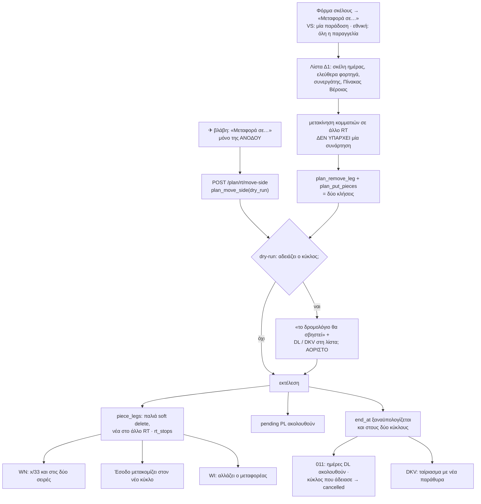

**Κενά / αντιφάσεις**
1. **Η μεταφορά ανά γραμμή δεν είναι μία πράξη.** Το `tech.md` έχει μόνο `plan_move_side` (όλη η πλευρά). Η μεταφορά μίας παράδοσης ή μίας παραγγελίας γίνεται `plan_remove_leg` + `plan_put_pieces`, δηλαδή δύο συναλλαγές. Αυτό παραβιάζει τον κανόνα 3 του `tech.md` («μία πράξη = μία συνάρτηση = μία συναλλαγή»): αν η δεύτερη πέσει με 422, το κομμάτι μένει σε αναμονή και ο κύκλος ίσως έχει ήδη σβηστεί. Χρειάζεται `plan_move_pieces(from, to, pieces, dry_run, token)`.
2. **Ο κύκλος που αδειάζει.** Το `plan_remove_leg` έχει `dry_run`, όχι όμως token ούτε λίστα παραστατικών, ενώ μπορεί να σβήσει κύκλο με μισθοδοσία ή DKV. Το §5 θέλει λίστα και επιβεβαίωση όταν υπάρχουν παραστατικά.
3. **Βλάβη στη μέση της ΚΑΘΟΔΟΥ** (μετά την 1η από 3 παραδόσεις): ο owner απάντησε μόνο για την ΑΝΟΔΟ. Η μετακίνηση των υπολοίπων στάσεων της ΚΑΘΟΔΟΥ γίνεται ανά γραμμή, με τα προβλήματα του 1.
4. **Επιβεβαιωμένες κινήσεις παλετών** μετά από μεταφορά-διόρθωση: το §5 (20/10) λέει «ακολουθούν», το `tech.md` μετακινεί μόνο τις pending. Οι confirmed θέλουν αντιλογισμό και νέα γραμμή, και αυτό δεν περιγράφεται.

---

## 7. Αλλαγή ημερομηνίας (σκέλους · μίας παράδοσης · VS)

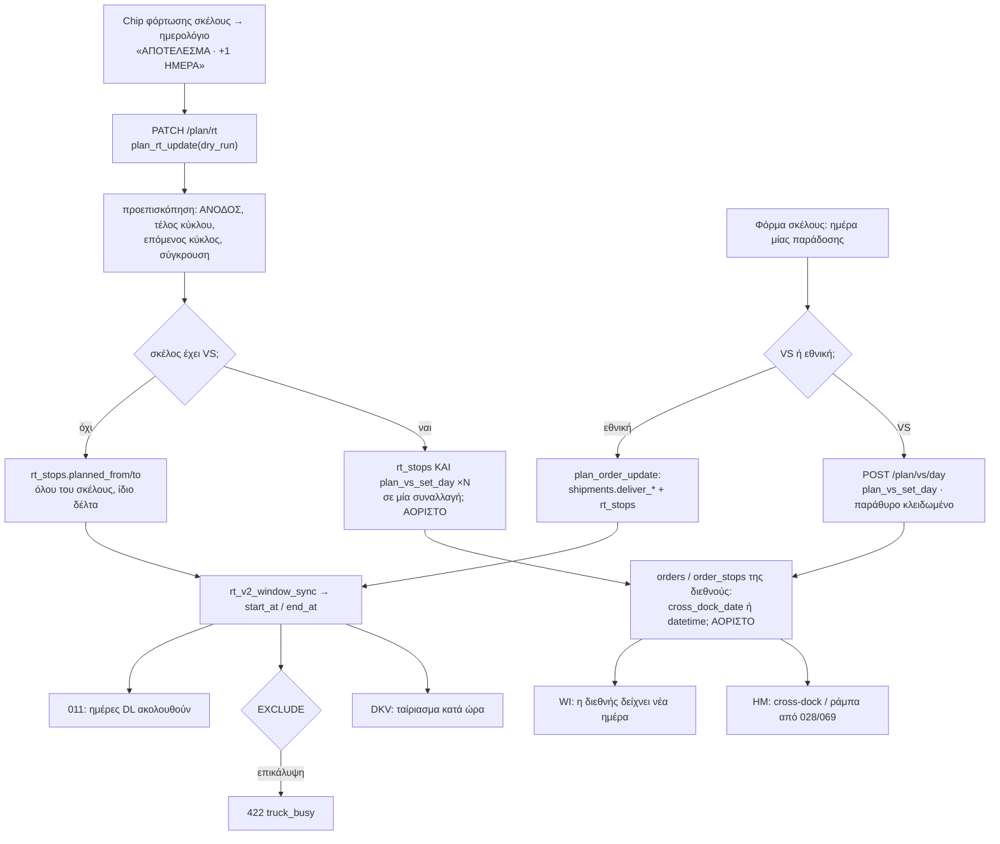

**Κενά / αντιφάσεις**
1. **Ποιο πεδίο της διεθνούς γράφει το `plan_vs_set_day(order_stop_id, day)`.** Η «ημέρα VS» είναι ανά παραγγελία (`orders.cross_dock_date`), ενώ η συνάρτηση παίρνει στάση. Το `design.md` (c) λέει «γράφει μόνο το `order_stops`». Αν γράφει `order_stops.datetime`, αλλάζει η συμφωνημένη ημέρα παράδοσης του πελάτη· αν γράφει `cross_dock_date`, μετακινεί όλες τις στάσεις της παραγγελίας.
2. **Σκέλος με VS και εθνικές μαζί:** η μετακίνηση της ΚΑΘΟΔΟΥ πρέπει να γράψει και τη διεθνή κάθε VS του σκέλους. Δεν υπάρχει συνάρτηση που να κάνει `rt_stops` + N VS σε μία συναλλαγή.
3. **«Μετά τη Βέροια, αλλαγή ημέρας ή προορισμού κάνει όποιος το μάθει πρώτος»** (§5). Ο εθνικών μπορεί να αλλάξει την ημέρα (`plan_vs_set_day`) αλλά όχι τον **προορισμό**: το `plan_order_update` αρνείται κάθε αλλαγή σε γέφυρα (`vs_locked`). Λείπει δρόμος για τον προορισμό.
4. **Κινήσεις παλετών:** τα pending PL ακολουθούν στο `plan_put_pieces`, `plan_move_side` και `plan_remove_leg`, όχι στο `plan_rt_update`. Μετά από αλλαγή ημέρας, η εκκρεμής LOADING/DELIVERY μένει στην παλιά ημερομηνία.
5. **Ονόματα στηλών:** το `design.md` (c, §3) γράφει `rt_stops.planned_at`· το `tech.md` έχει `planned_from`/`planned_to`.

---

## 8. Καθαρισμός ανάθεσης

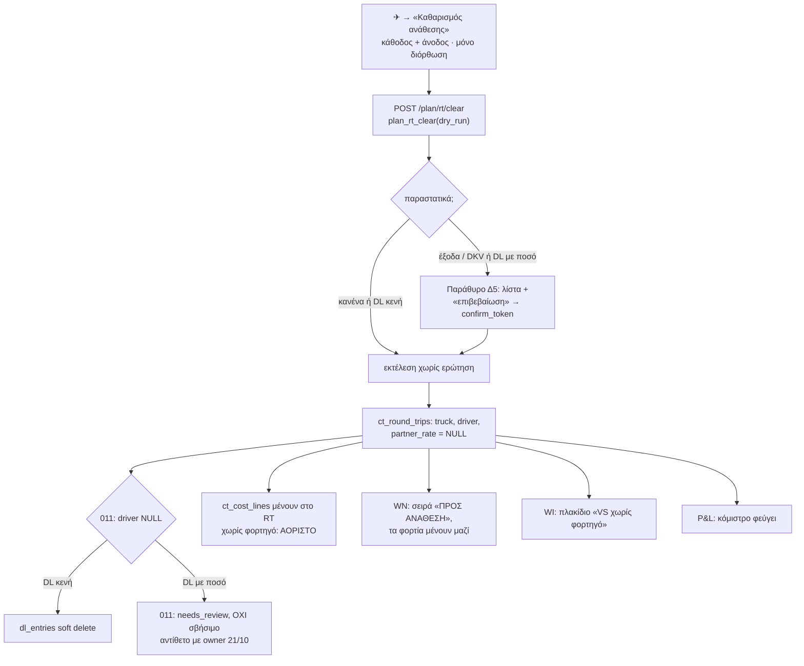

**Κενά / αντιφάσεις**
1. **Μισθοδοσία με ποσό.** Owner 21/10: ειδοποίηση, επιβεβαίωση, και η γραμμή σβήνεται. Το 011 (`011:166-178`), που το `tech.md` αφήνει «χωρίς αλλαγή», όταν ο οδηγός γίνεται NULL και υπάρχουν ποσά βάζει `needs_review` και **δεν** σβήνει. Το `plan_rt_clear` πρέπει να σβήνει ρητά τη γραμμή μετά το token, αλλιώς μένει γραμμή μισθοδοσίας σε κύκλο που «δεν έγινε».
2. **Τα έξοδα / DKV του κύκλου μετά την επιβεβαίωση:** δεν λέγεται αν αποσυνδέονται (`rt_id = NULL`, ώστε να βγει «λείπει δρομολόγιο») ή μένουν σε κύκλο χωρίς φορτηγό. Ο B-81 πιάνει «RT `cancelled`/σβησμένο», όχι «RT χωρίς φορτηγό», άρα στη δεύτερη περίπτωση σιωπή.
3. **Ο Δ5 είναι ακόμη «πρόταση· θέλει ναι»** στο `design.md` (§2), και το `tech.md` (`plan_rt_clear`) έχει μόνο `stale_confirm`. Η απάντηση της 21/10 (λίστα για έξοδα και για DL με ποσό) κλείνει το θέμα: ο Δ5 περνά από «πρόταση» σε «αποφασισμένο».
4. **Τοπική φόρτωση του κύκλου** (Ροή 10): δεν λέγεται τι παθαίνει όταν ο κύκλος χάνει το φορτηγό.

---

## 9. Διαγραφή παραγγελίας με παραστατικά

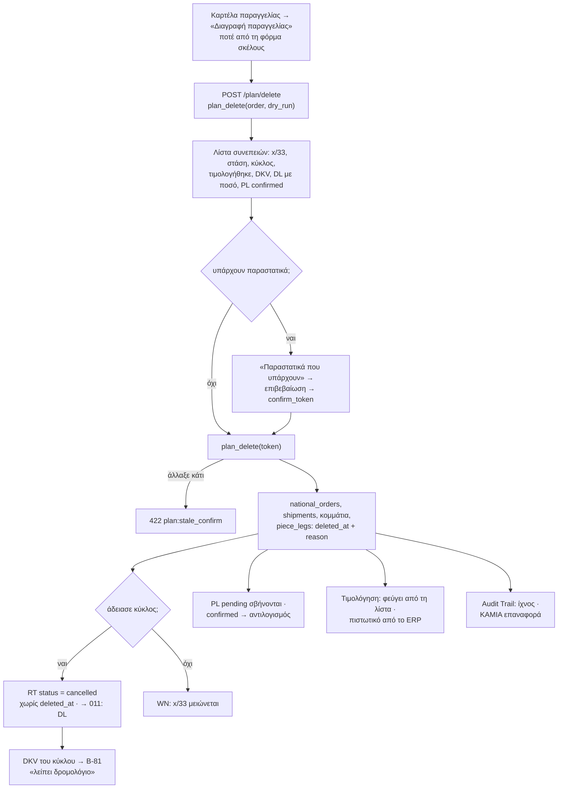

**Κενά / αντιφάσεις**
1. **Δεν υπάρχει επαναφορά (owner 21/10), αλλά τα κείμενα την έχουν ακόμη:** στο `tech.md`, η γραμμή `plan_restore` και η σημείωση για `deleted_batch uuid` (Φ2), το `restore` στο `PLAN_PERMS`, η γραμμή 30 του §0 («το 7ήμερο restore του v5 = `plan_restore`»), η απόφαση 7, και «Το restore μετά τις 7 ημέρες: απόφαση 7». Στο `design.md`: (g) «Διαγραμμένα · 7 ημέρες… ΕΠΑΝΑΦΟΡΑ», «Επαναφορά: γυρνά στην αναμονή», η αντίφαση με το Β10, το Δ13(α), το Δ12 «κενά Διαγραμμένα» και η §3 Διαγραφή «Μαλακή διαγραφή, Διαγραμμένα 7 ημέρες… Επαναφορά».
2. **Η παλιά «Επαναφορά» του Audit Trail** (`core/api.js:1360-1448`) ξαναδημιουργεί εγγραφή με `atCreate`. Για ένα `national_orders` που σβήστηκε στο v5 θα έφτιαχνε, μέσω facade, εθνική **χωρίς αποστολές**: αόρατη στο WN, ορατή στην τιμολόγηση. Πρέπει να κλείσει ρητά για εθνικές με αποστολές.
3. **Facade DELETE στο `national_orders`.** Ένα soft delete από άλλη οθόνη (π.χ. η παλιά φόρμα) αφήνει ζωντανά τα `shipments` και τα `piece_legs`. Για τη γέφυρα υπάρχει trigger στο `orders.deleted_at` (Φ5)· για το `national_orders` όχι.
4. **Μισθοδοσία σε κύκλο που σβήνεται:** ίδιο θέμα με τη Ροή 8. Το 011 σε `cancelled` με ποσά βάζει `needs_review`, ενώ το §5 λέει «σβήνεται». Επιπλέον, αν η γραμμή έχει **ήδη πληρωθεί**, το σβήσιμο αλλάζει αναδρομικά το υπόλοιπο του οδηγού (δεν βρέθηκε κλείδωμα περιόδου στα migrations). **Ερώτηση 9.**
5. **«Σβησμένος κύκλος» = μόνο `status='cancelled'`.** Το `ct_round_trips` δεν έχει `deleted_at` (μέτρηση 21/10). Το `tech.md` Φ1 προσθέτει `deleted_at/deleted_reason/deleted_by` και τον CHECK `rt_deleted_pair`, και το §0 γράφει «`status='cancelled'` + `deleted_at`». Αυτό θα έδινε δύο σημάδια για το ίδιο γεγονός (αρχή 3), και όλοι οι σημερινοί αναγνώστες RT (011, 046, `/costs/rt`, B-81, ελεγκτές) κοιτάζουν μόνο το `status`. Πρόταση: μόνο `status='cancelled'`, και ο λόγος / ποιος στο `audit_log`. Αν χρειαστεί στήλη λόγου, μία `cancel_reason` χωρίς δεύτερη σημαία.
6. **Το `design.md` (g)** γράφει ότι η διαγραφή χωρίς παραστατικά «σβήνει την τοπική φόρτωση» και ότι «η μισθοδοσία δεν αλλάζει · ο κύκλος μένει». Το δεύτερο ισχύει μόνο αν ο κύκλος έχει κι άλλο φορτίο, και πρέπει να γραφτεί έτσι.

---

## 10. Φόρτωση με τοπικό (✈ → «Φόρτωση με τοπικό»)

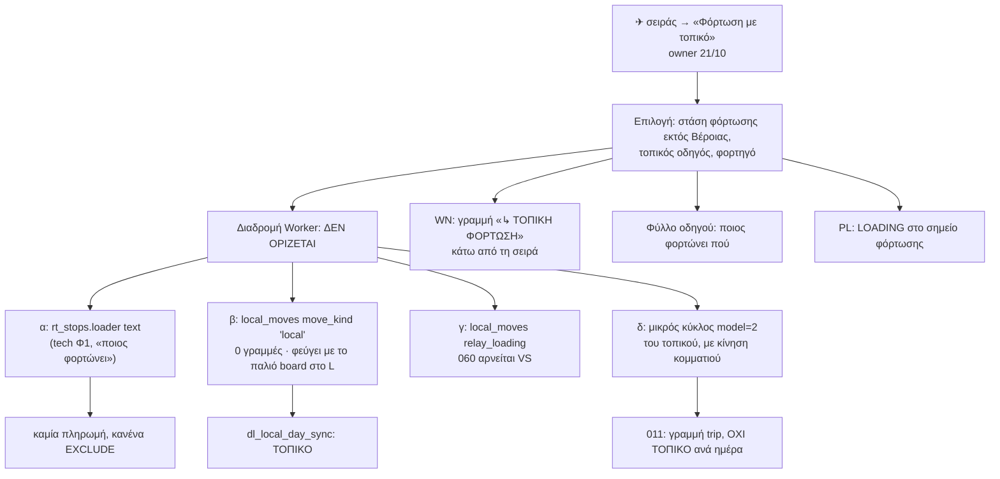

**Κενά / αντιφάσεις**
1. **Η ροή δεν έχει μοντέλο δεδομένων.** Ο owner όρισε την είσοδο (✈ → «Φόρτωση με τοπικό», `main.md` §5), αλλά τίποτα από τα τέσσερα υπάρχοντα δεν ταιριάζει: το `rt_stops.loader` είναι σκέτο κείμενο χωρίς πληρωμή· το `local_moves 'local'` έχει 0 γραμμές και η οθόνη του φεύγει με το παλιό board την ημέρα L (το `tech.md` Φ5.7 έλεγε «παγώνει ≥ W»)· το relay του 060 αρνείται VS· ένας κύκλος `model=2` γεννά γραμμή μισθοδοσίας **trip** (230 € τύπου κύκλου), ενώ η τοπική κίνηση πληρώνεται ΤΟΠΙΚΟ ανά ημέρα (owner 5/10, Χ9). **Ερώτηση 2.**
2. **Πού πάει το φορτίο του τοπικού.** Στο T2 (14/10) ο τοπικός προφορτώνει τη Σκύδρα την προηγούμενη μέρα και φέρνει στη Βέροια. Στο Figma (σειρά 3) ο Karras με ΚΖΗ 2111 φορτώνει για το Sigma Market. Αν φέρνει στη Βέροια, το κομμάτι έχει δύο κινήσεις (σημείο → Βέροια → προορισμός) και περνά από τον Πίνακα Βέροιας. Αν φορτώνει απευθείας το φορτηγό του κύκλου, είναι απλώς ένδειξη στη στάση.
3. **Υπόλοιπα του «ποιος φορτώνει».** Αφού δεν υπάρχει υποχρεωτικό πεδίο (21/10), πρέπει να φύγουν: ο B-88 (`tech.md` Φ5), η απόφαση 8 και η στήλη `rt_stops.loader` «(Α10, open decision 8)», αν δεν αξιοποιηθεί εδώ· στο `design.md`: (e) «Ποιος φορτώνει για κάθε σημείο φόρτωσης», (i) «με ποιος φορτώνει», Δ10 «"ποιος φορτώνει"», και η γραμμή ↳ ΤΟΠΙΚΗ ΦΟΡΤΩΣΗ «θέλει απόφαση (Δ11)».
4. **Το φορτηγό του τοπικού** (ΚΖΗ 2111) πρέπει να φαίνεται απασχολημένο εκείνη την ώρα. Χωρίς κύκλο, το EXCLUDE δεν το βλέπει και το παράθυρο ανάθεσης το δείχνει ελεύθερο.

---

## 11. Εκτέλεση με το ρολόι (σβήσιμο, «παραδόθηκε», πλακίδια WI)

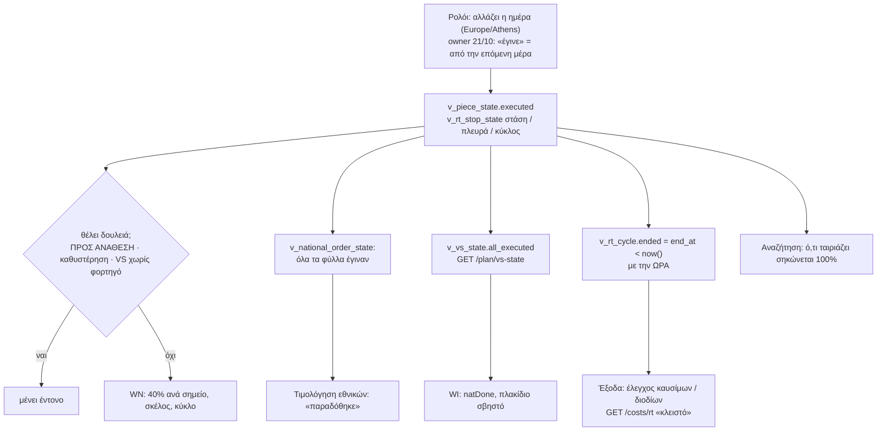

**Κενά / αντιφάσεις**
1. **Ημέρα, όχι ώρα (owner 21/10), σε όλα τα κείμενα που λένε ώρα:** στο `tech.md`, `v_piece_state.executed = national_end_at < now()` και `v_rt_stop_state` «στάση: `executed` = `planned_to < now()`», η απόφαση 2 («τέλος παραθύρου», ακόμη ανοιχτή) και το «για v5: `done` = `executed` (η ώρα πέρασε)» της Φ5. Στο `design.md`: (k) «έγινε = πέρασε η ώρα της στάσης», το «κάθε σημείο μόνο του ανά `planned_at`», το «Να γραφτεί αν μετρά η ώρα πλάνου ή το τέλος του παραθύρου», και η §3 «Κάθε σημείο σβήνει μόνο του όταν περάσει η ώρα του». Σωστό: `(planned_to at time zone 'Europe/Athens')::date < current_date`, ορισμένο μία φορά.
2. **Δύο ορισμοί «τέλους».** Το `v_rt_cycle.ended` και το «κλειστό» του `GET /costs/rt` μένουν με την ώρα (`end_at < now()`), ενώ το σβήσιμο πάει με την ημέρα. Αν αυτό είναι σκόπιμο (ο έλεγχος καυσίμων θέλει ώρα), πρέπει να γραφτεί, αλλιώς διαβάζεται ως αντίφαση (αρχή 3).
3. **«Καθυστέρηση» χωρίς πηγή.** Το Figma δείχνει «εκτός ~3 ώρες» (`.wi4-delay`). Στα εθνικά δεν υπάρχει GPS ούτε γεγονός στάσης, και με κανόνα ημέρας μια στάση δεν «αργεί» μέσα στη μέρα. Το `tech.md` δεν ορίζει τη στήλη. Μάλλον σημαίνει `overdue` (`leave_by` πέρασε) ή «VS χωρίς φορτηγό με ημέρα που πέρασε»· πρέπει να γραφτεί.
4. **Το ΗΜ (Ημερήσιο) είναι μόνο για διεθνή** (`daily_ops.js:3`). Δεν δείχνει εθνικούς κύκλους, άρα δεν χρειάζεται αλλαγή εκτός από το στάδιο «VS chain» (Ροή 2). Η λίστα αναγνωστών του `tech.md` Φ4 δεν το αναφέρει καθόλου· καλό είναι να γραφτεί ρητά «ΗΜ: εκτός εθνικών v5, εκτός από το στάδιο VS».
5. **Ακυρωμένη στάση μέρας που πέρασε** (Α8 του 20/10): με soft delete δεν εμφανίζεται. Αρκεί μία γραμμή στον ορισμό: «σβησμένο ≠ εκτελεσμένο».

---

## 12. Μισθοδοσία, DKV, κόμιστρο και έσοδο ανά κύκλο

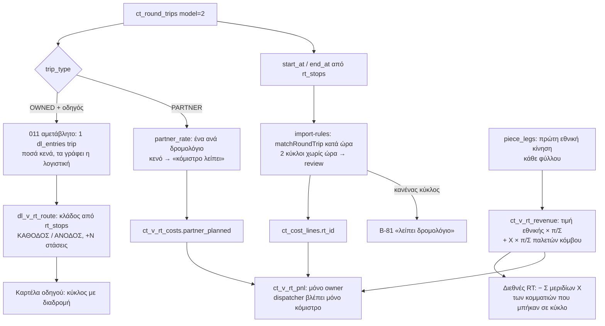

**Κενά / αντιφάσεις**
1. **Παρονομαστής του X.** Το `tech.md` Φ3 γράφει «με παρονομαστή μόνο `PALLET` (Β9)» και η απόφαση 5 «τα IFCO εκτός». Owner 21/10: καμία εξαίρεση ανά είδος· το «μόνο PALLET» αποσύρεται. Ο παρονομαστής = όλες οι παλέτες κόμβου της παραγγελίας.
2. **Η μισθοδοσία ξεκινά κενή** (owner 21/10). Στο `tech.md` πρέπει να φύγουν η απόφαση 6 («230 € προσυμπληρωμένα») και το «εκτός αν η απόφαση 6 πει…» της Φ3.5.
3. **Ο B-79 «Σ εσόδων RT της εβδομάδας = Σ τιμών της εβδομάδας» δεν θα είναι ποτέ 0.** Όσο υπάρχουν εθνικές σε αναμονή, απόθεμα που φεύγει την επόμενη εβδομάδα ή κομμάτια σε κύκλο άλλης εβδομάδας, το έσοδο δεν έχει μπει σε κανέναν κύκλο. Ο έλεγχος (και το κριτήριο αποδοχής της Φ5/Φ6 «ή αναφέρεται ή σταματάμε») θέλει «Σ εσόδων + Σ μη ανατεθειμένων = Σ τιμών», αλλιώς σταματά την κυκλοφορία την πρώτη μέρα.
4. **Ορατότητα κόμιστρου.** Owner 21/10: ο dispatcher βλέπει και γράφει το κόμιστρο, ως ρητή εξαίρεση στο «dispatcher δεν βλέπει κόστη» της 23/8. Η απόφαση 9 του `tech.md` είναι ακόμη «ανοιχτή». Χρειάζεται εγγραφή στο DECISION_LOG και στο `CLAUDE.md` («ΚΛΕΙΔΩΜΕΝΕΣ ΑΠΟΦΑΣΕΙΣ»), αλλιώς ένας επόμενος agent θα το «διορθώσει» ως διαρροή.
5. **Τοπικός οδηγός:** η γραμμή ΤΟΠΙΚΟ δεν έχει κλάδο στη Ροή 12 (βλ. Ροή 10).

---

## 13. Παλέτες

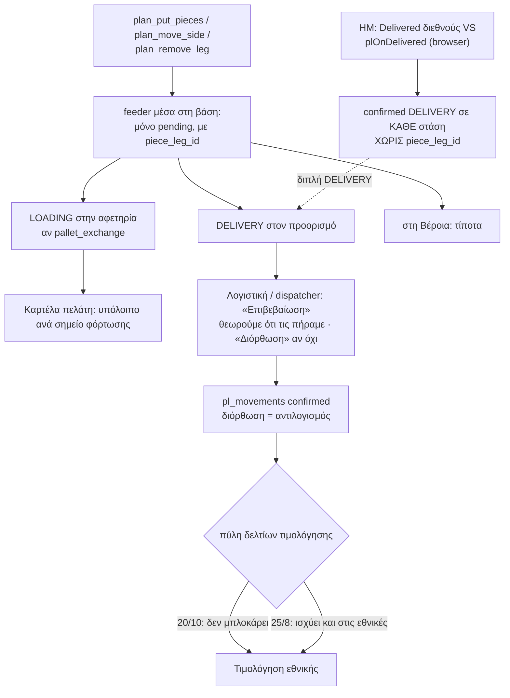

**Κενά / αντιφάσεις**
1. **Διπλή DELIVERY στις ελληνικές στάσεις VS.** Όταν το ΗΜ γράφει Delivered στη διεθνή, το `plOnDelivered` γράφει confirmed DELIVERY σε **κάθε** στάση εκφόρτωσης (Π6, 14/10), και τις ελληνικές που παρέδωσε το εθνικό φορτηγό. Ο feeder του v5 γράφει κι αυτός DELIVERY στον προορισμό. Ο `UNIQUE pl_mov_leg_once` του `tech.md` δεν το πιάνει, γιατί οι γραμμές του `plOnDelivered` δεν έχουν `piece_leg_id`. Το `tech.md` σταματά μόνο το `plOnOrderSaved` (`source:'natl'`), όχι το `plOnDelivered` για στάσεις γέφυρας.
2. **Επιβεβαίωση.** Το `tech.md` Φ3.4 γράφει «Confirmed κινήσεις: μόνο με δελτίο (Β7), ποτέ προσυμπληρωμένες», και το `design.md` (h) το έχει ως «ερώτηση owner». Ο owner απάντησε στις 18/10: θεωρούμε ότι τις πήραμε, ο χρήστης απλώς επιβεβαιώνει. Και τα δύο κείμενα πρέπει να ευθυγραμμιστούν.
3. **Πύλη δελτίων για εθνικές.** Το §5 (20/10): «το δελτίο παλετών δεν μπλοκάρει το τιμολόγιο». Ο κλειδωμένος κανόνας της 25/8 (Π4 του 14/10, μνήμη «ΠΟΤΕ cutoff») λέει ότι η πύλη ισχύει σε κάθε παραγγελία με PE, και στις εθνικές. Δεν είναι σαφές αν η 20/10 αλλάζει τον κανόνα μόνο για τις εθνικές v5 ή γενικά. **Ερώτηση 8.**
4. **Εθνικός συνεργάτης** = «διαφανής αγωγός, καμία εγγραφή συνεργάτη» (Π3). Ο feeder του `tech.md` δεν ξεχωρίζει OWNED από PARTNER κύκλο.
5. **Ποιος ρόλος επιβεβαιώνει:** το `design.md` (h) ρωτά για την Αλεξία (accountant). Το `PLAN_PERMS` δεν έχει resource για παλέτες· η επιβεβαίωση γίνεται από την υπάρχουσα `/pallets/*`, που το `CLAUDE.md` κατατάσσει στα «αμφίβολα, χρήζουν μέτρησης».

---

## 14. Κενή ΑΝΟΔΟΣ · κύκλος μόνο ΑΝΟΔΟΥ

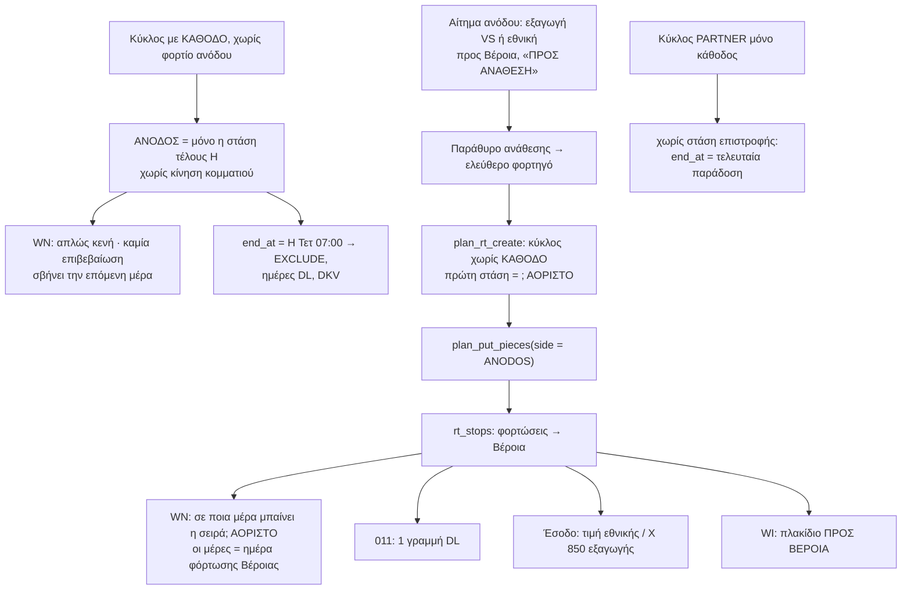

**Κενά / αντιφάσεις**
1. **«Κενό · εκκρεμεί» / «Κενό · επιβεβαιώθηκε» φεύγουν** (owner 21/10). Στο `design.md` υπάρχουν ακόμη: (a) ενέργεια «Κενό γύρισμα · εκκρεμεί», ο πίνακας επανάχρησης `_gapHTML` («θέλει απόφαση»), (k) και §3 «Ποτέ σβηστό… "Κενό γύρισμα · εκκρεμεί"», Δ13(δ). Στο `main.md` Φ0 υπάρχει το «χωρίς "Κενό · εκκρεμεί"». Στο `tech.md` δεν υπάρχει στήλη, και αυτό είναι πλέον σωστό.
2. **Κύκλος μόνο ΑΝΟΔΟΥ (Δ7, m3).** Το `plan_rt_create` ξεκινά πάντα με «H Δευ 18:00». Δεν ορίζεται η πρώτη στάση όταν το φορτηγό φεύγει άδειο για να φορτώσει (από Βέροια άδειο; από εκεί που τελείωσε ο προηγούμενος κύκλος;), ούτε σε ποια μέρα του WN μπαίνει η σειρά, αφού οι μέρες ταξινομούνται κατά ημέρα φόρτωσης Βέροιας. **Ερώτηση 10.**
3. **Κύκλος χωρίς στάση επιστροφής** (συνεργάτης ή φορτηγό που μένει στην Αθήνα): το `end_at` = τελευταία παράδοση, και το φορτηγό εμφανίζεται «ελεύθερο» για φόρτωση Βέροιας το ίδιο απόγευμα, ενώ είναι 500 km μακριά. Μόνο σημείωση, δεν μπλοκάρει.
4. **Κενή ΚΑΘΟΔΟΣ** σε κύκλο μόνο ΑΝΟΔΟΥ: το §5 λέει για την κενή ΑΝΟΔΟ «απλώς κενή». Για την κενή ΚΑΘΟΔΟ δεν λέγεται, αλλά λογικά ισχύει το ίδιο. Πρέπει να γραφτεί, για να μη δείχνει «ΠΡΟΣ ΑΝΑΘΕΣΗ».

---

## Ερωτήσεις για τον owner (κατά σειρά σημασίας, μόνο όσες μπλοκάρουν ροή)

| # | Ερώτηση | Παράδειγμα | Πρόταση | Μπλοκάρει |
|---|---|---|---|---|
| 1 | **Ο διεθνών μεταθέτει την ημέρα ενός VS που είναι ήδη σε εθνικό φορτηγό: τι «ακολουθεί»;** | Ο διεθνών κάνει το VS-118 από Δευ σε Τρί. Είναι ήδη στο ΚΖΗ 2106 της Δευτέρας μαζί με 2 εθνικές. (α) Βγαίνει από το φορτηγό και μπαίνει «ΠΡΟΣ ΑΝΑΘΕΣΗ» την Τρίτη, με ειδοποίηση· (β) μετακινείται όλος ο κύκλος· (γ) μένει στο φορτηγό με κόκκινη ένδειξη μέχρι να το λύσει ο εθνικών | (α) | Ροές 2, 7· `plan_bridge_sync` |
| 2 | **«Φόρτωση με τοπικό»: πού πάει το φορτίο και πώς πληρώνεται ο τοπικός;** | Ο Karras με ΚΖΗ 2111 φορτώνει 10π στο Orion Θεσσαλονίκης την Κυριακή. (α) Τα φέρνει στη Βέροια, και το ΚΖΗ 2108 τα παίρνει από εκεί τη Δευτέρα· (β) φορτώνει απευθείας το ΚΖΗ 2108. Πληρωμή: γραμμή ΤΟΠΙΚΟ ανά ημέρα (όπως το relay) ή γραμμή κύκλου; | (α), με ΤΟΠΙΚΟ ανά ημέρα | Ροή 10, σχήμα Φ1 |
| 3 | **Ανάθεση VS σε φορτηγό άλλης ημέρας από την ημέρα VS: γράφεται η νέα ημέρα στη διεθνή;** | Το VS-118 έχει ημέρα Δευ, ο εθνικών το βάζει στο ΚΖΗ 2108 της Τρίτης | Ναι, με τη γραμμή «ενημερώνει τη διεθνή #4127», αφού ρωτήσει τον διεθνών· μία ημέρα, μία πηγή | Ροή 3, `vs_hub_day` |
| 4 | **Ποια είναι η ημέρα VS όταν τα κομμάτια φεύγουν από τη Βέροια σε δύο ημέρες;** | VS 33π: 20 φεύγουν Δευ, 13 μένουν και φεύγουν Τετ | Ημέρα VS = η πρώτη αναχώρηση. Τα 13 είναι απόθεμα με `leave_by` και δεν αλλάζουν τη διεθνή | Ροές 5, 7 |
| 5 | **Ποιο κομμάτι μετρά ως «απόθεμα ήδη στη Βέροια» για το μερικό «+»;** | Το VS-118 (33π) φτάνει σήμερα στις 14:00. Μπορεί το «+» του ΚΖΗ 2106 να πάρει 20 από τα 33, ή μόνο ολόκληρο, και το σπάσιμο γίνεται στον Πίνακα Βέροιας; | Απόθεμα = ό,τι «έμεινε στη Βέροια» ή έφτασε σε προηγούμενη μέρα. Ό,τι φτάνει σήμερα σπάει μόνο στον Πίνακα Βέροιας | Ροή 4 |
| 6 | **Αλλαγή παλετών σε VS που έχει ήδη σπάσει: ποιο κομμάτι αλλάζει;** | 20π στο ΚΖΗ 2106 και 13π απόθεμα. Ο διεθνών γράφει 30 αντί για 33, ή ο εθνικών μαθαίνει ότι φορτώθηκαν 18 αντί για 20 | Η διαφορά αφαιρείται πρώτα από το κομμάτι που δεν έχει φύγει, αλλιώς από το τελευταίο φορτηγό, με ειδοποίηση | Ροές 2, 5 |
| 7 | **Πότε γίνεται τιμολογήσιμη μια διεθνής VS, αν ένα κομμάτι της μένει στη Βέροια;** | Η #4127 έχει 25π VS: 12 παραδόθηκαν Τρί, 13 φεύγουν Πέμ. Το Ημερήσιο γράφει Delivered την Τρίτη | Το Delivered της διεθνούς επιτρέπεται, αλλά βγαίνει προειδοποίηση «13π ακόμη στη Βέροια» | Ροή 5, τιμολόγηση |
| 8 | **Πύλη δελτίων για εθνικές:** το «δεν μπλοκάρει» της 20/10 αλλάζει τον κανόνα της 25/8 μόνο για τις εθνικές ή γενικά; | Η N-2198 έχει PE και δεν έχει επιβεβαιωμένη LOADING. Μπορεί η Αλεξία να βάλει «τιμολογήθηκε»; | Μόνο για τις εθνικές v5· στις διεθνείς η πύλη μένει | Ροή 13, τιμολόγηση |
| 9 | **Γραμμή μισθοδοσίας που έχει ήδη πληρωθεί, σε κύκλο που διαγράφεται ή καθαρίζεται: σβήνεται;** | Ο κύκλος της 12/10 πληρώθηκε 230 € στις 20/10, και στις 25/10 διαγράφεται η μόνη του παραγγελία | Μένει με «θέλει έλεγχο», γιατί τα χρήματα δόθηκαν· σβήνεται μόνο αν δεν έχει πληρωθεί | Ροές 8, 9 |
| 10 | **Κύκλος μόνο ΑΝΟΔΟΥ: από πού ξεκινά και σε ποια μέρα του πίνακα φαίνεται;** | Το ΚΖΗ 2108 φεύγει άδειο Τρί 13:00 από Βέροια, φορτώνει Κατερίνη 15:00 και γυρίζει Βέροια 18:00 | Ξεκινά από τη Βέροια, με κενή ΚΑΘΟΔΟ, και φαίνεται τη μέρα που φεύγει | Ροή 14, `plan_rt_create` |

---

## Αλλαγές που χρειάζονται στο `tech.md` / `design.md`

**`tech.md`**
0. **Καθαρή αντικατάσταση (owner 21/10, αργά).** Η Φ5 ξαναγράφεται ως «ημέρα L», ένα DO block: σβήσιμο των δεδομένων-δοκιμής (6 `national_orders`, η 1 ομάδα GL, όπως ορίζει ο κανόνας «GL ποτέ delete»)· γέφυρα για κάθε VS με ημέρα κόμβου ≥ L, και στην ίδια συναλλαγή αποσύνδεση των Direct NL τους (αλλιώς διπλό X)· τα υπόλοιπα από τα 70 VS NL μένουν ιστορικό. Φεύγουν: η συνύπαρξη, οι φρουροί παγώματος (Φ5.4, Π1), η Φ5.7, το `plan:legacy_nl`, ο B-82, το `planEraOf(date)`, οι αναγνώστες «NL για < W και `/plan` για ≥ W» (WI `nlBySrc`, `orders_natl.js`), το «παλιό board μόνο ανάγνωσης από W+2» και η Φ7 / Γ1 όπως είναι διατυπωμένα. Το `plan_config.cutover_week` γίνεται απλώς ημέρα L (μία τιμή, για τη γέφυρα). Το παλιό board και η παλιά φόρμα φεύγουν την ημέρα L, όχι στη Φ7. Μένει ανοιχτό: απόλυτος φρουρός «κανένα νέο NL/GL/CL μετά το L» ή μόνο έλεγχος (Ροή 2, κενό 8)· πώς διαβάζει το WI το ιστορικό των 70 (κενό 9).
0β. **Το `ct_round_trips` δεν έχει `deleted_at`.** Να φύγουν από τη Φ1 τα `deleted_at/deleted_reason/deleted_by` και ο CHECK `rt_deleted_pair` του `ct_round_trips`, και από το §0 το «`status='cancelled'` + `deleted_at`». Κύκλος που «δεν έγινε» = `status='cancelled'`, ο λόγος στο `audit_log`. Το ίδιο για το `plan_delete` («RT → `cancelled` + `deleted_*`») και για τους ελέγχους B-81 / B-86.
1. **Επαναφορά:** να φύγουν το `plan_restore`, η σημείωση για `deleted_batch uuid`, το `restore` στο `PLAN_PERMS`, η γραμμή 30 του §0 και η απόφαση 7. Να κλείσει η «Επαναφορά» του Audit Trail (`core/api.js:1360-1448`) για εθνικές, και το facade POST/DELETE για `national_orders` (η παλιά φόρμα φεύγει, ο ρόλος όμως μένει ανοιχτός).
2. **VS «ακολουθεί»:** να αντικατασταθούν τα `plan:piece_planned`, `plan:bridge_moved` και `plan:bridge_split` (Φ5.2, Φ5.5), η απόφαση 3 και το test «αλλαγή σειράς στάσεων με κίνηση → `bridge_moved`» με κανόνες «ακολουθεί + ειδοποίηση» (μετά την ερώτηση 1). Να οριστεί κανάλι ειδοποίησης. Τα tests της Φ5 «VS < W → NL όπως σήμερα» και «μετακίνηση παλιάς VS μέσα στο W → επιτρέπεται, B-82» φεύγουν· στη θέση τους «η ημέρα L μετατρέπει ακριβώς τα VS ≥ L, και B-84 = 0».
3. **Δήλωση κόμβου ανά στάση:** να μπει στήλη στο `order_stops` (Φ1), checkbox στην `orders_intl.js` (Φ4/Φ5), trigger γέφυρας που την ακούει, και να φύγει η απόφαση 4 από τις «ανοιχτές».
4. **Βέροια = κανονικός τόπος:** να φύγουν ο `plan_chk_hub` και η άρνηση `hub_endpoint`. Να επανεξεταστεί το `v_piece_state` (at_hub / waiting), ώστε μια εθνική με προορισμό τη Βέροια να μη φαίνεται στον κουβά.
5. **Εκτέλεση = ημέρα:** `v_piece_state`, `v_rt_stop_state` και το `done` της Φ5 με ημερομηνία Europe/Athens. Να κλείσει η απόφαση 2. Να γραφτεί ρητά αν το `v_rt_cycle.ended` μένει με την ώρα.
6. **Μερικό «+»:** να φύγει η άρνηση `piece_split` για κομμάτι στη Βέροια, να μπει μία πράξη split+put, και να αλλάξουν η Φ4 («το "πόσες από" φεύγει») και το rig «άρνηση εκτός Βέροιας».
7. **Νέα `plan_move_pieces`** (μεταφορά ανά γραμμή σε μία συναλλαγή). Dry-run με token και στο `plan_remove_leg` όταν αδειάζει κύκλος με παραστατικά.
8. **Μισθοδοσία:** το «011 χωρίς αλλαγή» δεν αρκεί. Τα `plan_rt_clear` / `plan_delete` σβήνουν ρητά τη γραμμή με ποσό μετά το token (ή κρατούν `needs_review`, ανάλογα με την ερώτηση 9). Να φύγει η απόφαση 6. Να οριστεί η σειρά INSERT στο `plan_rt_create` (CHECK `rt_v2_window` + 011 `entry_date`).
9. **Χρήματα:** ο παρονομαστής του X σε όλες τις παλέτες κόμβου (να φύγουν «μόνο PALLET», «IFCO εκτός» και η απόφαση 5). Ο B-79 να λογαριάζει και τα μη ανατεθειμένα. Νέος έλεγχος «κόμιστρο λείπει». Κλείσιμο της απόφασης 9 (ο dispatcher βλέπει και γράφει το κόμιστρο).
10. **«Ποιος φορτώνει»:** να φύγουν ο B-88 και η απόφαση 8· η στήλη `rt_stops.loader` είτε φεύγει είτε ξαναορίζεται για τη «Φόρτωση με τοπικό» (ερώτηση 2). Η Φ5.7 (πάγωμα `local_moves 'local'`) να πει τι το αντικαθιστά.
11. **Παλέτες:** φρουρός για το `plOnDelivered` στις στάσεις γέφυρας (διπλή DELIVERY)· η επιβεβαίωση προσυμπληρωμένη (18/10) αντί για «μόνο με δελτίο»· να ξεχωρίζει ο εθνικός συνεργάτης (Π3)· τα pending PL να ακολουθούν και στο `plan_rt_update`.
12. **`plan_vs_set_day`:** να γραφτεί ποιο πεδίο γράφει (`cross_dock_date` ή `order_stops.datetime`) και πώς συνδυάζεται με τη μετακίνηση σκέλους σε μία συναλλαγή. Να μπει δρόμος για αλλαγή **προορισμού** VS από τον εθνικών (§5).
13. **Μικρά:** άρνηση `no_price` στο `plan_orders_create`· ο B-87 με «≥ 2 °C»· κανόνας για NULL `cross_dock_date` στη γέφυρα· ποια πεδία του `national_orders` γεμίζει το v5 για τιμολόγηση και λίστες· οι αποφάσεις 1 και 10 κλείνουν από την καθαρή αντικατάσταση (L = πρώτο Σάββατο μετά το build· καμία μεταβατική περίοδος). Το ίδιο και η Φ4 «Αναγνώστες που πρέπει να μάθουν το v5»: όχι «για ≥ W», αλλά «από το L διαβάζουν μόνο `/plan/*` για εθνικά». Ο διακόπτης `WN_V5` ανοίγει στο L και το παλιό board αφαιρείται την ίδια μέρα.

**`design.md`**
1. Να φύγουν το «Κενό γύρισμα · εκκρεμεί» και το «Κενό · επιβεβαιώθηκε» (a, πίνακας `_gapHTML`, k, §3 «Εκτελεσμένα σβηστά», Δ13δ).
2. Να φύγει η επαναφορά: (g) «Διαγραμμένα · 7 ημέρες», «Επαναφορά: γυρνά στην αναμονή», η αντίφαση με το Β10, ο Δ13(α), τα «κενά Διαγραμμένα» του Δ12 και η §3 Διαγραφή.
3. Σβήσιμο **ανά ημέρα**: (k), το «κάθε σημείο μόνο του ανά `planned_at`», η §3 «όταν περάσει η ώρα του», και το παράδειγμα «Τρί 13/10 09:30» να δείχνει όλη τη μέρα μαζί.
4. Μερικό «+» από απόθεμα: (f) «Να φύγει η ποσότητα» → «ποσότητα μόνο για απόθεμα στη Βέροια»· §3 «+» και §3 Σπάσιμο («Καμία ποσότητα στο +»)· ο κανόνας 5 του `2011:7737`· η σημείωση «ΑΠΟΘΕΜΑ ΒΕΡΟΙΑΣ… θέλει επιβεβαίωση owner».
5. «Ποιος φορτώνει» έξω: (e), (i), Δ10, και η γραμμή ↳ ΤΟΠΙΚΗ ΦΟΡΤΩΣΗ («θέλει απόφαση») → νέα επιλογή ✈ «Φόρτωση με τοπικό» στο `2011:8858` (c, Δ11).
6. VS: (j) «άρνηση `plan:piece_planned`» → «η αλλαγή περνά και ο εθνικών ειδοποιείται»· σχέδιο της ειδοποίησης στο WN.
7. Δ5 από «πρόταση» σε «αποφασισμένο» (λίστα για έξοδα και για μισθοδοσία με ποσό· κενή μισθοδοσία σβήνεται χωρίς ερώτηση).
8. Δ13: (β) απόθεμα στο «+», (γ) Βέροια ως Α/Β, (δ), (ε) επιβεβαίωση παλετών, (στ) «−n» είναι απαντημένα (§5)· να σημειωθούν κλειστά. Το (h) «ερώτηση owner» για την προσυμπληρωμένη επιβεβαίωση φεύγει.
9. Αντιγραφή πινακίδων: «κάθε board αντιγράφει τα δικά του φορτηγά» αντί για «εκκρεμεί κανόνας» (c, Δ10, §3). Μένει ανοιχτό τι αντιγράφει το Ημερήσιο για VS.
10. Ονόματα: `plan_put_piece`/`plan_put_group`/`plan_order_create`/`plan_clear`, `rt_stops.planned_at` και `delivered_by_date` να γίνουν όπως στο `tech.md` (`plan_put_pieces`, `plan_orders_create`, `plan_rt_clear`, `planned_from/to`, `executed`), αλλιώς τα contract tests δεν θα βρίσκουν αντίστοιχο.
11. Νέα frames ή καταστάσεις: κύκλος μόνο ΑΝΟΔΟΥ με κενή ΚΑΘΟΔΟ (Δ7, μετά την ερώτηση 10)· «Μεταφορά σε…» με λίστα παραστατικών όταν αδειάζει κύκλος (Δ6)· η γραμμή «ενημερώνει τη διεθνή» και στην ανάθεση VS σε άλλη ημέρα (μετά την ερώτηση 3).
