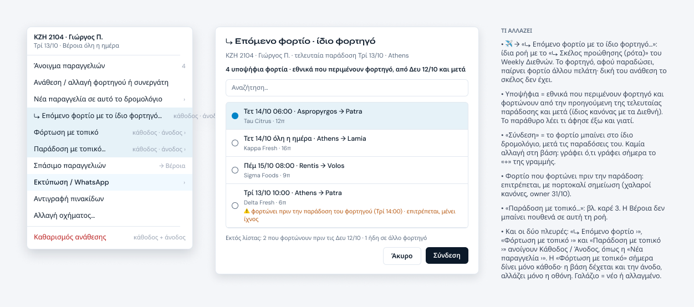
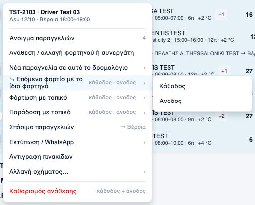
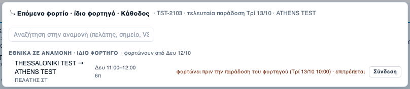
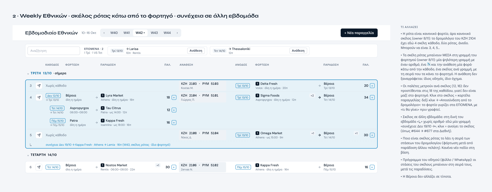
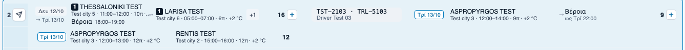
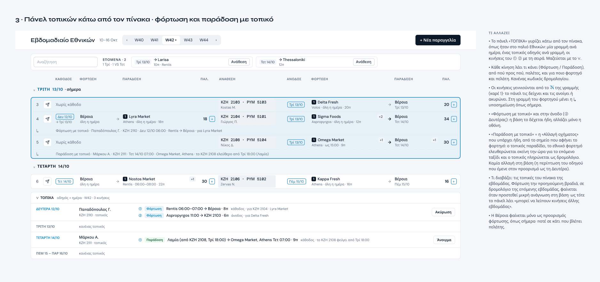
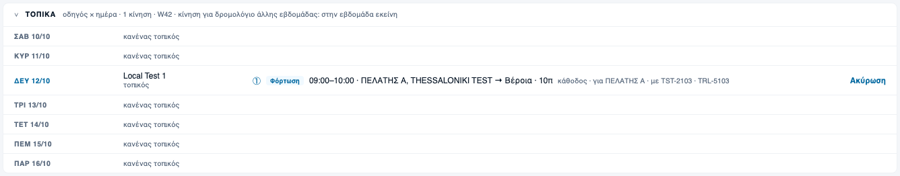
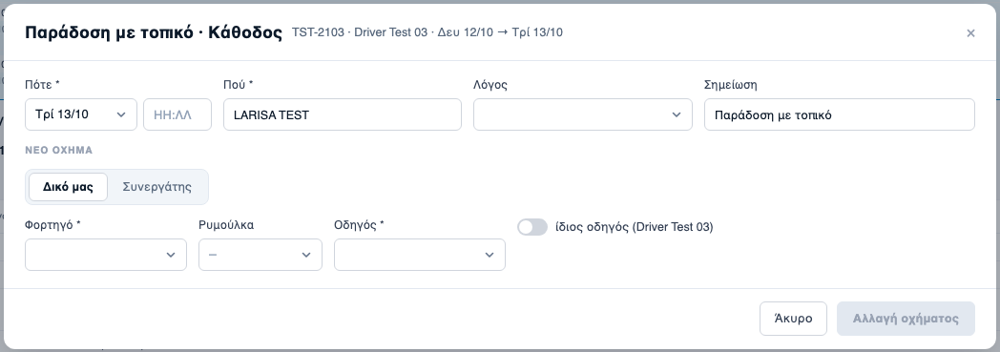

# Ρότα + πάνελ τοπικών: εγκεκριμένο Figma ↔ υλοποίηση (8/11)

Κανόνας owner 8/11: «θέλω καλό έλεγχο με screenshot και σύγκριση όταν κάνουμε υλοποίηση, εντοπίζοντας τις διαφορές από αυτό που θέλαμε ή έγινε».

- Figma: σελίδα «Εθνικών — ρότα + τοπικά (8-11)» (`2607:7793`), εγκεκριμένη από τον owner 8/11.
- Εφαρμογή: rig `tests/critics/wn5-board-rig.js rota-locals --shots docs/national-v5/rota-locals-proof`, συνθετική εβδομάδα, πλάτος **1440** όπως τα καρέ. Το Figma δεν έχει καρέ 1920· το rig ελέγχει και τα 1920 στη γεωμετρία (εσοχή).
- Ονόματα, πινακίδες και πελάτες είναι φανταστικά και στα δύο. Στο Figma είναι ελληνικά δείγματα, στην εφαρμογή τα «TEST» του rig.

## 1 · ✈ και παράθυρο ρότας

| Figma (καρέ 1) | Εφαρμογή 1440 |
|---|---|
|  |   |

## 2 · Σκέλη ρότας μέσα στη γραμμή του φορτηγού

| Figma (καρέ 2) | Εφαρμογή 1440 |
|---|---|
|  |  |

## 3 · Πάνελ «ΤΟΠΙΚΑ» και παράδοση με τοπικό

| Figma (καρέ 3) | Εφαρμογή 1440 |
|---|---|
|  |   |

## Πίνακας διαφορών

| # | Ζητήθηκε (Figma / λόγια owner) | Έγινε | Κρίση |
|---|---|---|---|
| 1 | ✈: 11 γραμμές, με αυτή τη σειρά | Ίδιες 11, ίδια σειρά (το rig ελέγχει τις ετικέτες) | ίδιο |
| 2 | «⤷ Επόμενο φορτίο ›», «Φόρτωση με τοπικό ›», «Παράδοση με τοπικό ›» με «κάθοδος · άνοδος» | Ίδιο. Η ετικέτα της ρότας σπάει σε 2 γραμμές στο μενού των 300px | διαφορά: αναδίπλωση, χωρίς απώλεια |
| 3 | Γαλάζιο φόντο στις νέες γραμμές | Χωρίς φόντο | διαφορά, σκόπιμη: στο Figma το γαλάζιο σήμαινε «νέο για έγκριση», όχι κατάσταση οθόνης |
| 4 | Παράθυρο ρότας με λίστα επιλογής και «Άκυρο / Σύνδεση» κάτω | Το παράθυρο «+» σε λειτουργία ρότας, με «Σύνδεση» σε κάθε γραμμή | διαφορά, σκόπιμη: ένας δρόμος εγγραφής (ίδιο `POST /plan/legs`, ίδια μηνύματα απασχολημένου και άρνησης). Ένα πάτημα αντί για δύο |
| 5 | Κεφαλίδα «φορτηγό · τελευταία παράδοση ημέρα · τόπος» | Ίδιο | ίδιο |
| 6 | Γραμμή «ημέρα ώρα · φόρτωση → παράδοση», από κάτω «πελάτης · π» | «φόρτωση → παράδοση / πελάτης» και «ημέρα ώρα / π» σε δύο στήλες | ίδιο περιεχόμενο, άλλη διάταξη (στήλες του «+») |
| 7 | Πορτοκαλί «φορτώνει πριν την παράδοση του φορτηγού … επιτρέπεται» | Ίδιο | ίδιο |
| 8 | «Εκτός λίστας: N που φορτώνουν πριν …» | Ίδιο, όταν N > 0 | ίδιο |
| 9 | Μόνο εθνικά, «άσε τη Βέροια» | Έξω τα VS, το απόθεμα και ό,τι φορτώνει ή παραδίδει στη Βέροια | ίδιο |
| 10 | Η ρότα είναι κανονικό σκέλος, 3, 4, 5 σκέλη | Όσα σκέλη ρότας έχει το δρομολόγιο, ένα ανά γραμμή, με τη σειρά της βάσης | ίδιο |
| 11 | Μέσα στη γραμμή του φορτηγού, «προς τα μέσα», ανάθεση μία φορά | Χωρίς αριθμό, ✈ και γραμμή διαχωρισμού. Ημέρα +3px, τόποι +34px προς τα μέσα (το rig το μετρά σε 1440 και 1920) | ίδιο. Στο 1440 η στήλη φόρτωσης είναι 76px και η εσοχή εκεί φαίνεται λιγότερο |
| 12 | Τόποι με πελάτη («1 Tau Citrus») | Τόπος + πόλη | διαφορά, σκόπιμη: κανόνας του ζωντανού πίνακα (owner 28/10, «τόπος + πόλη, όχι πελάτης στη γραμμή»). Το Figma ξεκίνησε από παλιότερο καρέ |
| 13 | «+» δίπλα στις παλέτες του σκέλους | Χωρίς «+» | διαφορά, σκόπιμη: το «+» ανήκει στην πλευρά (κάθοδο / άνοδο), όχι σε ένα φορτίο |
| 14 | Παλέτες ανά σκέλος, όχι στο σύνολο της πλευράς | Ίδιο (16 μένει 16, το rig το ελέγχει) | ίδιο |
| 15 | Κλικ = καρτέλα, δεξί κλικ = «Αποσύνδεση» με «τι θα γίνει» πριν γραφτεί | Ίδιο: δοκιμαστική κλήση (dry run) πρώτα, μετά επιβεβαίωση | ίδιο |
| 16 | «συνέχεια: Δευ 19/10 →» για σκέλος σε άλλη εβδομάδα | Δεν υπάρχει χωριστή γραμμή. Όλη η γραμμή του φορτηγού φαίνεται στην άλλη εβδομάδα με το σημάδι «15 · W45» (wn5-cleanup, owner 8/11), μαζί με τα σκέλη της | διαφορά, σκόπιμη: τη δουλειά την κάνει ήδη το σημάδι άλλης εβδομάδας |
| 17 | Πάνελ «ΤΟΠΙΚΑ» κάτω από τον πίνακα, 7 ημέρες, «κανένας τοπικός» | Ίδιο | ίδιο |
| 18 | Οδηγός με φορτηγό («ΚΖΗ 2110 · τοπικός») | Μόνο «τοπικός» στις φορτώσεις. Στις παραδόσεις υπάρχει φορτηγό | λείπει: ο πίνακας της βάσης δεν δίνει φορτηγό για φόρτωση με τοπικό. Θέλει μικρή προσθήκη ανάγνωσης στη βάση (owner) |
| 19 | Κίνηση ① ② με «Φόρτωση / Παράδοση», τι, για ποιον, κάθοδο / άνοδο | Ίδιο | ίδιο |
| 20 | «Ακύρωση» φόρτωσης, «Άνοιγμα» παράδοσης | Ίδιο: η «Ακύρωση» ανοίγει πρώτα επιβεβαίωση | ίδιο |
| 21 | «Φόρτωση με τοπικό» και στην άνοδο | Ίδιο: η βάση το δεχόταν ήδη | ίδιο |
| 22 | «Παράδοση με τοπικό» = αλλαγή οχήματος από το σημείο, πληρωμή ως δρομολόγιο | Το παράθυρο «Αλλαγή οχήματος» με τίτλο «Παράδοση με τοπικό · Κάθοδος», προσυμπληρωμένο στην πρώτη παράδοση (ημέρα, τόπος, σημείωση) | ίδιο. Το πάνελ τη βρίσκει από τη σημείωση «Παράδοση με τοπικό» (η αρχή της μετράει). Αν σβηστεί η σημείωση, δεν φαίνεται στο πάνελ |
| 23 | Σημείωση για κινήσεις άλλης εβδομάδας | «κίνηση για δρομολόγιο άλλης εβδομάδας: στην εβδομάδα εκείνη» | ίδιο |

**Βάση και Worker:** καμία αλλαγή. Όλα γράφουν από τους δρόμους που υπάρχουν ήδη: `POST /plan/legs`, `/plan/move`, `/plan/local-loading`, `/plan/rt/:id/handover`.
