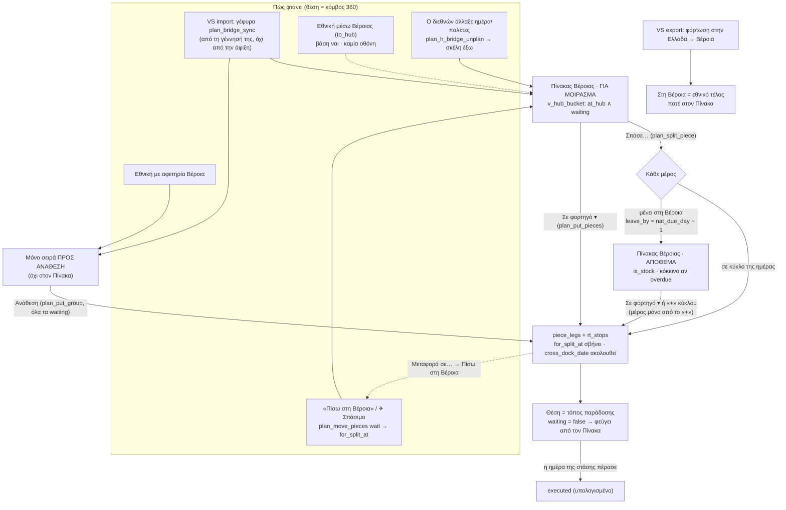

# Πίνακας Βέροιας: μελέτη (Εθνικά v5, 28/10/2026)

Ερώτηση owner: ο Πίνακας Βέροιας είναι από τα πιο κρίσιμα σημεία του συστήματος. Πριν από άλλη αλλαγή θέλει να ξέρει
**τι μπαίνει εκεί, πότε, τι κάνει ο χρήστης εκεί, τι γράφεται, τι λείπει**.

Είναι **μόνο ανάγνωση**. Κανένας κώδικας δεν άλλαξε. Στη βάση έτρεξαν μόνο SELECT: ορισμοί συναρτήσεων και views με
`pg_get_functiondef` / `pg_get_viewdef`, και μετρήσεις. Τα ids είναι αριθμοί· ονόματα πελατών δεν γράφονται.

## Πώς μετρήθηκε

| | |
|---|---|
| Κώδικας | `origin/main` στο `a59b784e` (μετά το #162, άρα και το #157 / #159 / #160 / #161). Ο κλάδος πήρε μετά το `3b41619b` (#163, #164, #138, #154): κανένα από τα αρχεία που παραθέτονται εδώ δεν άλλαξε (`git diff --stat` κενό). Το `worker/src/index.js` του main είναι ίδιο με το tip του `fix/audit-write-loud`, την πηγή του ζωντανού Worker `bacc4240` (`git diff` κενό). Ισότητα byte με την παραγωγή δεν ελέγχθηκε, όπως ορίζει το `CLAUDE.md`. |
| SQL | Οι **ζωντανοί** ορισμοί διαβάστηκαν από την παραγωγή. Οι παραπομπές δείχνουν το αρχείο του repo όπου γράφτηκε κάθε κομμάτι (072 + hooks 074a + 075). Η 074 εκτελέστηκε, αλλά ζει ακόμη στο `worker/migrations/drafts/` (βλ. §3.18). |
| Δεδομένα | SELECT στην παραγωγή, **28/10 ~19:06 ώρα Αθήνας**. Τα δεδομένα αλλάζουν όσο γράφεται αυτό: το session καταχώρησης δούλευε παράλληλα. Πριν βασιστείς σε νούμερο, ξανατρέξε το SELECT του Παραρτήματος. |
| Figma | Αρχείο `KO7l2AfucR3HJEDIg1Yptr`. Τα καρέ `2011:8744` («Πίνακας Βέροιας · ανοιχτός, μικρός») και Δ11 `2069:8356` («Τρί 13/10 · απόθεμα») διαβάστηκαν με το Figma MCP (screenshot). **Τα εργαλεία δούλεψαν.** |
| Figma audit | `docs/national-v5/figma-audit-2026-10-28.md` (PR #154, στο main από το `ee469f87`), §8. |

---

## 0. Με μια ματιά

1. Στον Πίνακα δεν μπαίνει κάποιο «γεγονός». Μπαίνει ένα **κομμάτι (`shipment_pieces`) που η θέση του είναι ο κόμβος
   (360) και δεν έχει φτάσει στο εθνικό του τέλος** (`v_hub_bucket` = `at_hub AND waiting`). Η θέση **υπολογίζεται**
   από τα σκέλη (`piece_legs`) και δεν γράφεται πουθενά.
2. Σήμερα στον Πίνακα υπάρχουν **μόνο VS imports**: 17 κομμάτια σε 8 διεθνείς, όλα «ΓΙΑ ΜΟΙΡΑΣΜΑ». Απόθεμα δεν
   υπάρχει, και δεν έχει γίνει **κανένα** σπάσιμο στην παραγωγή (0 παιδιά, 0 `split_at`).
3. Ένα VS import βρίσκεται «στη Βέροια» **από τη στιγμή που γεννιέται η γέφυρά του**, όχι όταν φτάσει το διεθνές
   φορτηγό. Η βάση δεν ξέρει «έφτασε».
4. Ένα **VS export δεν εμφανίζεται ποτέ** στον Πίνακα. Η εθνική του ζωή τελειώνει στη Βέροια.
5. Από τα 17 κομμάτια, **12 είναι «αργά»** (`overdue`). Είναι VS της εβδομάδας L που στον πραγματικό κόσμο έχουν ήδη
   φύγει (διεθνείς `Delivered` / `In Transit`), αλλά στο v5 δεν τα πήρε κανένα φορτηγό.
6. Το `plan_board` δεν έχει **κάτω όριο ημέρας** στο `hub[]`. Κάθε κομμάτι που μένει στον κόμβο εμφανίζεται σε **κάθε
   επόμενη εβδομάδα**: W45 = 17 (τα 13 από πριν από την εβδομάδα), W46 = 17 (όλα από πριν).
7. Η **ημέρα του Πίνακα** είναι η πιο νωρίς ημέρα όσων περιμένουν, όχι η σημερινή. Αυτή η ημέρα περνά και στο
   «Σε φορτηγό ▾» **για κάθε κομμάτι**: ένα κομμάτι της Τετάρτης ανατίθεται με φόρτωση Βέροιας την Κυριακή.
8. Το «Σπάσε…» γράφει την προθεσμία `leave_by = nat_due_day − 1` χωρίς να τη δείξει (B-26). Καμία συνάρτηση δεν την
   αλλάζει μετά. Κανένας έλεγχος του ελεγκτή δεν πιάνει απόθεμα ή κομμάτι κόμβου που δεν έφυγε.
9. Figma και κώδικας διαφωνούν σε τρία σημεία: πού πάει το υπόλοιπο την ημέρα του σπασίματος, τα ελεύθερα φορτηγά, και
   η επιλογή ημέρας. Οι ερωτήσεις είναι στην §5.

---

## 1. Τι μπαίνει στον Πίνακα και πότε

### 1.0 Ο μηχανισμός, από τη βάση ως την οθόνη

1. **Ο κόμβος:** `locations.is_hub`, ακριβώς μία γραμμή (unique index), η Βέροια `recJucKOhC1zh4IP3` = **id 360**
   (`worker/migrations/071_plan_schema.sql:180-183`).
2. **Από πού ως πού κινείται εθνικά ένα κομμάτι** (`v_shipments`, `071_plan_schema.sql:369-378`):
   - εθνική: `origin_location_id → dest_location_id` της αποστολής·
   - **VS import: κόμβος → σημείο παράδοσης** του `order_stops` (`nat_from = hub.id`)·
   - **VS export: σημείο φόρτωσης → κόμβος** (`nat_to = hub.id`).

   Ημέρες: import `nat_ready_day = orders.cross_dock_date`, `nat_due_day = order_stops.datetime`· export ανάποδα·
   εθνική οι ημέρες του `load_from` / `deliver_to`.
3. **Θέση** (`v_piece_pos`, `071_plan_schema.sql:391-411`): η στάση εκφόρτωσης (`drop_stop_id`) του τελευταίου ζωντανού
   σκέλους. Χωρίς σκέλος, η θέση είναι το `nat_from`. Ένα παιδί σπασίματος χωρίς δικό του σκέλος κληρονομεί το σκέλος
   του γονέα (αναδρομή `walk`).
4. **Κατάσταση** (`v_piece_state`, `071_plan_schema.sql:416-440`): `at_hub = θέση = 360`· `waiting = θέση ≠ nat_to`·
   `is_stock = έχει γονέα και κανένα δικό του σκέλος`· `overdue = waiting και coalesce(leave_by, nat_due_day) < σήμερα
   (Αθήνα)`. Τα κομμάτια που έχουν σπάσει (γονείς) **βγαίνουν** από το view (`WHERE NOT pp.is_split`).
5. **Κάδος του κόμβου** (`v_hub_bucket`, `071_plan_schema.sql:470-475`): `at_hub AND waiting`, και `inbound_rt_id` = ο
   κύκλος που το ξεφόρτωσε εκεί (null αν δεν ήρθε με εθνικό φορτηγό).
6. **`plan_board(week, role)`** → `hub[]` (`072_plan_functions.sql:2450-2457` + hook `074a_plan_reads.sql:74-80`):
   - κάθε γραμμή του κάδου με `coalesce(nat_ready_day, week) <= week + 6`, **χωρίς κάτω όριο** (§3.6)·
   - μαζί με `client`, `reference`, `temperature_c`, `nat_to_location_id`, παράθυρα (null για γέφυρα VS) και
     `for_split = for_split_at IS NOT NULL`.

   Το `waiting[]` παίρνει τα ίδια με `not at_hub` (`072:2449`): ένα κομμάτι είναι **ή** στο `hub[]` **ή** στο `waiting[]`.
7. **Worker:** `GET /plan/board` → `plan_board` (`worker/src/index.js:5986`), για κάθε ρόλο (`PLAN_PERMS`,
   `index.js:5840-5865`). Δεν φιλτράρει ούτε αλλάζει το `hub[]`.
8. **Μοντέλο οθόνης** (`core/wn5-logic.js:432-436`):
   - **ΓΙΑ ΜΟΙΡΑΣΜΑ** = `!is_stock` και (`inbound_rt_id` ή `for_split` ή `kind = 'vs_import'`)·
   - **ΑΠΟΘΕΜΑ** = `is_stock`·
   - το υπόλοιπο του `hub[]` (εθνική με αφετηρία τη Βέροια, που δεν πήρε ποτέ φορτηγό: `_neverAssigned`,
     `wn5-logic.js:267`) γίνεται **μόνο** σειρά «ΠΡΟΣ ΑΝΑΘΕΣΗ» (`wn5-logic.js:399`)·
   - ένα VS import χωρίς φορτηγό είναι **και** σειρά ΠΡΟΣ ΑΝΑΘΕΣΗ **και** ΓΙΑ ΜΟΙΡΑΣΜΑ (B1 μέρος 2).
9. **Οθόνη** (`modules/wn5_veroia.js:84-133`, τοποθέτηση `modules/weekly_natl_v5.js:457`): ο Πίνακας **κρύβεται** όταν
   ΓΙΑ ΜΟΙΡΑΣΜΑ και ΑΠΟΘΕΜΑ είναι άδεια (γρ. 87).

### 1.1 Η κλειστή γραμμή και το «Άνοιγμα ▸»

`ΒΕΡΟΙΑ · <ημέρα> · n για μοίρασμα · πλήθος π · απόθεμα πλήθος π` και ως 3 ονόματα (`modules/wn5_veroia.js:92-103`):

- **`<ημέρα>`** = `_hubDay` (γρ. 43-51): η πιο νωρίς `nat_ready_day` των ΓΙΑ ΜΟΙΡΑΣΜΑ. Αν δεν υπάρχουν, το πιο νωρίς
  `leave_by` του αποθέματος· ένα αργό απόθεμα μετρά ως `hub.day` (σήμερα). Το αποτέλεσμα **κόβεται στα όρια της
  εβδομάδας**. Δεν είναι η «σήμερα» (§3.5).
- **`n`** = πλήθος **κομματιών**, όχι παραγγελιών (VS 555 = 4 κομμάτια).
- **Ονόματα:** τα τρία πρώτα ΓΙΑ ΜΟΙΡΑΣΜΑ ως «**πελάτης** Nπ» (`h.client`). Για ένα VS import αυτός είναι ο πελάτης της
  διεθνούς, όχι προμηθευτής. Η περιγραφή «<suppliers>» είναι ανακριβής· βλ. ερώτηση 10.
- Μια μηδενική μερίδα παραλείπεται (γρ. 91-93).
- **«Άνοιγμα ▸»** (γρ. 103, 139) αλλάζει μόνο τη μεταβλητή `_open` στη μνήμη της σελίδας (γρ. 24): **δεν γράφει
  τίποτα**, δεν καλεί τον Worker, και χάνεται στο reload. Μετά από «Σπάσε» ο Πίνακας ξαναγυρίζει ανοιχτός (γρ. 265).

Ανοιχτός (γρ. 105-133): αριστερά ΓΙΑ ΜΟΙΡΑΣΜΑ και ΑΠΟΘΕΜΑ. Δεξιά «ΦΟΡΤΗΓΑ <ΗΜΕΡΑ> · χωρητικότητα», δηλαδή οι κύκλοι
της ημέρας του Πίνακα που η ΚΑΘΟΔΟΣ τους έχει στάση Βέροιας (`_trucks`, γρ. 53-60), με x/33 και ελεύθερες θέσεις.
Πάνω από 33 εμφανίζεται «υπέρβαση», ποτέ άρνηση (Ε-17).

### 1.2 Οι διαδρομές προς τον Πίνακα

| # | Διαδρομή | Συνθήκη (βάση / Worker / οθόνη) | Ενότητα | Πότε και πώς φεύγει |
|---|---|---|---|---|
| Δ-1 | **VS import «φτάνει» στη Βέροια** | Η γέφυρα (`shipments` με `order_stop_id`, ένα κομμάτι ανά στάση) γεννιέται από το `plan_bridge_sync` (`drafts/074_plan_cutover.sql:436-495`) όταν το `plan_h_bridge_wanted` είναι αληθές (γρ. 169-175): στάση `Unloading` μιας `Import` με παλέτες > 0, και VS στο v5 (`plan_h_vs_in_v5`, γρ. 156-166: `veroia_switch`, όχι Cancelled, `cross_dock_date >= L` ή ήδη γέφυρα). Από εκεί `nat_from = 360` → `at_hub` **αμέσως**. Οθόνη: `kind = 'vs_import'` → ΓΙΑ ΜΟΙΡΑΣΜΑ (`wn5-logic.js:432`), **και** σειρά ΠΡΟΣ ΑΝΑΘΕΣΗ. | ΓΙΑ ΜΟΙΡΑΣΜΑ | Όταν μπει σε σκέλος. Το σκέλος γράφεται από το «Σε φορτηγό ▾», το «Σπάσε…» (τα μέρη σε φορτηγό), την «Ανάθεση» της σειράς ΠΡΟΣ ΑΝΑΘΕΣΗ (`plan_put_group`) ή το «+» ενός κύκλου. Η θέση γίνεται η στάση παράδοσης (= `nat_to`), άρα `waiting = false`. Φεύγει επίσης όταν η γέφυρα αποσύρεται (VS σβήνεται / Cancelled / στάση χωρίς παλέτες). **Δεν** φεύγει όταν ο διεθνών αλλάξει ημέρα: το `plan_h_bridge_unplan` (`drafts/074:294-…`) ξεκρεμά τα σκέλη και το κομμάτι **γυρίζει** στον Πίνακα (αν δεν έχει εκτελεστεί). |
| Δ-2 | **VS export που περιμένει φόρτωση** | `nat_from` = σημείο φόρτωσης στην Ελλάδα, `nat_to = 360`. Πριν από το σκέλος: θέση ≠ κόμβος → `waiting[]`, όχι `hub[]`. Μετά την εκφόρτωση στη Βέροια: θέση = `nat_to` → `waiting = false` → **ούτε** `hub[]`. | **ποτέ** στον Πίνακα | — Η φόρτωση στο διεθνές φορτηγό δεν είναι πράξη του v5. Σήμερα: 11 κομμάτια export σε 7 διεθνείς, όλα στο `waiting[]` (SELECT §Π.3). |
| Δ-3α | **Εθνική που φορτώνει στη Βέροια** (αφετηρία 360) | `origin_location_id = 360` → `at_hub` από τη δημιουργία. Χωρίς φορτηγό, `inbound_rt_id` null και χωρίς `for_split` → `_neverAssigned` → μόνο σειρά ΠΡΟΣ ΑΝΑΘΕΣΗ (απόφαση B1 μέρος 2: «οι εθνικές που φορτώνουν στη Βέροια χωρίς φορτηγό μένουν μόνο σειρές»). | **όχι** (μόνο ΠΡΟΣ ΑΝΑΘΕΣΗ) | Μπαίνει στον Πίνακα μόνο μέσω Δ-4. |
| Δ-3β | **Εθνική που ξεφορτώνει στη Βέροια** (προορισμός 360, ΑΝΟΔΟΣ) | Στην άφιξη: θέση = `nat_to` → `waiting = false`. | **ποτέ** | — |
| Δ-3γ | **Εθνική που περνά από τη Βέροια** (ξεφορτώνεται εκεί και συνεχίζει) | Η βάση το υποστηρίζει: `plan_h_put` με `to_hub: true` (`072:712-…`) → θέση = κόμβος, `inbound_rt_id` = ο κύκλος → ΓΙΑ ΜΟΙΡΑΣΜΑ. **Καμία οθόνη δεν στέλνει `to_hub`** (`grep to_hub modules core`: μόνο ανάγνωση στο `wn5_actions.js:803`). | ΓΙΑ ΜΟΙΡΑΣΜΑ (θεωρητικά) | Νεκρή διαδρομή σήμερα (αρχή 8): ερώτηση 12. |
| Δ-4 | **«Πίσω στη Βέροια» από «Μεταφορά σε…»** ή ✈ «Σπάσιμο παραγγελιών → Βέροια» | `POST /plan/move` με `target: {wait: true}` (`wn5_actions.js:608-609`· άμεσα από ✈ `weekly_natl_v5.js:1367` → `wn5_actions.js:1326-1345`). Το `plan_move_pieces` σβήνει (soft) τα σκέλη. Αν η νέα θέση είναι ο κόμβος, γράφει `shipment_pieces.for_split_at = now()` με audit (hook `074a_plan_reads.sql:87-99`). Οθόνη: `for_split` → **μόνο** ΓΙΑ ΜΟΙΡΑΣΜΑ (όχι ΠΡΟΣ ΑΝΑΘΕΣΗ), με «· από ✈ «Σπάσιμο»» κάτω από την αναφορά (`wn5_veroia.js:77`). Η επιλογή λέγεται «Πίσω στη Βέροια» μόνο όταν όλα τα κομμάτια φορτώνουν στη Βέροια (`allHub`, `wn5_actions.js:1323`, 767-768)· αλλιώς «Πίσω στην αναμονή». | ΓΙΑ ΜΟΙΡΑΣΜΑ | Όταν ένας κύκλος ξαναπάρει το κομμάτι: το `plan_h_leg_add` σβήνει το `for_split_at` με audit (hook `074a:103-111`· ζωντανό, βλ. #50 στην §4.2). |
| Δ-5 | **Υπόλοιπο σπασίματος** | `plan_split_piece`: κάθε μέρος **χωρίς** `target` γίνεται παιδί με `leave_by = nat_due_day − 1` (`072:943`)· `is_stock = true` αμέσως. Και το «μέρος» του «+» από απόθεμα (`take_pallets`) αφήνει παιδί-απόθεμα με το `leave_by` του γονέα (`072:757-770`). | ΑΠΟΘΕΜΑ | Με «Σε φορτηγό ▾» (ολόκληρο) ή με το «+» ενός κύκλου (ολόκληρο ή μέρος, `wn5_actions.js:1003-1015`). Η γραμμή γίνεται κόκκινη «έπρεπε να φύγει … · καθυστέρηση» όταν `overdue` (`wn5_veroia.js:32-37`). |
| Δ-6 | **Απόθεμα** (γενικά) | Δεν υπάρχει άλλη πηγή αποθέματος: απόθεμα = **μόνο** υπόλοιπο σπασίματος (`is_stock`, `071:434`). Το Figma (Δ11) και η «Μεταφορά σε…» το έλεγαν «απόθεμα Βέροιας» και για άλλα· ο κώδικας το έβγαλε (R-66, `wn5_actions.js:763-766`). | ΑΠΟΘΕΜΑ | όπως Δ-5 |

**Τι δεν είναι διαδρομή:** η «άφιξη» του διεθνούς φορτηγού, η εκφόρτωση στη ράμπα και το «Delivered» της διεθνούς **δεν
αγγίζουν** τον Πίνακα. Η Ράμπα (Ε14) διαβάζει το ίδιο `hub[]` και δείχνει κάθε κομμάτι χωρίς `inbound_rt_id` ως
«φόρτωση» την ημέρα `nat_ready_day` (`modules/daily_ramp.js:221-223`).

---

## 2. Τι κάνει ο χρήστης εκεί και τι γράφεται

Κοινά για όλες τις εγγραφές:

- Ο Worker περνά το σώμα ως `p` στη συνάρτηση, με `p_actor` = χρήστης του JWT και `p_role`
  (`worker/src/index.js:6236-6278`).
- Αρνείται 403 ρόλο που δεν έχει την πράξη (γρ. 6231-6233) και 409 `writes_closed` όσο `PLAN_WRITES_OPEN = false`
  (σήμερα `true`, γρ. 5871).
- Μια άρνηση της βάσης (`plan:<code>`) γίνεται 4xx με ελληνικό κείμενο (`PLAN_RULE_TEXT`, γρ. 3398-3447)· deadlock /
  serialization → 409 `busy_retry`, «τίποτα δεν γράφτηκε».
- Κάθε εγγραφή γράφει γραμμή στο `audit_log` (`plan_h_audit`).
- **Ρόλοι:** οι `split`, `legs`, `move`, `orders` είναι ανοιχτοί σε **όλους τους ρόλους** (owner, dispatcher,
  management, accountant, warehouse: `index.js:5859-5863`, απόφαση 41, κλειδωμένη 23/8 «όλοι επεξεργάζονται ευρέως,
  το DELETE στενό»). Το `delete` (διαγραφή παραγγελίας από την κάρτα ✈) μένει owner + dispatcher.

### 2.1 «Σπάσε…» (μόνο σε ΓΙΑ ΜΟΙΡΑΣΜΑ)

| | |
|---|---|
| Οθόνη | `modules/wn5_veroia.js:169-266`. Popover με μέρη: «— διάλεξε —», «μένει στη Βέροια» ή ένας **κύκλος της ημέρας του Πίνακα που φορτώνει στη Βέροια** (`_trucks(day)`, γρ. 177-180). Ξεκινά με δύο μέρη, το δεύτερο «μένει» (γρ. 182)· «+ ακόμη ένα μέρος». Το κουμπί ανάβει μόνο αν: ≥ 2 μέρη, καθένα με προορισμό και παλέτες > 0 με ως ένα δεκαδικό, και άθροισμα = σύνολο (`_partsOk`, γρ. 159-167). Για μέρος σε φορτηγό, ένδειξη «πριν → μετά/33 · μπαίνει kη» και «παράδοση <ημέρα> όλη η ημέρα» όταν η γέφυρα δεν έχει παράθυρο (γρ. 198-207). Για «μένει», «φεύγει ως <ημέρα> 22:00» **μόνο** αν το κομμάτι έχει ήδη `leave_by`· αλλιώς «μένει απόθεμα · η προθεσμία γράφεται με την αποθήκευση» (γρ. 208-211). |
| Αίτημα | `POST /plan/pieces/split` `{piece_id, parts:[{pallets, target?:{rt_id, side:'KATHODOS'}, stops?}]}` + `request_id` (`wn5_veroia.js:152-158, 258`). Worker: resource `split` → `plan_split_piece` (`index.js:6005`). |
| Dry run | **Κανένα.** Η διαδρομή δεν έχει `dryRun` (`index.js:6005`). Ό,τι βλέπει ο χρήστης είναι η πρόβλεψη της οθόνης (άθροισμα, x/33, θέση στάσης). |
| Επανάληψη | `request_id` (απόφαση 44): ίδιο id σε κάθε πάτημα ως το πρώτο 200 (`PlanApi.slot`). Η βάση το απαντά από το `plan_h_replay` / `plan_h_remember` (`072:895, 962`· γράφει γραμμή `audit_log` με `table_name = 'plan_request'`). Ένα `request_reused` ελέγχεται πάνω στο board (`onReused`, γρ. 261). |
| Γράφει | **`shipment_pieces`** (γονέας): `split_at = now()`, `split_by` = χρήστης (`072:935`). **`shipment_pieces`** (ένα παιδί ανά μέρος): `shipment_id` του γονέα, `parent_piece_id`, `pallets`, **`leave_by` = `nat_due_day − 1` μόνο για μέρος χωρίς target** (`072:940-945`), `created_by`. Για κάθε μέρος σε φορτηγό, μέσω `plan_h_target` + `plan_h_put`: **`rt_stops`** (νέα στάση Βέροιας / παράδοσης αν ο κύκλος δεν έχει ήδη στον τόπο αυτό, με `planned_from/to` από την οθόνη· όλη η ημέρα για γέφυρα VS), **`piece_legs`** (`piece_id` = το παιδί, `rt_id`, `pickup_stop_id`, `drop_stop_id`, `leg_no`), επανατοποθέτηση `rt_stops.seq` (`plan_h_reseq`), **`ct_round_trips.start_at/end_at`** (trigger `plan_rt_window_sync`), **`pl_movements`** μόνο για εθνική με ανταλλαγή παλετών (`plan_h_pallet_sync`· όχι για VS). Για VS που μπαίνει πρώτη φορά σε φορτηγό: **`orders.cross_dock_date`** = πρώτη ημέρα κόμβου (`plan_h_vs_follow` → `plan_h_vs_day`, `072:437-470`), με audit και ειδοποίηση `plan_notices` προς τον διεθνών. |
| Αποτυχία | `not_at_hub` (`072:916`, «Το φορτίο δεν βρίσκεται στη Βέροια — σπάει μόνο εκεί»), `parts_sum` (`072:934`), `piece_split` (έχει ήδη σπάσει), `bad_input` (μέρη < 2, δεκαδικά), `rt_gone` / `rt_cancelled`, `stop_gone`. Μία συναλλαγή: μια άρνηση οπουδήποτε δεν κρατά **τίποτα**. Στο τέλος, ο έλεγχος `split_not_at_hub` του `plan_chk` (`071:645`) ελέγχει ξανά στο COMMIT. Η οθόνη κρατά το παράθυρο ανοιχτό με τη λωρίδα του Worker (`wn5_actions.js:236-273`). Κλειδώνει μόνο σε `request_reused` που δεν φαίνεται στο board. |

### 2.2 «Σε φορτηγό ▾» (ΓΙΑ ΜΟΙΡΑΣΜΑ και ΑΠΟΘΕΜΑ)

| | |
|---|---|
| Οθόνη | `wn5_veroia.js:142-148` → το παράθυρο Δ1 `WN5Act.assign({pieces:[{piece_id}]}, {entry:'hub', day: <ημέρα Πίνακα>, side:'KATHODOS'})` (`wn5_actions.js:778-833`). Δείχνει κύκλους της ημέρας με x/33, ελεύθερα φορτηγά (νέος κύκλος) και συνεργάτη. Ζητά «Παράθυρο φόρτωσης Βέροιας *» όταν ο κύκλος δεν έχει στάση Βέροιας, και ένα πεδίο ανά παράδοση χωρίς παράθυρο (όλη η ημέρα ως προεπιλογή, B1). **Η ημέρα είναι του Πίνακα, όχι του κομματιού** (§3.5). |
| Αίτημα | `POST /plan/legs` `{pieces:[{piece_id}], target:{rt_id \| new_rt, side}, stops}` → `plan_put_pieces` (`index.js:6003`). **Ολόκληρο** το κομμάτι: το `take_pallets` (μέρος από απόθεμα) το στέλνει μόνο το «+» του κύκλου (`wn5_actions.js:1013`). |
| Dry run | **Κανένα** (`/plan/legs` χωρίς `dryRun`). Χωρίς `request_id`. |
| Γράφει | όπως ένα μέρος σε φορτηγό του §2.1: `rt_stops`, `piece_legs`, `seq`, παράθυρο κύκλου, `orders.cross_dock_date` για πρώτη ανάθεση VS (ή για κομμάτι που δεν ήταν απόθεμα). Με «νέο φορτηγό / συνεργάτη»: και **`ct_round_trips`** (νέος κύκλος model 2, `plan_rt_create`), `rt_vehicle_segments`, μισθοδοσία από το `dl_sync_from_rt`. Προειδοποιήσεις (ποτέ άρνηση): `over_33`, `mixed_temp` (`072:800-815`). Το `plan_h_leg_add` σβήνει το `for_split_at`. |
| Αποτυχία | `piece_busy` (δεν περιμένει πια), `piece_split`, `bad_input 'pickup:<id>@360'` (στάση Βέροιας χωρίς παράθυρο), `rt_gone`, απασχολημένο όχημα κ.ά. Όλα σε μία συναλλαγή. Το κουμπί μένει κλειστό όσο λείπει παράθυρο ή τόπος, και λέει ποια στάση λείπει. |

### 2.3 ✈ «Καρτέλα παραγγελίας» (#157, F23)

| | |
|---|---|
| Οθόνη | `WN5.orderCardBtn(raw.nat_order_id)` σε κάθε γραμμή (`wn5_veroia.js:82` → `weekly_natl_v5.js:755-761`). **Μόνο για εθνική**: ένα VS είναι παραγγελία του διεθνούς και δεν το παίρνει (`''`). Ανοίγει την κάρτα T18 (`WN5Act.orderCard`): Επεξεργασία / Διαγραφή. |
| «Επεξεργασία» | Διαβάζει και το `hub[]` (`modules/wn5_forms.js:612-640`). Αφετηρία = η Βέροια (`kit.hubId()`). Προέλευση, τιμή, PE και κατεύθυνση δεν έρχονται από το `hub[]` και **δεν στέλνονται** όταν δεν αλλάξουν (`_patchBody`). Μία γραμμή ανά αποστολή, ώστε δύο μέρη μιας αποστολής να αθροίζουν (γρ. 641-651). Αίτημα `PATCH /plan/orders/:id` → `plan_order_update` (`index.js:6002`). Γράφει **`shipments.load_from/load_to/deliver_from/deliver_to`** (και `national_orders` όπου άλλαξε κάτι), με audit. |
| Dry run | κανένα για την επεξεργασία· η **Διαγραφή** έχει δύο βήματα (`POST /plan/delete`, `dryRun: true`, `index.js:6008`), μόνο για owner / dispatcher. |
| Αποτυχία | Η «Επεξεργασία» είναι κλειστή (`riding`) όταν η παραγγελία έχει ζωντανό σκέλος. Για κομμάτι του Πίνακα δεν έχει (γι' αυτό είναι εκεί), άρα ανοίγει. |

### 2.4 «Κλείσιμο»

`WN5Hub.close()` (`wn5_veroia.js:140`): `_open = false` και ξαναζωγράφισμα. **Δεν γράφει τίποτα**, δεν καλεί τον
Worker. Επιτρέπεται σε κάθε ρόλο που βλέπει το board. Δεν αποτυγχάνει: χωρίς ζωντανό board (`WN5.active()` ψευδές) απλώς
δεν κάνει τίποτα.

---

## 3. Τι δεν υπάρχει ακόμη ή είναι γνωστά σπασμένο

1. **B1 (έκλεισε 28/10): κομμάτια χωρίς εισερχόμενο φορτηγό v5 έμεναν κρυφά.**
   - Πριν από το «B1 μέρος 2», το ΓΙΑ ΜΟΙΡΑΣΜΑ ήθελε `inbound_rt_id` ή `for_split` (Ε-40/Ε-41), άρα ένα VS import χωρίς
     εθνικό φορτηγό δεν είχε δρόμο εκεί (`docs/sessions/2026-10-28-dimitris-v5-real-user-test.md`, πίνακας ευρημάτων B1).
   - Τώρα: `|| h.kind === 'vs_import'` (`wn5-logic.js:432`).
   - **Μένει κρυφό:** εθνική με αφετηρία τη Βέροια που δεν πήρε ποτέ φορτηγό (σκόπιμα, DECISION_LOG «B1 μέρος 2»), και
     κάθε VS export (Δ-2).
2. **B-26: το πεδίο της προθεσμίας στο «Σπάσε…».**
   - Figma 8744: «μένει στη Βέροια [13] παλέτες · φεύγει ως [Δευ 12/10 22:00]», επεξεργάσιμο, και chip
     «0 → 20/33 · μπαίνει 1η».
   - Κώδικας: το chip υπάρχει μόλις διαλεχτεί φορτηγό (`wn5_veroia.js:203`), αλλά η προθεσμία λέει μόνο «γράφεται με την
     αποθήκευση».
   - Η βάση δέχεται στο μέρος **μόνο** `pallets`, `target`, `stops` (`plan_h_keys`, `072_plan_functions.sql:921`): ένα
     `leave_by` στο σώμα γυρίζει `bad_input`. Επεξεργάσιμη προθεσμία θέλει **SQL** (νέο κλειδί, έλεγχος ημερομηνίας).
   - **Worker:** η διαδρομή περνά το σώμα όπως είναι (`index.js:6236-6278`), χωρίς λίστα κλειδιών για το `split`. Από
     όσα διάβασα, **αλλαγή Worker δεν χρειάζεται**, εκτός από tests / σημάδι φρουρού. Η διατύπωση «χρειάζεται SQL + Worker»
     του audit είναι **προς επαλήθευση**.
   - Η απόφαση 22/10 («μόνο "φεύγει ως"») λέει τι δείχνεται, όχι ότι είναι επεξεργάσιμο.
   - Μια προθεσμία **που μόνο φαίνεται** (υπολογισμένη `nat_due_day − 1`) θέλει μόνο front end.
3. **B-27: το ΑΠΟΘΕΜΑ δεν έχει φανεί ποτέ ζωντανά.**
   - Μέτρηση: παιδιά 0, γονείς με `split_at` 0, `is_stock` 0, γραμμές audit με `split_at` 0.
   - Η ενότητα είναι γραμμένη (`wn5_veroia.js:112`, `_stockLine` 32-37) αλλά **δεν έχει τρέξει ποτέ σε πραγματικά
     δεδομένα**.
   - Επίσης **καμία συνάρτηση δεν αλλάζει το `leave_by`** ενός υπάρχοντος αποθέματος (grep `leave_by =` στα 071–079: 0).
     Μια λάθος προθεσμία διορθώνεται μόνο με «ξε-σπάσιμο» (`plan_h_bridge_unplan`, όταν ο διεθνών αλλάξει ημέρα/παλέτες).
4. **«παρ. —» στις γέφυρες VS (C-15).**
   - Η γέφυρα δεν αντιγράφει τίποτα (`shipments_shape`, `071:226-231`), και το `order_stops.datetime` είναι **date**.
     Άρα `deliver_from` = null, και η γραμμή γράφει «παρ. —» (`wn5_veroia.js:74`).
   - Μέτρηση: 17/17 κομμάτια του `hub[]` χωρίς παράθυρο.
   - Δεν είναι σφάλμα (αρχή 1: καμία επινοημένη ώρα). Όμως η γραμμή **δεν δείχνει ούτε την ημέρα**, ενώ τη γνωρίζει
     (`nat_due_day`). Ερώτηση 9.
5. **Η ημέρα του Πίνακα ≠ η ημέρα του κομματιού.**
   - Το `_hubDay` (`wn5_veroia.js:43-51`) παίρνει την **πιο νωρίς** `nat_ready_day` όλων των ΓΙΑ ΜΟΙΡΑΣΜΑ, κομμένη στην
     εβδομάδα.
   - Αυτή η μία ημέρα:
     1. ορίζει τη στήλη ΦΟΡΤΗΓΑ·
     2. ορίζει τα φορτηγά του «Σπάσε…» (γρ. 177-180)·
     3. **περνά ως `day` στο Δ1 του «Σε φορτηγό ▾»** (γρ. 146). Εκεί γίνεται η ημέρα της στάσης φόρτωσης Βέροιας
        (`wn5_actions.js:778-833`, `st.day = ctx.day`).
   - Μέτρηση 19:06 (προς επαλήθευση στην οθόνη):
     - **W44**: ΓΙΑ ΜΟΙΡΑΣΜΑ με ημέρες 25/10–28/10 → ημέρα Πίνακα **Κυρ 25/10**, στήλη ΦΟΡΤΗΓΑ = οι 2 κύκλοι της 25/10.
       Το «Σε φορτηγό ▾» στο κομμάτι 123 (έτοιμο 28/10) ανοίγει το Δ1 στην Κυριακή.
     - **W45**: η πιο νωρίς ημέρα (25/10) κόβεται στο Σάβ 31/10. Κανένας κύκλος → «κανένα φορτηγό δεν φορτώνει στη
       Βέροια αυτή την ημέρα», ενώ τα κομμάτια 15–18 είναι για 1–2/11.
   - Το μοντέλο έχει και `hub.day` = σήμερα (`wn5-logic.js:436`), που ο Πίνακας χρησιμοποιεί μόνο για αργό απόθεμα.
   - Το Figma ζητά «επιλογή ημέρας» (Α9, `design-draft-2026-10-21.md:107`), που δεν υλοποιήθηκε. Ερώτηση 4.
6. **Τα VS προηγούμενων ημερών εμφανίζονται σε κάθε επόμενη εβδομάδα, ως «αργά».**
   - Το φίλτρο του `hub[]` είναι μόνο `nat_ready_day <= week + 6` (`072:2457`), χωρίς κάτω όριο.
   - Μέτρηση `plan_board`: W44 13 κομμάτια (0 πριν από την εβδομάδα)· **W45 17 (13 πριν)**· **W46 17 (17 πριν)**. 12 με
     `overdue`.
   - Στο W45 οι σειρές ΠΡΟΣ ΑΝΑΘΕΣΗ τους πέφτουν στο Σάββατο (`wn5-logic.js:414`), και η ΕΠΟΜΕΝΑ τις δείχνει «αργό»
     (`late = overdue`, `wn5-logic.js:353, 420-425`).
   - Όσο ένα κομμάτι μένει στον κόμβο, δεν «φεύγει» από καμία εβδομάδα. Αυτό είναι σωστό για την αλήθεια (αρχή 1), αλλά
     πολλαπλασιάζει τον θόρυβο. Ερώτηση 3.
7. **Τα 12 «αργά» είναι VS που στον πραγματικό κόσμο έχουν ήδη κινηθεί.**
   - Διεθνείς 553 / 572 / 580 `Delivered`· 554 / 555 `In Transit`· 485 (VS 2037) `Delivered` αλλά πια σε φορτηγό.
   - Οι γέφυρες γράφτηκαν από την 079 (`079 backfill`) ή από trigger, για την ημέρα L 24/10.
   - Στο v5 περιμένουν ακόμη μοίρασμα. Χωρίς σκέλος δεν εκτελούνται ποτέ, άρα:
     - η Ράμπα τα δείχνει ως φορτώσεις που εκκρεμούν·
     - το «παραδόθηκε» του v5 δεν γράφεται ποτέ.

   Ερώτηση 2.
8. **Το VS import είναι «στη Βέροια» πριν φτάσει.** Η βάση δεν ξεχωρίζει «έφτασε» από «θα φτάσει»
   (`flows-2026-10-21.md` §4 κενό 2, ερώτηση 5 του ίδιου εγγράφου). Ο Πίνακας δείχνει από σήμερα και VS της 1–2/11
   (κομμάτια 15–18) ως «για μοίρασμα». Ερώτηση 1.
9. **Οι γραμμές ΓΙΑ ΜΟΙΡΑΣΜΑ δεν κοκκινίζουν όταν αργούν.** Μόνο οι γραμμές αποθέματος δείχνουν `overdue`
   (`wn5_veroia.js:75-77`). Τα 12 αργά κομμάτια στον Πίνακα δείχνουν «παρ. —» και αναφορά, χωρίς ένδειξη καθυστέρησης
   (το «αργό» φαίνεται μόνο στην ΕΠΟΜΕΝΑ). Ερώτηση 9.
10. **Το απόθεμα μπορεί να γεννηθεί ήδη αργό.**
    - `leave_by = nat_due_day − 1` (`072:943`).
    - Παράδειγμα: για κομμάτι με παράδοση 27/10, ένα σπάσιμο σήμερα (28/10) γράφει `leave_by` 26/10, δηλαδή κόκκινο από
      την πρώτη στιγμή.
    - Ο διάλογος δεν το λέει πριν από την αποθήκευση (B-26). Ερώτηση 7.
11. **Κανένας έλεγχος δεν πιάνει απόθεμα ή κομμάτι κόμβου που δεν έφυγε** (αρχή 1).
    - Το `flows-2026-10-21.md` §5 ζωγραφίζει «B-85: leave_by πέρασε χωρίς κίνηση». Ο ζωντανός B-85 όμως είναι **μείξη
      θερμοκρασιών** (`073b_plan_monitoring.sql:228-234`).
    - grep `leave_by` στα 073b / 074b: 0.
    - Αν ένα απόθεμα ξεχαστεί, το μαθαίνει μόνο όποιος ανοίξει τον Πίνακα. Ερώτηση 11.
12. **Τα ελεύθερα φορτηγά λείπουν από τη στήλη ΦΟΡΤΗΓΑ και από το «Σπάσε…».**
    - Figma 8744: «3 φορτηγά φορτώνουν 16:00–20:00 · 1 ελεύθερο» και γραμμή «ΚΖΗ 2108 · από 13:00 · 0/33». Ο διάλογος
      σπασίματος βάζει μέρος σε φορτηγό που δεν είναι στη στήλη.
    - Κώδικας: μόνο κύκλοι της ημέρας με στάση Βέροιας (`_trucks`). Ένα μέρος δεν πάει ποτέ σε νέο φορτηγό ή συνεργάτη
      μέσα από το «Σπάσε…».
    - Ο δρόμος σήμερα είναι δύο βήματα: «μένει» → ΑΠΟΘΕΜΑ → «Σε φορτηγό ▾». Ερώτηση 8.
13. **Πού πάει το υπόλοιπο την ημέρα του σπασίματος: Figma ≠ κώδικας.**
    - Figma 8744 (υπόμνημα): μετά το σπάσιμο, η γραμμή γράφει «2 για μοίρασμα · 19π · απόθεμα 10π». Τα 13π που μένουν
      μετρούν **για μοίρασμα** την ίδια ημέρα, και γίνονται ΑΠΟΘΕΜΑ την επόμενη (Δ11).
    - Βάση και κώδικας: το υπόλοιπο είναι `is_stock` **αμέσως** → ΑΠΟΘΕΜΑ. Ερώτηση 5.
14. **Η «Ανάθεση» της σειράς ΠΡΟΣ ΑΝΑΘΕΣΗ παίρνει και το απόθεμα της ίδιας διεθνούς.**
    - Το `plan_put_group` παίρνει **κάθε** `waiting` κομμάτι της παραγγελίας (`072:866`), άρα και ένα παιδί-απόθεμα στον
      κόμβο. Το `_groupItems` το προσθέτει στις παλέτες του Δ1 (`wn5_actions.js:467-468`).
    - Παράδειγμα: VS με 3 παραδόσεις, όπου η μία έσπασε και άφησε απόθεμα. Η «Ανάθεση» των άλλων δύο από τη σειρά
      φορτώνει και το απόθεμα.
    - Δεν έχει δοκιμαστεί ζωντανά (0 σπασίματα): **προς επαλήθευση με rig**. Ερώτηση 6.
15. **Η κλειστή γραμμή γράφει πελάτες.** Από 28/10 ο owner έβγαλε τον πελάτη από τις σειρές του board (τόπος + πόλη,
    DECISION_LOG 28/10). Ο Πίνακας κρατά «πελάτης Nπ» στην κλειστή γραμμή και τον πελάτη στη γραμμή 1 κάθε κομματιού
    (`wn5_veroia.js:79, 98`). Ερώτηση 10.
16. **Το `hub[]` δεν φέρνει τιμή, PE, κατεύθυνση ή προέλευση.** Η «Επεξεργασία» της ✈ τα δείχνει «άγνωστα» και δεν τα
    στέλνει (`wn5_forms.js:614-640`, F23). Το #153 (F13/F21, `plan_order_read`) θα το αλλάξει και θα συγκρουστεί εκεί
    (σημείωση στο `docs/sessions/2026-10-28-dimitris-wn5-veroia-card.md`).
17. **Εθνική μέσω Βέροιας (`to_hub`) χωρίς οθόνη.** Η βάση την υποστηρίζει (Δ-3γ), καμία οθόνη δεν τη στέλνει (αρχή 8).
    Ερώτηση 12.
18. **Η 074 εκτελέστηκε αλλά τα αρχεία της ζουν ακόμη στο `worker/migrations/drafts/`** (κανόνας 5 του `CLAUDE.md`).
    Εδώ ζουν η `plan_bridge_sync` και η `plan_h_vs_in_v5`, δηλαδή οι κανόνες της Δ-1.
19. **Το Δ1 του «Σε φορτηγό ▾» και του «Σπάσε…» δεν έχει dry run**, ενώ η «Μεταφορά σε…» έχει
    (`index.js:6003-6005`). Ένα λάθος (π.χ. λάθος ημέρα, §3.5) διορθώνεται μόνο με «Μεταφορά σε…» ή «Πίσω στη Βέροια».
20. **Ένα VS χωρίς `cross_dock_date` δεν μπαίνει ποτέ στο v5** (`plan_h_vs_in_v5`: θέλει `cross_dock_date >= L` ή
    ύπαρξη γέφυρας). Συνδέεται με το F20 (διεθνής μέσω Βέροιας χωρίς σήμανση VS), που είναι ανοιχτό στο
    `docs/sessions/2026-10-28-dimitris-coordinator-handover.md`.

---

## 4. Πραγματικές περιπτώσεις της εβδομάδας (24–30/10)

### 4.1 VS 2037 (διεθνής 485) → το σημείο παράδοσής του

| Ώρα (Αθήνα) | Τι έγινε | Πού το βλέπεις |
|---|---|---|
| πριν από 28/10 | Διεθνής 485, Import, VS, cross-dock **25/10**, μία παράδοση (στάση 1730, τόπος 2473, **26/10**, 15π). Στον πραγματικό κόσμο **Delivered**. Το παλιό εθνικό φορτίο (NL, `Delivered`) υπήρχε. | `orders`, `order_stops` |
| 28/10 17:02 | Η 079 (ημέρα L 24/10) γράφει τη γέφυρα: `shipments` 111 (`order_stop_id` 1730), `shipment_pieces` 111 (15π), `created_by = '079 backfill'`. Το NL αποσυνδέεται (`nl_unlinked`). | `audit_log` 15327 |
| 28/10 17:02 → 19:00 | Θέση = 360 (`nat_from` = κόμβος, κανένα σκέλος) → `hub[]` → **ΓΙΑ ΜΟΙΡΑΣΜΑ** και ΠΡΟΣ ΑΝΑΘΕΣΗ στη W44, «παρ. —», `overdue` (παράδοση 26/10 < 28/10). | §1.2 Δ-1 |
| 28/10 19:00 | Ανάθεση από dispatcher: νέος κύκλος **RT-1301** (rt 303, truck 5, OWNED), στάσεις 33 (360, 25/10 00:00–23:59) και 34 (2473, 26/10 00:00–23:59, όλη η ημέρα, B1), σκέλος 17 (κομμάτι 111). Η είσοδος (σειρά ΠΡΟΣ ΑΝΑΘΕΣΗ ή «Σε φορτηγό ▾») δεν φαίνεται στο audit: και οι δύο στέλνουν `POST /plan/legs`. | `audit_log` 15549–15552 |
| μετά | Θέση = 2473 = `nat_to` → `waiting = false` → **φεύγει από τον Πίνακα**. `executed = true`, γιατί η 26/10 πέρασε. Το `cross_dock_date` δεν άλλαξε (πρώτη ημέρα κόμβου = 25/10 = ίδια). | `v_piece_state` |

Συμπέρασμα: η αναδρομική ανάθεση ενός ήδη παραδομένου VS **δουλεύει** και κλείνει το κομμάτι («εκτελεσμένο»). Είναι ο
μόνος δρόμος σήμερα για τα 12 «αργά» της §3.7.

### 4.2 Παραγγελία #50 / κομμάτι 55 («Πίσω στη Βέροια», μετά επεξεργασία από την κάρτα)

| Ώρα (Αθήνα) | Τι έγινε | Πού το βλέπεις |
|---|---|---|
| 14:14 | Δοκιμαστική εθνική **50** (ΚΑΘΟΔΟΣ από 360 προς τον τόπο 386, 33π, σημείωση `TEST 28/10 W44 r37`). Αποστολή 55, κομμάτι 55, φόρτωση **1/11** (η μετατόπιση +7 της πρώτης δοκιμής). | `audit_log` 15143–15145 |
| 14:14 → 14:18 | Αφετηρία = κόμβος, χωρίς φορτηγό → `hub[]`, `_neverAssigned` → **μόνο ΠΡΟΣ ΑΝΑΘΕΣΗ** (Δ-3α), όχι στον Πίνακα. | §1.2 |
| 14:18 | Σκέλος 1 στον κύκλο 287 (RT-1285, στάσεις 1 → 2). Βγαίνει από το `hub[]`. | 15179 |
| 17:09 | «Μεταφορά σε… → **Πίσω στη Βέροια**» (`plan_move_pieces`, wait): το σκέλος 1 σβήνεται (`deleted_reason = 'plan_move_pieces: back to waiting'`). Ο κύκλος 287 αδειάζει και ακυρώνεται (`status = cancelled`, στάσεις soft-deleted). Το **`for_split_at` γράφεται**. | 15383, 15387 |
| 17:09 → 18:12 | `for_split` → **μόνο ΓΙΑ ΜΟΙΡΑΣΜΑ**, όχι ΠΡΟΣ ΑΝΑΘΕΣΗ. Πριν από το #157 εδώ ήταν η παγίδα F23: καμία κάρτα, καμία επεξεργασία ημερομηνιών. Με το #157 η γραμμή έχει ✈. | DECISION_LOG 28/10 F23 |
| 18:10 | Από την ✈ → «Επεξεργασία» (`PATCH /plan/orders/50`): η αποστολή 55 γυρίζει στις πραγματικές ημέρες, φόρτωση 25/10, παράδοση ως 26/10. | 15493 |
| 18:12 | Νέο σκέλος 12 στον κύκλο **300** (RT-1298, truck 24, στάσεις 23: 360 25/10 → 24: 386 26/10). Το `plan_h_leg_add` **σβήνει το `for_split_at`**. **Φεύγει από τον Πίνακα.** | 15498, 15499 |

Συμπέρασμα: ολόκληρη η διαδρομή Δ-4 (μπαίνει με `for_split`, βγαίνει με νέο σκέλος) τρέχει ζωντανά, με audit σε κάθε
βήμα. Το «Πίσω στη Βέροια» σημαδεύει «για μοίρασμα» ακόμη κι όταν ο σκοπός ήταν απλώς ξεκρέμασμα. Αυτό είναι
αποφασισμένο (DECISION_LOG 28/10, 074a: «Πίσω στην αναμονή στη Βέροια = για μοίρασμα»).

### 4.3 Σπάσιμο VS με πολλά σημεία παράδοσης: **δεν έχει γίνει ακόμη**

Μέτρηση: 0 παιδιά, 0 `split_at`, 0 audit σπασίματος. Η ιστορία παρακάτω είναι το πώς **θα** περάσει, με το VS 555 του
Πίνακα: 4 κομμάτια, 18 + 1 + 10 + 2 = 31π, τόποι 886 / 2473 / 471 / 794, cross-dock 26/10, παράδοση 27/10.

1. **Ένα VS με πολλές παραδόσεις είναι ήδη πολλά κομμάτια**, ένα ανά στάση `Unloading` (`plan_bridge_sync`). Ο Πίνακας
   δείχνει 4 γραμμές, και κάθε γραμμή φεύγει **χωριστά** με «Σε φορτηγό ▾». **Δεν** χρειάζεται «Σπάσε…» για να πάνε τα
   σημεία σε διαφορετικά φορτηγά.
2. Το «Σπάσε…» χρειάζεται όταν **μία παράδοση** δεν χωρά ολόκληρη. Παράδειγμα: τα 18π του τόπου 886 → 12 στον κύκλο Χ
   και 6 «μένει». Γράφει γονέα 118 `split_at`, παιδί Α (12, σκέλος στον Χ) και παιδί Β (6, `leave_by = 26/10`).
3. Το Β εμφανίζεται στο **ΑΠΟΘΕΜΑ** αμέσως, **κόκκινο**: `leave_by` 26/10 < σήμερα (§3.10).
4. Η σειρά ΠΡΟΣ ΑΝΑΘΕΣΗ του 555 μένει για τα 119 / 120 / 121. Η «Ανάθεσή» της θα πάρει **και** το Β (§3.14).
5. Η πρώτη ανάθεση σε φορτηγό γράφει το `orders.cross_dock_date` = πρώτη ημέρα κόμβου. Η ημέρα VS = η πρώτη αναχώρηση
   (`flows-2026-10-21.md` ερώτηση 4).
6. Αν ο διεθνών αλλάξει ημέρα ή παλέτες της στάσης, το `plan_h_bridge_unplan` **ξε-σπάει** (σβήνει τα παιδιά, ο γονέας
   παίρνει ξανά τις παλέτες της στάσης) και το κομμάτι γυρίζει στον Πίνακα (`drafts/074:294-340`), εκτός αν έχει
   εκτελεστεί (τότε μόνο ειδοποίηση).

**Πριν από το πρώτο πραγματικό σπάσιμο** προτείνεται ένα rig ή PGlite σενάριο με αυτή τη σειρά, και SELECT μετά
(Παράρτημα §Π.4).

---

## 5. Ερωτήσεις προς τον owner

Μία απόφαση η καθεμία, με πρόταση. Όπου ο κώδικας, το spec και το Figma διαφωνούν, η ερώτηση το λέει.

1. **Από πότε φαίνεται ένα VS import στον Πίνακα;**
   - (α) από τη γέφυρα, όπως σήμερα: «θα φτάσει» και «έφτασε» φαίνονται ίδια·
   - (β) από την ημέρα cross-dock του·
   - (γ) με σήμανση «έφτασε» από τη ράμπα.

   **Πρόταση (β):** μόνο οθόνη, με ορατή ημέρα σε κάθε γραμμή· το (γ) θέλει νέο γεγονός στη βάση.
2. **Τα 12 «αργά» VS της εβδομάδας L, που στον πραγματικό κόσμο έχουν φύγει:**
   - (α) αναδρομική ανάθεση στο πραγματικό φορτηγό, όπως έγινε με το VS 2037 (§4.1)·
   - (β) νέα πράξη «εκτελέστηκε εκτός v5»·
   - (γ) μένουν ως έχουν.

   **Πρόταση (α):** ο δρόμος υπάρχει και δοκιμάστηκε.
3. **Πόσο πίσω κοιτά το `hub[]` μιας εβδομάδας;**
   - (α) όπως σήμερα: κάθε κομμάτι του κόμβου σε κάθε επόμενη εβδομάδα·
   - (β) τα κομμάτια της εβδομάδας, συν τα αργά **μόνο** στην τρέχουσα εβδομάδα.

   **Πρόταση (β).** Θέλει SQL (κάτω όριο στο `plan_board`) ή φίλτρο στην οθόνη· τα αργά δεν χάνονται ποτέ από την
   τρέχουσα.
4. **Ποια ημέρα δείχνει ο Πίνακας** (κώδικας: η πιο νωρίς ημέρα κομματιού· Figma Α9: επιλογή ημέρας);
   - (α) όπως σήμερα·
   - (β) σήμερα·
   - (γ) επιλογή ημέρας, με σημερινή προεπιλογή.

   **Πρόταση (γ)**, και ανεξάρτητα από την επιλογή: το «Σε φορτηγό ▾» να ανοίγει στην **ημέρα του κομματιού**
   (`nat_ready_day`), όχι του Πίνακα (§3.5).
5. **Το υπόλοιπο του σπασίματος την ίδια ημέρα** (Figma: «για μοίρασμα» ως την επόμενη· κώδικας: ΑΠΟΘΕΜΑ αμέσως);

   **Πρόταση: ΑΠΟΘΕΜΑ αμέσως**, όπως η βάση. Ένας κανόνας, χωρίς ρολόι στην οθόνη (αρχή 3)· το Figma ενημερώνεται.
6. **Η «Ανάθεση» ολόκληρης VS μετά από σπάσιμο:**
   - (α) παίρνει και το απόθεμα, όπως σήμερα, ορατό στις παλέτες του Δ1·
   - (β) το απόθεμα εξαιρείται και φεύγει μόνο από τον Πίνακα ή το «+».

   **Πρόταση (β)** (απόφαση 19/10: «απόθεμα μόνο στον Πίνακα Βέροιας»). Θέλει SQL στο `plan_put_group`.
7. **Προθεσμία ήδη περασμένη στο «μένει»** (παράδοση χθες):
   - (α) άρνηση·
   - (β) επιτρέπεται, με προειδοποίηση στον διάλογο πριν από την αποθήκευση.

   **Πρόταση (β).** Ο χρήστης βλέπει ότι γεννιέται κόκκινο.
8. **B-26, η προθεσμία στο «Σπάσε…»:**
   - (α) επεξεργάσιμη (Figma)·
   - (β) υπολογισμένη (`nat_due_day − 1`) και ορατή πριν από την αποθήκευση, όχι επεξεργάσιμη.

   **Πρόταση (β) τώρα:** μόνο front end, ακολουθεί την απόφαση 22/10. Το (α) αργότερα, με SQL. Μαζί: χρειάζεται τρόπος
   αλλαγής της προθεσμίας ενός **υπάρχοντος** αποθέματος (σήμερα κανένας, §3.3);
9. **Η γραμμή ενός κομματιού χωρίς παράθυρο:**
   - (α) «παρ. —» όπως σήμερα·
   - (β) «παρ. <ημέρα>» από το `nat_due_day`, και κόκκινη ένδειξη όταν το κομμάτι είναι `overdue`.

   **Πρόταση (β).** Μόνο οθόνη· η ημέρα είναι γνωστή, η ώρα όχι.
10. **Τι γράφει η κλειστή γραμμή** (σήμερα πελάτες· owner 28/10: τόποι στο board);
    - (α) πελάτες·
    - (β) τόποι παράδοσης.

    **Πρόταση (β)**, συνεπές με τον κανόνα 28/10.
11. **Ποιος μαθαίνει ότι ένα κομμάτι ή απόθεμα στη Βέροια δεν έφυγε** (αρχή 1);
    - (α) μόνο ο Πίνακας·
    - (β) νέος έλεγχος του ελεγκτή («κομμάτι κόμβου με `overdue`») με ειδοποίηση.

    **Πρόταση (β).** Το «B-85» του spec δεν υπάρχει: ο ζωντανός B-85 είναι άλλος έλεγχος.
12. **Φορτηγά στο «Σπάσε…» και στη στήλη ΦΟΡΤΗΓΑ** (Figma: και ελεύθερα φορτηγά· κώδικας: μόνο κύκλοι της ημέρας);
    - (α) όπως σήμερα, με νέο φορτηγό σε δύο βήματα (μένει → «Σε φορτηγό ▾»)·
    - (β) και ελεύθερα φορτηγά / συνεργάτης μέσα στο σπάσιμο.

    **Πρόταση (α):** λιγότερη πολυπλοκότητα σε μια ροή που δεν έχει τρέξει ακόμη· στη στήλη ΦΟΡΤΗΓΑ το πλήθος των
    ελεύθερων, όπως στο Figma.
13. **Εθνική που περνά από τη Βέροια** (ξεφόρτωση εκεί, συνέχεια με άλλο φορτηγό· `to_hub` στη βάση, καμία οθόνη):
    - (α) μένει έξω ως να υπάρξει πραγματική περίπτωση·
    - (β) ανοίγει στο Δ1.

    **Πρόταση (α).** Σήμερα 0 εθνικές στον κόμβο. Αν μείνει έξω, να γραφτεί ως αναβολή, ώστε να μην εκληφθεί ως
    χαρακτηριστικό που δουλεύει (αρχή 8).

---

## 6. Η ζωή ενός κομματιού μέσα από τη Βέροια



---

## Παράρτημα: τα SELECT της μελέτης (μόνο ανάγνωση, για επανάληψη)

**Π.1 Τι είναι τώρα στον κόμβο**
```sql
SELECT hb.piece_id, hb.kind, hb.order_id, hb.nat_order_id, hb.pallets, hb.is_stock, hb.leave_by, hb.overdue,
       hb.nat_ready_day, hb.nat_due_day, hb.inbound_rt_id, sp.for_split_at, sp.parent_piece_id
FROM v_hub_bucket hb JOIN shipment_pieces sp ON sp.id = hb.piece_id
ORDER BY hb.nat_ready_day NULLS FIRST, hb.piece_id;
```

**Π.2 Τι στέλνει το board ανά εβδομάδα** (κλήση STABLE, δεν γράφει)
```sql
WITH b AS (SELECT w, plan_board(w, 'dispatcher') j
           FROM (VALUES ('2026-10-24'::date), ('2026-10-31'::date), ('2026-11-07'::date)) v(w))
SELECT w, jsonb_array_length(j->'hub') AS hub_n,
       (SELECT count(*) FROM jsonb_array_elements(j->'hub') h WHERE (h->>'nat_ready_day')::date < w) AS before_week,
       (SELECT count(*) FROM jsonb_array_elements(j->'hub') h WHERE (h->>'overdue')::boolean) AS overdue,
       (SELECT count(*) FROM jsonb_array_elements(j->'hub') h WHERE h->>'deliver_from' IS NULL) AS no_window
FROM b ORDER BY w;
```
Αποτέλεσμα 28/10 19:06: W44 13 / 0 / 12 / 13 · W45 17 / 13 / 12 / 17 · W46 17 / 17 / 12 / 17.

**Π.3 Κομμάτια VS ανά διεθνή και κατάσταση**
```sql
SELECT ps.kind, ps.order_id, count(*) n, sum(ps.pallets) pal, bool_and(ps.waiting) all_wait,
       bool_or(ps.at_hub) any_hub, min(ps.nat_ready_day) ready, min(ps.nat_due_day) due, count(l.id) legs
FROM v_piece_state ps LEFT JOIN piece_legs l ON l.piece_id = ps.piece_id AND l.deleted_at IS NULL
WHERE ps.kind <> 'national' GROUP BY 1, 2 ORDER BY 1, 2;
```

**Π.4 Σπασίματα και απόθεμα (μετά το πρώτο πραγματικό σπάσιμο)**
```sql
SELECT (SELECT count(*) FROM shipment_pieces WHERE parent_piece_id IS NOT NULL AND deleted_at IS NULL) AS children,
       (SELECT count(*) FROM shipment_pieces WHERE split_at IS NOT NULL) AS split_parents,
       (SELECT count(*) FROM v_piece_state WHERE is_stock) AS stock_now,
       (SELECT count(*) FROM v_piece_state WHERE is_stock AND overdue) AS stock_overdue,
       (SELECT count(*) FROM shipment_pieces WHERE for_split_at IS NOT NULL AND deleted_at IS NULL) AS for_split_now;
```
28/10 19:06: 0 / 0 / 0 / 0 / 0.

**Π.5 Το ίχνος ενός κομματιού** (π.χ. 55)
```sql
SELECT a.id, a.created_at AT TIME ZONE 'Europe/Athens' AS athens, a.role, a.action, a.table_name, a.record_id
FROM audit_log a
WHERE (a.table_name = 'shipment_pieces' AND a.record_id = '55')
   OR (a.table_name = 'piece_legs' AND (a.after_data->>'piece_id' = '55' OR a.before_data->>'piece_id' = '55'))
   OR (a.table_name = 'shipments' AND a.record_id = '55')
ORDER BY a.id;
```
